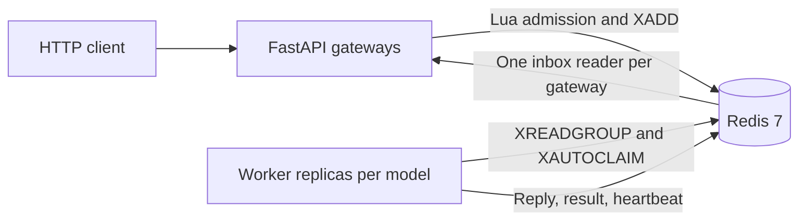
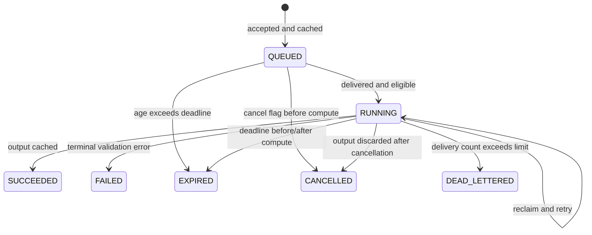
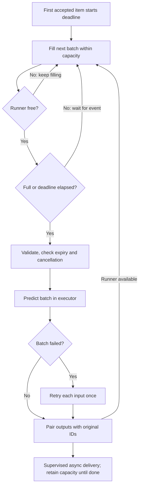

# Architecture — Phase 3

The current platform serves fake-classifier (**simulated** compute/output) and
real DistilBERT SST-2 sentiment inference. Both use bounded dynamic batching.
Phase 3 adds registry, reclaim, DLQ, admission, rate limits, cancellation and
async result polling. LLM serving, dashboards, autoscaling and Kubernetes
deployment remain later phases.

## Diagram 1: containers



Gateways never select a worker. Each has a unique response inbox and one reader.
Each worker has a unique consumer name and one model executor thread. Fresh reads
and reclaim share a single producer loop and capacity budget. Model load/warmup
finish before the worker registers as ready. Compose supports three or more
fake replicas with the scale option; the torch profile adds a CPU sentiment worker.
Redis has no published host port; HTTP binds localhost.

## Diagram 2: accepted synchronous request

```mermaid
sequenceDiagram
    participant C as Client
    participant G as Gateway
    participant R as Redis
    participant W as Worker
    C->>G: POST input with X-API-Key
    G->>G: Authenticate and validate
    G->>R: Token-bucket Lua using TIME
    G->>G: Register waiter
    G->>R: SCAN/GET accepting worker heartbeats
    G->>R: Lua: recheck workers/depth, SET QUEUED, XADD
    W->>R: XREADGROUP workers, COUNT free capacity
    W->>R: TIME, EXISTS cancel, GET result, mark RUNNING
    W->>W: Dynamic batching and executor inference
    W->>R: XADD final/error reply
    W->>R: SET final result with TTL
    W->>R: MULTI: XACK, XDEL; EXEC
    R-->>G: Inbox reader XREAD dispatches by request_id
    G-->>C: Output with timing metadata
```

The waiter exists before enqueue, so fast replies cannot outrun registration.
Inbox streams are trimmed approximately to 10000 entries and expire. A result
record starts at acceptance, distinguishing known pending work from unknown IDs.
Async submission returns 202 without a waiter. Polling requires the same API-key
identity and returns 202 while pending, 200 on success, an error on failure, or
404 for unknown/expired cache IDs. Pending work past its logical deadline returns
504 even before the worker updates the cache. Terminal cache writes refresh TTL.

## Redis key schema

| Key | Type | Current purpose |
|---|---|---|
| req:{model} | Stream + group workers | Retained undelivered and pending work, deleted on completion |
| inbox:{gateway_id} | Stream | Temporary final/error replies, approximate MAXLEN and refreshed expiry |
| result:{request_id} | String JSON | QUEUED/RUNNING or terminal outcome, owner hash, deadline, TTL 300 s |
| cancel:{request_id} | String | Best-effort cancellation flag, default TTL 120 s |
| worker:{model}:{worker_id} | String JSON | Registry with default TTL 10 s, refreshed every 3 s |
| dlq:{model} | Stream | Original poison envelope, source ID, last error, delivery count; MAXLEN ~10000 |
| rl:{key_id} | Hash | Atomic token-bucket tokens and update time |

autoscaler:lock remains Phase 6 work. No Redis KEYS command is used.

Heartbeats include device, backend, in_flight (all locally outstanding items),
busy_ratio (recent compute fraction), Redis started_at and accepting. Inference
runs off the event loop, allowing refresh during compute. The busy window includes
an active model invocation. A registry entry is a TTL liveness signal, not proof
that a particular pending delivery will finish. /v1/models reports live_workers
and retained queue_depth, not just undelivered backlog.

## Timing and states

Redis TIME minus the stream ID timestamp measures queue_ms at local acceptance.
The injected monotonic Clock measures local batch_wait_ms and inference_ms.
Each item reports full shared compute duration, not amortized cost. Reply I/O,
gateway overhead and retries from earlier deliveries are not all represented by
that attempt's timings; client elapsed latency is the complete observation.
Poison isolation includes the failed batch plus that item's retry in inference_ms.



These are cache/outcome states, not a separate event-sourced state store.
Conditional RUNNING updates protect existing final records, and cached finals
can be replayed without compute. Concurrent executions are still possible and
can race to publish finals. Do not put non-idempotent external effects in runners.

## Diagram 3: dynamic batcher



Like a shuttle, the next batch keeps its doors open while the road is occupied.
A timer does not run on an empty batch. Slow reply I/O does not hold an idle
runner. Active, staged, queued and undelivered local results share the same
prefetch bound. The consumer reads only free capacity; excess work stays in Redis.

## Diagram 4: worker death and reclaim

```mermaid
sequenceDiagram
    participant G as Gateway
    participant R as Redis
    participant A as Worker A
    participant B as Worker B
    G->>R: Accepted request XADD
    A->>R: XREADGROUP workers A >
    A->>A: Begin batch; SIGKILL
    Note over R: Entry remains pending under A
    B->>R: XAUTOCLAIM after idle threshold
    B->>R: XPENDING id id 1 (delivery count)
    B->>R: TIME and cancellation/deadline checks
    B->>B: Retry inference if eligible
    B->>R: XADD reply; SET result
    B->>R: MULTI: XACK + XDEL; EXEC
    R-->>G: Final reply through inbox XREAD
```

Heartbeat expiry and reclaim are separate mechanisms. A new reader using only >
does not recover A's pending entries. XAUTOCLAIM transfers ownership and increments
the delivery count. The loop preserves its scan cursor and runs only when local
capacity is available. Too-short idle thresholds can steal valid slow work.

**Default timing limitation:** the catalog's classifier request deadline is
5 seconds and reclaim idle is 30 seconds. A killed request will time out before
default reclaim, then expire when reclaimed. Successful synchronous recovery
requires a deadline longer than idle wait + scan/capacity delay + compute.
E4 and the chaos tests use explicitly recorded, shorter safe idle thresholds
for their small simulated workloads. This is not hidden by the diagrams.

Persistent runner failure leaves an entry pending, with last_error in the result
record. When delivery_count > max_deliveries, DLQ append precedes terminal error
publication and ACK/delete. Malformed envelopes are quarantined too; a reply is
possible only if routing fields can be salvaged. Deadlines can end valid requests
before they reach their delivery limit. DLQ retention is bounded and not an archive.

## Scaling and admission

Each process is one replica. Available workers pull more; there is no fairness or
equal-count guarantee. Lua token buckets share per-key limits across gateways.
A separate enqueue Lua operation rechecks heartbeat existence and retained stream
depth, initializes result state and appends work without an intervening enqueue.
The depth bound includes pending entries; it is deliberately conservative.
429 and 503 include Retry-After. Do not count rejected requests as successful
low-latency inference when interpreting E5.

## Failure modes and shutdown

| Failure | Detection | Recovery | Client effect |
|---|---|---|---|
| SIGKILL mid-batch | PEL idle age, heartbeat TTL | XAUTOCLAIM at free capacity | Success if deadline permits; otherwise 504/EXPIRED |
| Persistent model failure | Repeated failed attempts | Quarantine after delivery limit | DEAD_LETTERED, cache and DLQ |
| Malformed envelope | Pydantic validation | Bounded reclaims then DLQ | Error if routable; otherwise internal quarantine only |
| No accepting workers | SCAN/GET plus enqueue recheck | Start and warm a replica | 503 with Retry-After |
| Excess retained work | Atomic depth check | Reject until capacity frees | 503 with Retry-After |
| Excess per-key traffic | Atomic token bucket | Wait for refill | 429 with Retry-After |
| Timeout/disconnect | HTTP deadline or disconnect monitor | Set cancel flag; skip/discard output | 504 or disconnected client |
| Redis outage | Bounded network failures | Restore Redis; pending survives if persisted | 503/504; workers may need restart |
| Duplicate delivery/reply | Cached result and waiter identity | Replay final or ignore late reply | One response per HTTP handler; duplicate compute still possible |
| Gateway loss | HTTP connection loss | Poll accepted ID from another gateway | Cache lookup if ID known |
| Redis data loss | Missing keys/streams | Restore storage/Redis service | AOF is not an HA or zero-loss guarantee |

SIGTERM stops fresh reads/reclaims and drains accepted compute and response tasks.
Heartbeat accepting becomes false on refresh, then the key is deleted before
exit. Compose gives 15 seconds. There is a short signal/heartbeat race and no
promise of new work completing on a stopping replica. SIGKILL runs no cleanup.
Kubernetes probes and terminationGracePeriodSeconds are Phase 7 work.

## Design principles and remaining limits

Pull, bound and observe work. Acknowledge only after publishing the outcome.
Use JSON, never pickle, and trusted safetensors without remote model code.
Measure cross-process age with Redis time and local durations with monotonic time.
Keep inputs and API keys out of logs; protect DLQ contents as input-bearing data.
Retry with limits and deadlines; do not claim exactly-once execution.

There is no Redis HA, streaming LLM backend, worker HTTP probe, autoscaler, result
history beyond TTL, or automatic DLQ replay. API body bytes are bounded, while
slow-client timeouts belong at the server/ingress. See [progress](PROGRESS.md).
