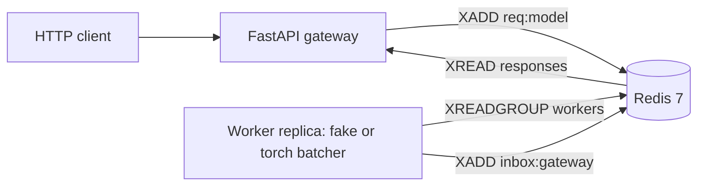
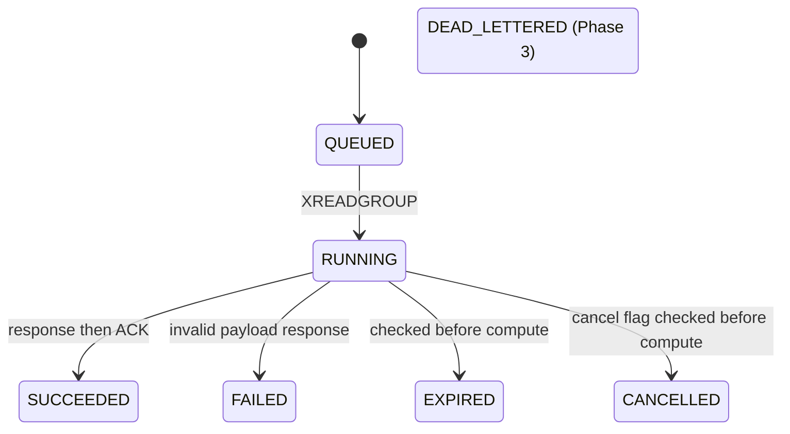
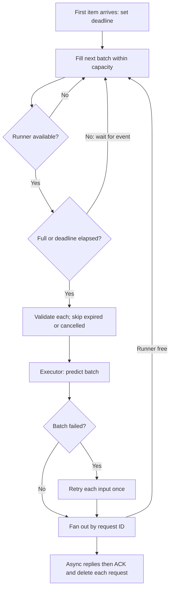

# Architecture — Phase 2

This describes the running code, not the final roadmap. Available models are
fake-classifier (**simulated** output/cost) and sentiment (real DistilBERT SST-2).
Both use bounded dynamic batching. LLM serving, autoscaling and the metrics
pipeline remain later phases.

## Diagram 1: containers



Gateway and worker are independent Python processes. Redis is their only
communication path. A gateway owns an ephemeral inbox name generated at startup.
A worker owns a unique consumer name. No process imports another process's state.
Redis is reachable only inside the Compose network; the HTTP port binds to localhost.

## Diagram 2: synchronous lifecycle

```mermaid
sequenceDiagram
    participant C as Client
    participant G as Gateway
    participant R as Redis
    participant W as Worker
    C->>G: POST input + X-API-Key
    G->>G: Authenticate, validate, register waiter
    G->>R: XADD req:model (JSON payload)
    W->>R: XREADGROUP workers COUNT free capacity
    R-->>W: Entry, now pending
    W->>W: Stage batch; validate; infer in executor
    W->>R: XADD inbox:gateway (final)
    W->>R: XACK then XDEL request
    G->>R: Single inbox reader XREAD
    R-->>G: Response with request_id
    G-->>C: Output and timing metadata
```

The inbox reader runs concurrently with HTTP handlers. Registering the waiter
before XADD prevents a fast worker response arriving before its destination exists.
Each waiter is a queue of capacity one. Unknown or completed request IDs are ignored.
The gateway's map has a configurable capacity. Inbox streams use approximate
MAXLEN 10000 and a refreshed expiry. Approximate trimming is not an exact hard cap.

## Redis keys and timing

| Key | Type | Current behavior |
|---|---|---|
| req:{model} | Stream, group workers | Created from ID 0; delivered entries enter pending list; deleted after ACK |
| inbox:{gateway_id} | Stream | Final/error responses; bounded approximately, expires; removed on clean gateway exit |

Workers also check cancel:{request_id} string flags before compute. Gateway
flag creation, result cache, worker heartbeat, DLQ, rate-limit and autoscaler-lock
remain future phases. There is no result polling or worker count yet.
/v1/models reports configured model IDs, backend, and stream length, including
pending entries. It does not report undelivered backlog separately.

Queue time is Redis TIME at delivery minus the stream entry ID timestamp,
clamped to zero because stream timestamps have millisecond resolution.
Compute and local batch waiting use the injected monotonic Clock. queue_ms
ends at delivery into the local buffer; batch_wait_ms runs from that point to
compute start, including waiting for the previous batch and eligibility checks.
Each item reports the full shared inference_ms and actual surviving batch_size.
Gateway overhead and reply fan-out are not currently measured separately.
The HTTP deadline includes enqueue and waiting.

## Request states

These are conceptual states, not separately persisted status records:



A gateway timeout releases its waiter and returns 504. It does not remove queued
work or set cancellation flags yet. Workers honor externally supplied cancellation
flags before compute. An old queued request receives EXPIRED before inference.
A worker crash leaves a pending entry; restarting the worker reads only
new entries and cannot recover it. Phase 3 adds reclaim, cancellation and DLQ.

## Scaling model

Workers pull only free prefetch capacity and keep collecting while compute runs.
The total bound counts active, staged and queued items together. Multiple
consumers can share the group without gateway routing changes. The Compose
torch profile adds an independent sentiment worker. There is no automatic scaling,
live registry, or fairness guarantee. Gateways can each own a separate inbox.
A gateway crash loses its HTTP
connections; durable result lookup is a later phase.

## Failure modes

| Failure | Detection | Recovery now | User effect |
|---|---|---|---|
| Worker killed after delivery | XPENDING nonzero | Manual inspection only; reclaim in Phase 3 | 504, retained pending entry |
| No worker | HTTP deadline | Start worker; expired work skipped | 504 |
| Redis unavailable during request | Redis exception or deadline | Restore Redis; inbox reader retries | 503 or 504 |
| Inbox reader fails unexpectedly | readyz checks task | Restart gateway | Not ready |
| Gateway crash | Connection loss | Restart with a new inbox | Request outcome unavailable to client |
| Poison input in a batch | Model call raises | Retry items individually once | Good items succeed; poison receives error |
| Model load/warmup failure | Worker startup fails | Repair cache/config and restart | Worker never consumes; gateway can time out |
| Duplicate response | Waiter absent or already full | Ignore duplicate | One HTTP response |
| Crash after response before ACK | Pending entry remains | Reclaim deferred | Response may succeed; possible future repeat |
| Redis data lost | Streams missing | AOF volume reduces risk, no HA | Work may be lost |

## Diagram 3: batcher flow



The shuttle leaves when full or its timer expires, but keeps accepting passengers
while the road is occupied. A busy runner does not freeze a partial next batch.
Result fan-out is supervised separately, so slow reply I/O does not hold an
idle runner; capacity remains reserved through response completion.
There is no timer on an empty batch. See [ADR-0004](adr/0004-dynamic-batching.md).

Torch load and warmup run on the dedicated executor before worker.ready is set
and before consumption begins. This internal event is not yet a registry or
worker HTTP readiness probe. Weights use safetensors and trust_remote_code=False.
The torch Compose profile uses a CPU-only image extra and a persistent /models
volume owned by the non-root user. CPU threads are configurable.

## Design principles

Pull work rather than route to a specific worker. Keep JSON wire schemas explicit.
Do not block the event loop with inference. Acknowledge only after writing a
response. Keep secrets and inputs out of logs. Use Redis time across processes and
monotonic time within a process. Bound local waiters, inbox retention and worker reads.

Important remaining limits: no queue admission enforcement, rate limit, request-body
byte cap, durable results or retry controller yet. This is a local teaching system,
not a production-ready ingress. See [progress](PROGRESS.md) for phase boundaries.
