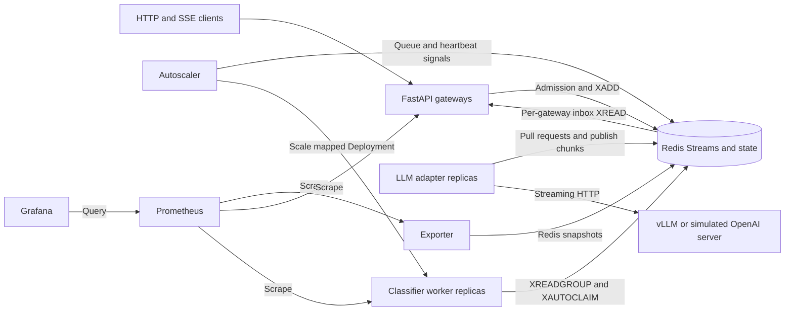
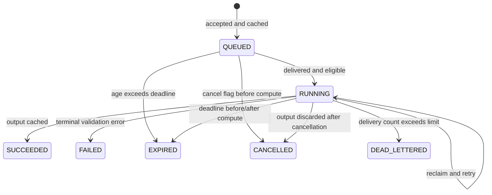
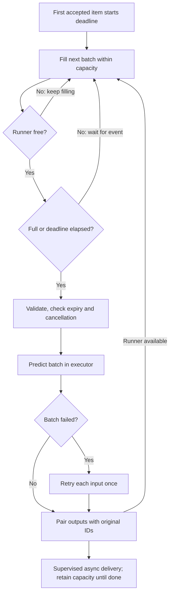
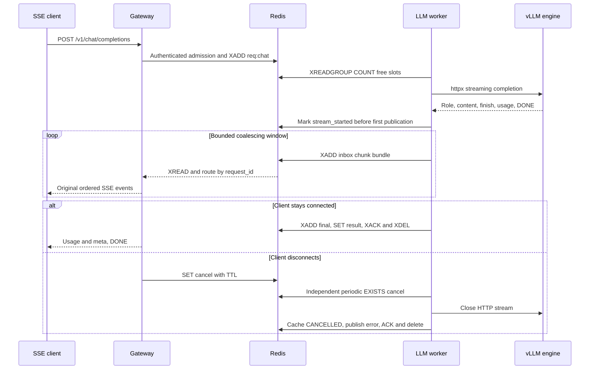
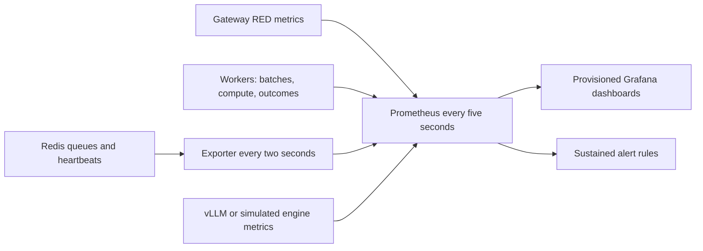
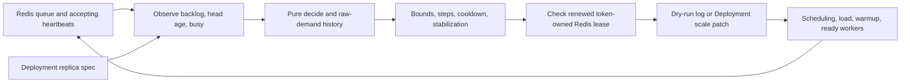
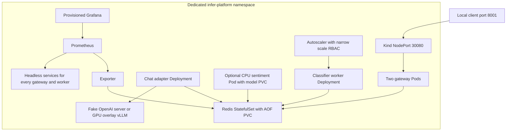

# Architecture — completed implementation, verified local scope

The current platform serves fake-classifier (**simulated** compute/output) and
real DistilBERT SST-2 sentiment inference. Both use bounded dynamic batching.
Registry, reclaim, DLQ, admission, rate limits, cancellation and async result
polling remain shared. Streaming chat uses a separate vLLM adapter, verified on
a TCP fake server and real GB10 vLLM. Dashboards and actual kind autoscaling,
rollout and process-loss recovery are implemented. Phase 8 adds executed runbook
drills, open/closed-loop benchmarks, a measured capacity worksheet and a local
SLO proposal. Wrap-up verifies hosted CI/GHCR, real GPU kind, snapshot restore
and a bounded soak. Production HA/cloud and month-long SLOs remain outside those
checks; see [the audit](VERIFICATION.md) and [wrap-up](FINAL_VERIFICATION.md).

## Diagram 1: containers



Prometheus also scrapes the LLM adapter, engine and controller; diagram 6 shows
that focused pipeline. The current Kubernetes scale map manages the fake
classifier only; configured replica intent and ready capacity are separate.


Gateways never select a worker. Each has a unique response inbox and one reader.
Each worker has a unique consumer name. Classifier workers use one model executor
thread; LLM workers use bounded concurrent HTTP streams. Fresh reads
and reclaim share a single producer loop and capacity budget. Model load/warmup
finish before the worker registers as ready. Compose supports three or more
fake replicas with the scale option; the torch profile adds a CPU sentiment worker.
Redis has no published host port; HTTP binds localhost. The fake-llm and gpu
profiles add alternative chat servers and workers. Neither uses DynamicBatcher.

## Diagram 2: accepted synchronous request

```mermaid
sequenceDiagram
    participant C as Client
    participant G as Gateway
    participant R as Redis
    participant W as Worker
    C->>G: POST input with X-API-Key
    G->>G: Authenticate and validate
    G->>R: Token-bucket Lua using TIME
    G->>G: Register waiter
    G->>R: SCAN/GET accepting worker heartbeats
    G->>R: Lua: recheck workers/depth, SET QUEUED, XADD
    W->>R: XREADGROUP workers, COUNT free capacity
    W->>R: TIME, EXISTS cancel, GET result, mark RUNNING
    W->>W: Dynamic batching and executor inference
    W->>R: XADD final/error reply
    W->>R: SET final result with TTL
    W->>R: MULTI: XACK, XDEL; EXEC
    R-->>G: Inbox reader XREAD dispatches by request_id
    G-->>C: Output with timing metadata
```

The waiter exists before enqueue, so fast replies cannot outrun registration.
Inbox streams are trimmed approximately to 10000 entries and expire. A result
record starts at acceptance, distinguishing known pending work from unknown IDs.
Async submission returns 202 without a waiter. Polling requires the same API-key
identity and returns 202 while pending, 200 on success, an error on failure, or
404 for unknown/expired cache IDs. Pending work past its logical deadline returns
504 even before the worker updates the cache. Terminal cache writes refresh TTL.

## Redis key schema

| Key | Type | Current purpose |
|---|---|---|
| req:{model} | Stream + group workers | Retained undelivered and pending work, deleted on completion |
| inbox:{gateway_id} | Stream | Temporary chunk/final/error replies, approximate MAXLEN and refreshed expiry |
| result:{request_id} | String JSON | QUEUED/RUNNING or terminal outcome, owner hash, deadline, stream_started, TTL 300 s |
| cancel:{request_id} | String | Best-effort cancellation flag, default TTL 120 s |
| worker:{model}:{worker_id} | String JSON | Registry with default TTL 10 s, refreshed every 3 s |
| dlq:{model} | Stream | Original poison envelope, source ID, last error, delivery count; MAXLEN ~10000 |
| rl:{key_id} | Hash | Atomic token-bucket tokens and update time |
| autoscaler:lock | String | Token-owned NX leadership lease, default 30 s, renewed/released by Lua |

The leader lease is implemented. No Redis KEYS command is used.

Heartbeats include device, backend, in_flight (all locally outstanding items),
busy_ratio (recent compute fraction), Redis started_at and accepting. Inference
runs off the event loop, allowing refresh during compute. The busy window includes
an active model invocation. A registry entry is a TTL liveness signal, not proof
that a particular pending delivery will finish. /v1/models reports live_workers
and retained queue_depth, not just undelivered backlog.

## Timing and states

Redis TIME minus the stream ID timestamp measures queue_ms at local acceptance.
The injected monotonic Clock measures local batch_wait_ms and inference_ms.
Each item reports full shared compute duration, not amortized cost. Reply I/O,
gateway overhead and retries from earlier deliveries are not all represented by
that attempt's timings; client elapsed latency is the complete observation.
Poison isolation includes the failed batch plus that item's retry in inference_ms.



These are cache/outcome states, not a separate event-sourced state store.
Conditional RUNNING updates protect existing final records, and cached finals
can be replayed without compute. Concurrent executions are still possible and
can race to publish finals. Do not put non-idempotent external effects in runners.

## Diagram 3: dynamic batcher



Like a shuttle, the next batch keeps its doors open while the road is occupied.
A timer does not run on an empty batch. Slow reply I/O does not hold an idle
runner. Active, staged, queued and undelivered local results share the same
prefetch bound. The consumer reads only free capacity; excess work stays in Redis.

## Diagram 4: worker death and reclaim

```mermaid
sequenceDiagram
    participant G as Gateway
    participant R as Redis
    participant A as Worker A
    participant B as Worker B
    G->>R: Accepted request XADD
    A->>R: XREADGROUP workers A >
    A->>A: Begin batch; SIGKILL
    Note over R: Entry remains pending under A
    B->>R: XAUTOCLAIM after idle threshold
    B->>R: XPENDING id id 1 (delivery count)
    B->>R: TIME and cancellation/deadline checks
    B->>B: Retry inference if eligible
    B->>R: XADD reply; SET result
    B->>R: MULTI: XACK + XDEL; EXEC
    R-->>G: Final reply through inbox XREAD
```

Heartbeat expiry and reclaim are separate mechanisms. A new reader using only >
does not recover A's pending entries. XAUTOCLAIM transfers ownership and increments
the delivery count. The loop preserves its scan cursor and runs only when local
capacity is available. Too-short idle thresholds can steal valid slow work.

**Default timing limitation:** the catalog's classifier request deadline is
5 seconds and reclaim idle is 30 seconds. A killed request will time out before
default reclaim, then expire when reclaimed. Successful synchronous recovery
requires a deadline longer than idle wait + scan/capacity delay + compute.
E4 and the chaos tests use explicitly recorded, shorter safe idle thresholds
for their small simulated workloads. This is not hidden by the diagrams.

Persistent runner failure leaves an entry pending, with last_error in the result
record. When delivery_count > max_deliveries, DLQ append precedes terminal error
publication and ACK/delete. Malformed envelopes are quarantined too; a reply is
possible only if routing fields can be salvaged. Deadlines can end valid requests
before they reach their delivery limit. DLQ retention is bounded and not an archive.

## Scaling and admission

Each process is one replica. Available workers pull more; there is no fairness or
equal-count guarantee. Lua token buckets share per-key limits across gateways.
A separate enqueue Lua operation rechecks heartbeat existence and retained stream
depth, initializes result state and appends work without an intervening enqueue.
The depth bound includes pending entries; it is deliberately conservative.
429 and 503 include Retry-After. Do not count rejected requests as successful
low-latency inference when interpreting E5.

## Failure modes and shutdown

| Failure | Detection | Recovery | Client effect |
|---|---|---|---|
| SIGKILL mid-batch | PEL idle age, heartbeat TTL | XAUTOCLAIM at free capacity | Success if deadline permits; otherwise 504/EXPIRED |
| Persistent model failure | Repeated failed attempts | Quarantine after delivery limit | DEAD_LETTERED, cache and DLQ |
| Malformed envelope | Pydantic validation | Bounded reclaims then DLQ | Error if routable; otherwise internal quarantine only |
| No accepting workers | SCAN/GET plus enqueue recheck | Start and warm a replica | 503 with Retry-After |
| Excess retained work | Atomic depth check | Reject until capacity frees | 503 with Retry-After |
| Excess per-key traffic | Atomic token bucket | Wait for refill | 429 with Retry-After |
| Timeout/disconnect | HTTP deadline or disconnect monitor | Set cancel flag; skip/discard output | 504 or disconnected client |
| Redis outage | Bounded network failures | Restore Redis; pending survives if persisted | 503/504; workers may need restart |
| Duplicate delivery/reply | Cached result and waiter identity | Replay final or ignore late reply | One response per HTTP handler; duplicate compute still possible |
| Gateway loss | HTTP connection loss | Poll accepted ID from another gateway | Cache lookup if ID known |
| Redis data loss | Missing keys/streams | Restore storage/Redis service | AOF is not an HA or zero-loss guarantee |

SIGTERM stops fresh reads/reclaims and drains accepted compute and response tasks.
Heartbeat accepting becomes false on refresh, then the key is deleted before
exit. Compose gives classifier workers 15 seconds and chat workers 75 seconds. There is a short signal/heartbeat race and no
promise of new work completing on a stopping replica. SIGKILL runs no cleanup.
Kubernetes probes and termination grace are implemented; see diagram 8.

## Design principles and remaining limits

Pull, bound and observe work. Acknowledge only after publishing the outcome.
Use JSON, never pickle, and trusted safetensors without remote model code.
Measure cross-process age with Redis time and local durations with monotonic time.
Keep inputs and API keys out of logs; protect DLQ contents as input-bearing data.
Retry with limits and deadlines; do not claim exactly-once execution.

There is no Redis HA, result history beyond TTL, or automatic DLQ replay. API body bytes are bounded, while
slow-client timeouts belong at the server/ingress. See [progress](PROGRESS.md).


## Diagram 5: streaming and cancellation



The diagram shows logical stages; upstream parsing and publication overlap.
Always-streamed upstream requests allow TTFT observation even for a nonstream
client. Those clients receive an OpenAI-shaped chat.completion plus timing meta.
Streaming clients receive original chunk events, one usage/meta event, and DONE.
The API supports text system/user/assistant messages, max_tokens, temperature and
stream, not the full OpenAI API. The allowlisted platform name is chat; the
adapter substitutes the configured engine model. Token-cap violations return 422.

An asyncio.Semaphore and capacity-limited fresh/reclaim reads bound active work.
The catalog cap is 32, matching vLLM max-num-seqs; HTTP event/output buffers and
per-request gateway queues are bounded separately. A full client queue cancels
only that request. The gateway compares emitted text's hash with the final output
to detect missing/corrupt content after inbox trimming. Before headers, upstream
failures map to HTTP status; afterward they are SSE error objects followed by DONE.

A stream_started marker in the existing cached result prevents restarting an
unfinished partially published answer on reclaim. Reclaim fails it as
STREAM_INTERRUPTED (or EXPIRED), while a cached final can be replayed. There is no
resumable stream or exactly-once generation guarantee. The chat reclaim idle is
90 seconds, exceeding its 60-second request deadline, so defaults prioritize
avoiding live-work theft over synchronous crash recovery. SIGTERM drains HTTP
work within the 75-second Compose grace; disconnect/deadline closes upstream.

LLM worker TTFT is dequeue to first nonempty content. TPOT is an estimate from
content arrival span and final completion-token usage; network chunks may contain
multiple tokens. Gateway TTFT includes waiting and coalescing. Batch size is one
at the adapter boundary and batch_wait_ms is zero; vLLM's internal active batch
is a different concept. Worker inference_ms covers the whole upstream operation.
Metrics are exposed at gateway /metrics and worker :9001/metrics. Engine
/metrics is available on localhost:8100 in Compose and is scraped by Prometheus.

| Streaming failure | Detection | Recovery | Client effect |
|---|---|---|---|
| Upstream unavailable before data | HTTP status/timeout | Release slot; publish terminal error | HTTP 503/504 as appropriate |
| Broken upstream after content | Missing finish/DONE or invalid event | Close upstream, cache failure | SSE error then DONE |
| Worker killed after chunk publication | Reclaim reads stream_started | End partial request, no regeneration | Interrupted error if still connected/deadline permits |
| Missing inbox text | Emitted/final text hash mismatch | Cached full result remains available | STREAM_INTERRUPTED, no silent truncated success |
| Slow client | Bounded waiter overflow | Cancel upstream without blocking other waiters | SLOW_CONSUMER if connection remains readable |

See [ADR-0007](adr/0007-llm-adapter.md), [GPU evidence](GPU_VERIFICATION.md) and
[LLM concepts](concepts/llm-serving.md) for the boundary and measurement limits.


## Diagram 6: metrics pipeline



Per-process registries avoid global test contamination. Worker DNS discovery
scrapes each replica IP; counters use bounded labels, never request identity.
Logs carry request_id/trace_id and component context. Queue gauges are best-effort
Redis snapshots; exporter freshness must accompany their interpretation.
Histograms aggregate buckets before quantiles. Phase 8 recording rules now supply measured local candidate targets; their
limited scope and failure budget are in SLO.md. Metrics endpoints and Grafana are development-local/internal;
production authentication, notification routing and retention remain deployment work.
See [panel queries](dashboards.md), [ADR-0008](adr/0008-metrics.md) and
[lesson 05](learning/05-observability.md). The Autoscaler dashboard receives live control-loop metrics; E13 verifies actual
Deployment growth and contraction.


## Diagram 7: autoscaler feedback loop



Compose runs dry-run by default; no virtual replica count is claimed as real.
The Kubernetes adapter uses an explicit model/deployment map and official-client
scale calls in threads with network timeouts. It is fake-client-tested and verified against a real kind cluster in E13. The leader lease renews separately
and stops on ownership loss. It is coordination, not API fencing. Restart seeds
history with current capacity to avoid immediate contraction. Simulation plots
show delayed ready capacity separately from desired capacity; their inference
costs are explicitly simulated. HPA and KEDA alternatives are documented in
[autoscaling concepts](concepts/autoscaling.md) and [ADR-0009](adr/0009-autoscaling.md).


## Diagram 8: deployment topology



Base/kind serve simulated classifier/chat workloads, real networking and delivery.
The optional CPU component adds verified real sentiment. The GPU overlay requests
NVIDIA resources and routes chat to vLLM but has not run on a GPU cluster.
Named non-root image targets share the locked application build; optional CPU/CUDA
ML extras use separate indexes. Model weights use writable PVCs rather than image
layers. Role credentials are not baked into images. Only autoscaler mounts a
service-account token, with get/patch limited to worker-fake deployments/scale.

Readiness follows warmup/inbox health, liveness is process-local, startup probes
allow initialization. SIGTERM drains within 45-second classifier/80-second chat
grace, and maxUnavailable=0/maxSurge=1 retains serving capacity on rollout.
PDBs protect voluntary eviction, not force kills. A single Redis PVC/AOF is dev
persistence, not HA. Monitoring history is ephemeral. Initial dependency-startup
restarts are possible and observed; stable readiness precedes testing.

CI defines local-equivalent checks and role-image builds with conditional GHCR
publication on main pushes. Hosted CI and publication are not verified because
no push was performed. See [lesson 07](learning/07-kubernetes-deployment.md),
[deployment concepts](concepts/deploying-ml-workloads.md), [ADR-0010](adr/0010-deployment.md)
and [real kind experiments](EXPERIMENTS.md).


## Final latency contract and measured operation

Every successful live classifier/chat final contains worker_id, batch_size,
queue_ms, batch_wait_ms and inference_ms. queue_ms uses Redis time minus the
request stream ID timestamp through local worker acceptance; it includes some
consumer bookkeeping. Local wait/compute use the injected monotonic Clock.
Shared batch inference duration is reported in full for each item, not divided
by batch size. LLM batch size one denotes the adapter boundary, not vLLM's private
continuous batch; its batch_wait_ms is zero.

Phase 8 adds total_ms and gateway_overhead_ms for a live HTTP delivery. total_ms
runs from the gateway's ASGI entry until constructing its final reply; it excludes
later serialization/send and client transport. The residual is total minus the
three worker components. Clock resolution/boundaries can make a small residual
negative; it is not a separately profiled function. HTTP metrics measure the full
handler/stream lifetime, and benchmark clients measure their own elapsed time.
Never add component percentiles to reconstruct an overall percentile.

Canonical worker outcomes stay in the existing result cache. Polling/replay keeps
those worker timings and leaves delivery-specific gateway timing null; it does
not invent the original gateway's elapsed time. This does not alter ACK ordering,
Redis key names or outcome ownership. The duplicate replay test still verifies
all canonical fields and no extra compute.

Final-image spot checks completed 800 fake and 100 real CPU requests with p95
110.42 and 60.76 ms. Three-repeat baseline, Locust, Little's Law and the local
250 ms candidate are documented in [BENCHMARKS.md](BENCHMARKS.md),
[CAPACITY_PLANNING.md](CAPACITY_PLANNING.md) and [SLO.md](SLO.md). All simulated
compute is labeled. Runbook drills cover Redis loss, no workers, poison input,
slow compute, DLQ growth and overload through real TCP/Redis. Worker reclaims
count every claimed attempt, including the claim that leads to quarantine.

The final local verification suite passes 62 CPU tests plus one explicit real
GB10/vLLM test. A real GPU engine scrape and current Compose round trip are
recorded separately. This is a learning deployment: Redis and monitoring are not
HA, stream resumption and automatic DLQ replay are absent, production ingress/
TLS/notification/retention policies are deployment work. Hosted CI and GHCR
publication passed; the GPU overlay actually served on local kind. Its vLLM Pod
disables service-link injection to avoid a VLLM_PORT collision, and uses Recreate
because the single GPU cannot accommodate a surge engine. Engine updates have
downtime; the zero-failure rolling experiment concerns classifier workers.
