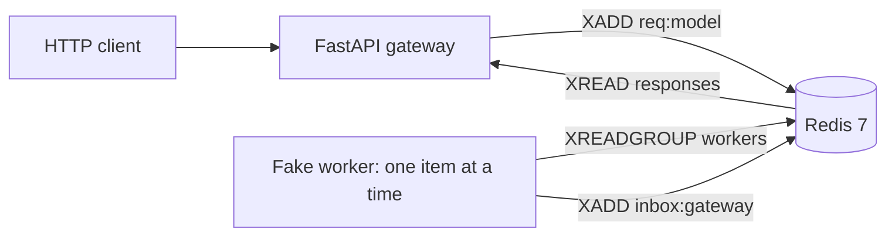
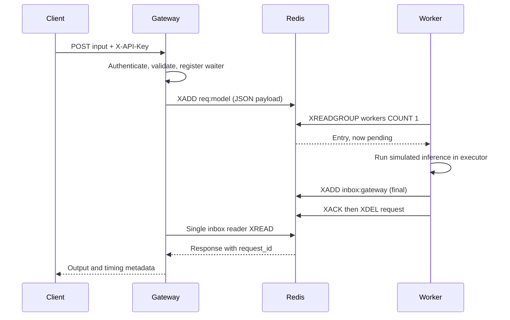
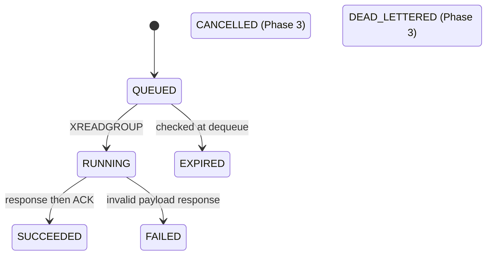

# Architecture — Phase 1

This describes the running code, not the final roadmap. The only available model
is fake-classifier: its output and compute cost are **simulated**. There is no
trained model, batching, LLM adapter, autoscaler, or metrics pipeline yet.

## Diagram 1: containers

Gateway and worker are independent Python processes. Redis is their only
communication path. A gateway owns an ephemeral inbox name generated at startup.
A worker owns a unique consumer name. No process imports another process's state.
Redis is reachable only inside the Compose network; the HTTP port binds to localhost.

## Diagram 2: synchronous lifecycle

The inbox reader runs concurrently with HTTP handlers. Registering the waiter
before XADD prevents a fast worker response arriving before its destination exists.
Each waiter is a queue of capacity one. Unknown or completed request IDs are ignored.
The gateway's map has a configurable capacity. Inbox streams use approximate
MAXLEN 10000 and a refreshed expiry. Approximate trimming is not an exact hard cap.

## Redis keys and timing

| Key | Type | Current behavior |
|---|---|---|
| req:{model} | Stream, group workers | Created from ID 0; delivered entries enter pending list; deleted after ACK |
| inbox:{gateway_id} | Stream | Final/error responses; bounded approximately, expires; removed on clean gateway exit |

The result, cancel, worker heartbeat, DLQ, rate-limit, and autoscaler-lock keys in
AGENTS.md are future phases. There is no result polling or worker count yet.
/v1/models reports configured model IDs, backend, and stream length, including
pending entries. It does not report undelivered backlog separately.

Queue time is Redis TIME at processing minus the stream entry ID timestamp,
clamped to zero because stream timestamps have millisecond resolution.
Compute time uses the injected monotonic Clock within one process.
batch_wait_ms is zero and batch_size is one in Phase 1. Gateway overhead is
not currently measured separately. The HTTP deadline includes enqueue and waiting.

## Request states

These are conceptual states, not separately persisted status records:

A gateway timeout releases its waiter and returns 504. It does not remove queued
work or cancel compute yet. An old queued request receives EXPIRED when dequeued.
A worker crash leaves a pending entry; restarting the Phase 1 worker reads only
new entries and cannot recover it. Phase 3 adds reclaim, cancellation and DLQ.

## Scaling model

Workers pull COUNT 1 and do not read another item until they finish. Multiple
consumers can share the group without gateway routing changes. This phase verifies
a single worker; it supplies no automatic scaling, live registry, or fairness
guarantee. Gateways can each own a separate inbox. A gateway crash loses its HTTP
connections; durable result lookup is a later phase.

## Failure modes

| Failure | Detection | Recovery now | User effect |
|---|---|---|---|
| Worker killed after delivery | XPENDING nonzero | Manual inspection only; reclaim in Phase 3 | 504, retained pending entry |
| No worker | HTTP deadline | Start worker; expired work skipped | 504 |
| Redis unavailable during request | Redis exception or deadline | Restore Redis; inbox reader retries | 503 or 504 |
| Inbox reader fails unexpectedly | readyz checks task | Restart gateway | Not ready |
| Gateway crash | Connection loss | Restart with a new inbox | Request outcome unavailable to client |
| Duplicate response | Waiter absent or already full | Ignore duplicate | One HTTP response |
| Crash after response before ACK | Pending entry remains | Reclaim deferred | Response may succeed; possible future repeat |
| Redis data lost | Streams missing | AOF volume reduces risk, no HA | Work may be lost |

## Design principles

Pull work rather than route to a specific worker. Keep JSON wire schemas explicit.
Do not block the event loop with inference. Acknowledge only after writing a
response. Keep secrets and inputs out of logs. Use Redis time across processes and
monotonic time within a process. Bound local waiters, inbox retention and worker reads.

Important remaining limits: no queue admission enforcement, rate limit, request-body
byte cap, durable results or retry controller yet. This is a local teaching system,
not a production-ready ingress. See [progress](PROGRESS.md) for phase boundaries.
