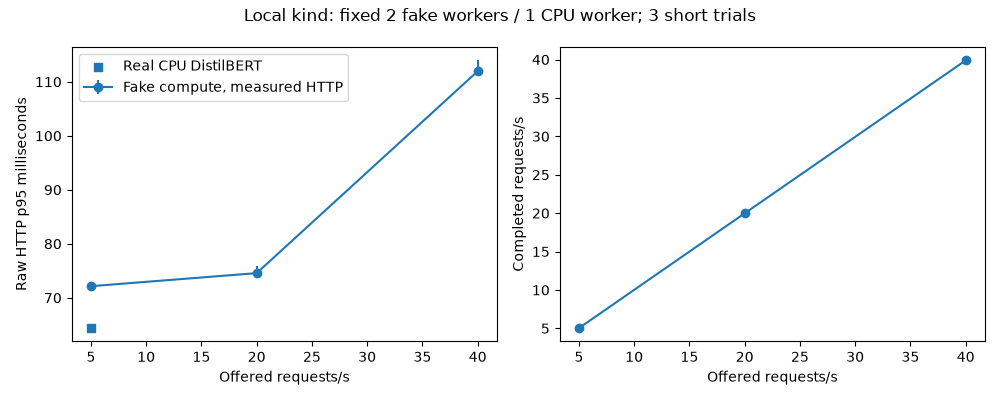

# Benchmarks: methods, hardware and measured scope

Measured on **2026-11-06**. These are local reproducible experiments, not a cloud
capacity certificate. Fake classifier and fake chat execute **simulated compute**;
HTTP, Redis, containers, Kubernetes and client timing are real. DistilBERT and the
separately recorded GB10 vLLM measurements use real models.

## Hardware and versions

Linux aarch64, kernel 6.11.0-1016-nvidia, 20 logical CPU cores (Cortex-X925 and
Cortex-A725); owner reports Ubuntu 24 LTS. NVIDIA GB10 is available but **not used**
by the Phase 8 HTTP/Locust/Little's Law benchmarks. Client Python 3.12.3; serving
CPU container Python 3.12.16, torch 2.15.0+cpu, Transformers 4.57.6.
The sentiment worker configures one intra-op thread; the metadata's fresh probe
process reports its own default thread count and is not a measurement of the
already-running worker. Model revision observed: 714eb0fa89d2f80546fda750413ed43d93601a13.

Docker 28.3.3, kind 0.30.0, Kubernetes 1.34.0, Redis 7.4.12. No CPU affinity or
host isolation; short operational checks also ran on this host. The benchmarked
serving baseline is commit **1fcfcba** (full SHA in raw metadata). Phase 8's harness
is committed with this report. After adding delivery-specific gateway timing and
correcting a reclaim counter, a separate final-image spot check verified the new
contract and latency; its raw artifact includes serving image IDs/source changes.
No inference scheduling or model algorithm was changed in that correction.

## Open-loop method

Two fixed fake workers, one CPU sentiment worker and two gateways on the same
kind node. Controller paused during this experiment and restored afterward.
Fake policy: batch cap/prefetch four, collection wait 10 ms, base 50 ms + 2 ms/item,
no jitter; CPU policy: batch 16, wait 10 ms, truncation 256 tokens. Small alternating
positive/negative sentences are stored through outputs/meta, without private data.
All worker/model warmup completes before traffic.

The harness schedules arrivals independently of earlier responses, bounded by a
fixed total and connection budget. Each setting runs three 20-second arrival
traces. HTTP duration starts before the client call and ends after the final body;
quantiles use nearest-rank raw successful durations. Rejections/errors are counted
separately and never averaged as fast successful inference. Completed throughput
uses start-to-last-response elapsed time, so finite-window values can be slightly
above the nominal arrival rate. This is not a capacity gain.

| Model | Offered req/s | Completed req/s | Mean ms | p95 ms | p99 ms | Successful / offered |
|---|---:|---:|---:|---:|---:|---:|
| fake-classifier (simulated) | 5 | 5.03 | 70.21 | 72.14 | 72.78 | 300/300 |
| fake-classifier (simulated) | 20 | 19.98 | 71.46 | 74.56 | 77.19 | 1200/1200 |
| fake-classifier (simulated) | 40 | 39.89 | 87.95 | 111.95 | 116.11 | 2400/2400 |
| sentiment (real CPU) | 5 | 5.04 | 55.90 | 64.38 | 66.93 | 300/300 |

Table values are medians of three per-trial summaries, not pooled percentiles.
The real CPU row has only 100 requests per trial; its p99 is especially noisy.
None of these rates saturates every possible deployment or establishes peak
capacity. At 40 req/s the fake workload shows more local waiting than at 5/20.



Raw records: [p8-e2e.json](results/p8-e2e.json);
[serving environment](results/p8-serving-environment.json). The 60-second worksheet
trace adds 600 successful fake requests; see [capacity planning](CAPACITY_PLANNING.md).

## Final image spot check

After gateway timing enrichment, one additional 20-second trace per model ran
against rebuilt/reloaded images, with the same fixed replica boundaries:

| Model | Offered req/s | Successful | Raw p95 ms |
|---|---:|---:|---:|
| fake-classifier | 40 | 800 | 110.42 |
| sentiment | 5 | 100 | 60.76 |

Every live response included non-null total_ms/gateway_overhead_ms, and each p95
remained below the measured local candidate target. This is a single regression
check, not a replacement for the three-repeat baseline. See
[p8-e2e-final.json](results/p8-e2e-final.json). API total_ms ends before final
serialization/send; client duration also includes transport. Cached polling
retains canonical worker timings and leaves delivery-specific gateway fields null.

## Locust closed-loop scenarios

Locust 2.47.0, real kind, controller enabled, 50 ms think time per user. Steady is
four users for 30 s; ramp is 2/8/16/4 users over four 10 s stages; spike is two
users for 10 s, 32 for 20 s, then two for 10 s; mixed is eight users for 30 s with
three classifier calls per streamed chat call. Thirty seconds of idle time
separates scenarios. A 35-second stop timeout allows active iterations to finish.
SSE bodies are fully read and checked for errors/DONE, so response time covers
the whole generation, not just headers. TTFT uses the separate E6 harness.

| Scenario | Requests | Failures | Achieved req/s | Approximate p95 ms |
|---|---:|---:|---:|---:|
| steady | 933 | 0 | 31.08 | 85 |
| ramp | 2063 | 0 | 51.53 | 120 |
| spike | 3088 | 0 | 77.17 | 220 |
| mixed | 1367 | 0 | 45.57 | 230 |

Mixed includes 1028 classifier and 339 chat requests; their approximate p95 values
were 160 ms and 230 ms respectively. Aggregated mixed latency combines different
populations and is not a model SLO. Locust percentiles use its rounded histogram;
do not compare every digit with raw nearest-rank values above.

Closed-loop users naturally slow their arrival rate when responses slow. This
**coordinated omission** can underrepresent a fixed-rate external burst. That is
why we also use open-loop traces and preserve E5 overload and E13 scaling results.
All Locust inference here is simulated. Zero errors in short runs does not prove
month-long availability. Raw [Locust summary](results/p8-locust.json) and CSV/log
files under results/locust preserve per-endpoint totals and histories.

## Reproduce

Start the dedicated kind stack as in [lesson 07](learning/07-kubernetes-deployment.md).
Load the CPU image/component before running the sentiment benchmark; these setup
commands were exercised:

```bash
export PATH="/tmp/infer-tools:$PATH"
export KUBECONFIG=/tmp/infer-kind-kubeconfig
export INFER_API_KEYS='["phase1-verification-key"]'
docker build --target worker --build-arg INSTALL_ML=1 --build-arg TORCH_DEVICE=cpu -f deploy/docker/Dockerfile -t infer-platform:cpu .
kind load docker-image infer-platform:cpu --name infer-platform
kubectl --context kind-infer-platform apply -k deploy/k8s/overlays/cpu
kubectl --context kind-infer-platform -n infer-platform rollout restart deployment/gateway deployment/exporter
kubectl --context kind-infer-platform -n infer-platform rollout status deployment/worker-sentiment --timeout=300s
kubectl --context kind-infer-platform -n infer-platform rollout status deployment/gateway --timeout=120s
uv run --extra ml python -m tools.bench.e2e
uv run python -m tools.loadtest.run_scenarios
uv run python -m tools.bench.propose_slo
uv run python -m tools.bench.plot_results
uv run --extra ml python -m tools.bench.e2e --verify-final
```

The benchmark owns replica/controller changes only in the dedicated context and
restores them. Result files are overwritten on rerun: preserve historical copies
when comparing code or hardware. Do not run a second load generator against the
same stack while collecting a baseline. [SLO proposal](SLO.md) explains targets;
[tuning guide](TUNING.md) explains which changes need another measurement.

## Earlier real model measurements and remaining gaps

E2 measured real CPU runner-only batching throughput 38.77→238.11 items/s at batch
1→16, with 303.41 at 64, at higher shared batch latency. That is not HTTP capacity.
E6 measured real GB10/Qwen serving: concurrency 1→16 gave 139.15→1750.81 completion
tokens/s for a fixed 32-token burst; E6b coalescing reduced real chunk writes 75.4%
while slightly reducing throughput. Their own methods, hardware/image revisions,
raw records and caveats are in [EXPERIMENTS.md](EXPERIMENTS.md). They must not be
combined into one generic classifier-or-LLM speed number.

Still unverified: long-duration soak, WAN/cloud performance, production Redis HA,
GPU Kubernetes, CUDA graph comparisons, long-context saturation, and hosted CI.
The local candidate targets are proposals for the measured scope, not commercial
service guarantees or evidence that arbitrary prompts fit a 250 ms budget.
