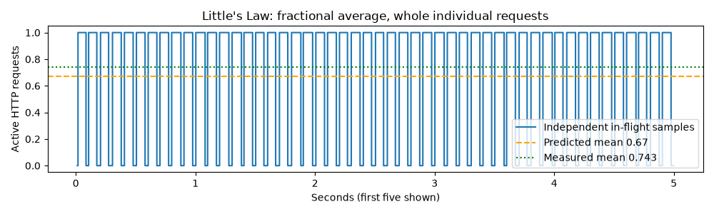

# Little's Law capacity worksheet: predict, then measure

## Pick one boundary

This worksheet counts active **client HTTP calls**, from immediately before POST
to the final response body. It includes transport, gateway work, Redis waiting,
local batching, compute and reply delivery. It does not count idle Locust users,
only Redis backlog, or the engine's private active sequences.

For a stable population, **L = lambda × W**: average requests present equals
completed requests/second times mean seconds in that same boundary. Use a mean,
not p95. A fractional average means one whole request is present part of the time.

## Prediction saved before traffic

[p8-capacity-prediction.json](results/p8-capacity-prediction.json) records the
prediction timestamp before any benchmark traffic. At 10 requests/s, assume
50 ms simulated base compute + 2 ms per item + 10 ms collection + 5 ms transport/
gateway allowance = **67 ms**. Predict **L = 10 × 0.067 = 0.67 requests**.
This is a hypothesis using known fake-cost settings, not a measured latency.

Setup: 2026-11-06, same local ARM/kind environment as [benchmarks](BENCHMARKS.md),
two fixed fake workers, two gateways, no autoscaler changes during the trace.
Run 10 arrivals/s for 60 seconds, 600 requests, then drain. The model cost is
**simulated**; every HTTP/Redis operation and elapsed duration is real.

## Measured comparison

| Quantity | Result |
|---|---:|
| Successful / offered | 600 / 600 |
| Completed throughput lambda | 10.00412 requests/s |
| Mean client duration W | 75.278 ms |
| Predicted mean L | 0.670 requests |
| Independently sampled mean L | 0.74274 requests |
| Measured lambda × W | 0.75309 requests |
| Prediction error relative to 0.67 | 10.86% |
| Sampling difference relative to lambda W | -1.37% |

The sampler observes active calls every approximately 5 ms and integrates those
samples over time. It does not define L by summing the same durations used in W;
that would be an algebraic identity rather than an independent check. Scheduling
and finite start/drain boundaries explain some sampling error.

## Explain the prediction error

Mean worker-reported queue time was 1.145 ms, local batch wait
11.579 ms and inference 52.463 ms. The remaining
client-boundary residual was 10.090 ms. The assumed transport/collection
allowance was too optimistic; the measured mean was above 67 ms. The residual
includes response/gateway/transport and timing-boundary differences, not a
separately profiled single function. Summing component percentiles would not
reconstruct the total percentile.

## Use the worksheet before tuning

1. Name the population and time boundary before choosing a rate.
2. Measure mean W and completion rate under stable load, with errors separate.
3. Predict average L, then sample actual occupancy independently.
4. If backlog grows rather than stabilizes, stop using a single steady-state
   average to claim a safe capacity. Inspect service throughput, readiness and
   deadlines instead.
5. For a new waiting budget, lambda × queue-wait budget gives a starting mean
   queue budget, not a p95 guarantee or a safe maximum admission threshold.
   Test bursts and failures before changing max_queue_depth.

The kind max depth of 1000 is a demonstration overload guard, not a value derived
from the 250 ms candidate target. A short latency budget requires a much tighter
admission policy under overload; E5 and the runbook depth-two drill show the
trade-off. Prefetch also contains local work that is absent from undelivered
backlog, so size Redis and local budgets together.

## Reproduce and teach back

Run the benchmark command in [BENCHMARKS.md](BENCHMARKS.md); it saves the prediction
before its trials and the worksheet trace afterward. Raw timestamps/samples:
[p8-e2e.json](results/p8-e2e.json). Explain why 0.743 average requests does not mean
fractional requests exist, why p95 cannot replace W, and why a growing burst queue
cannot be treated as stable merely because a formula exists.
