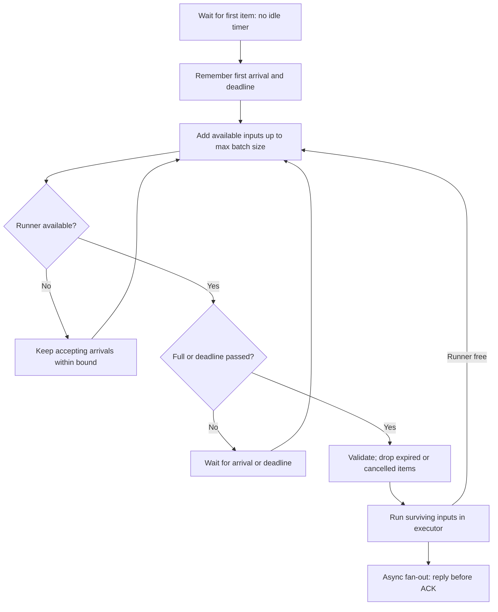

# Batching: share compute without waiting forever

A batch is several independent inputs passed through one model invocation.
Throughput is completed inputs per second; latency is how long one input waits
for its output. Improving one does not guarantee improving the other.

## Three different batching strategies

| Strategy | How inputs join | When it is useful | Main cost |
|---|---|---|---|
| Static | Client supplies a fixed group | Offline jobs with inputs already available | Online clients must coordinate |
| Dynamic | Server gathers independent requests briefly | Classifiers with bounded per-input work | Intentional wait plus padding |
| Continuous | Serving engine updates active sequences during generation | LLM requests with different output lengths | Specialized scheduler and KV-cache management |

This platform dynamically batches fake and torch requests. It will delegate
continuous LLM batching to vLLM in Phase 4. Putting several complete LLM requests
into our classifier batcher would not reproduce a generation engine's scheduler.

## The shuttle-bus rule

Imagine one shuttle on a road that fits one departing bus at a time. The next bus
starts its timer when its first passenger arrives. It leaves when full or after
the timer expires **and the road is free**. If another bus still occupies the
road, leave the doors open: freezing empty seats cannot make departure earlier.

In code, “road occupied” means the shared inference call is active. Result delivery is supervised separately and retains its capacity slots until
completion. There is one
executor thread and at most one staged next batch. While that thread is busy,
the consumer may still pull work into the bounded local buffer. A timer that
expired during compute is not restarted when compute finishes.

The implementation also drains accepted work on clean shutdown; it does not wait
for the normal coalescing timer after reads stop. A deadline rejection still
receives an error response, so “drop” means skip compute, not silently lose identity.

## What max_wait_ms does and does not promise

At low load, an input can wait nearly the whole coalescing window and still run
alone. At high load, enough arrivals can fill the batch before that window ends.
If the runner is occupied, the next input can wait longer than max_wait_ms.
The setting bounds deliberate coalescing with an available runner, not total
service latency. Redis queue time, local waiting and inference all matter.

Total local outstanding work is bounded by prefetch_bound, including the active
batch. Default capacity is twice max_batch_size: approximately one active batch
plus one waiting batch. Excess work remains in Redis. Future admission control
will also reject requests when the Redis backlog is too large.

At high load, a zero-wait setting can still create batches. While the previous
batch runs, several arrivals accumulate. Once the runner is free they can depart
together without an additional timer. Zero means no deliberate coalescing, not
“force batch size one.” E3 measures this distinction.

## Why batching may be faster

One call shares Python/framework overhead and can use hardware matrix operations
more effectively. A useful simulated cost model is:

T(batch) = base_ms + per_item_ms × batch_size.

For FakeRunner this is its actual programmed sleep cost, so amortized compute
cost decreases as the shared base is spread across more inputs. Real models have
more complicated behavior: compute, memory bandwidth, tensor shapes, thread
contention and kernel choices can dominate. Measurements must name the model,
input lengths, hardware, thread count and dependency versions.

E2 reports batch_latency_ms and amortized_item_ms separately. Every simultaneous
input experiences the entire batch execution time. Dividing that time by batch
size estimates service cost per item; it does not estimate that input's latency.

## Dynamic padding and correctness

Tokenizers convert text into token IDs. Inputs have different token lengths;
PyTorch expects a rectangular tensor. Padding fills shorter rows with pad tokens,
and an attention mask tells the model which positions are real. Our runner pads
to the longest sequence in each batch and truncates at 256 tokens. One long
input can therefore increase compute for every short neighbor.

The same input must produce numerically close class probabilities alone and
inside a padded batch. Evaluation mode disables training behavior such as dropout.
torch.inference_mode disables gradient bookkeeping during prediction. Floating
point kernels can round differently with different tensor shapes, so the test
compares probabilities within a documented tolerance rather than byte equality.

CPU thread count matters as much as batch size. If many replicas each create
large thread teams, they compete for cores and can slow each other down. Start
near available cores divided by replicas, then measure; heterogeneous cores,
CPU quotas and memory bandwidth make that a starting point, not a guarantee.

## Failure and identity

Validate each input independently before invoking the runner. If the whole call
fails, retry every surviving input individually once. Good neighbors can still
succeed; a persistent poison input receives INFERENCE_FAILED. This costs extra
work during failures. It is distinct from Redis redelivery after a dead worker.

The batcher carries request IDs all the way through result fan-out. Output order
is checked against input count, and results are paired in order. The transport
then replies to each original inbox. Logs never need the text itself to correlate
those events.

## Little's Law and the throughput-latency curve

For a stable system, average work present L equals completion rate λ multiplied
by average time W: L = λW. Keep units consistent (items, items/second, seconds).
This is an accounting relation over a stable interval, not a tail-latency bound.
If arrivals exceed service capacity, the queue grows and there is no stable L.

As batch size or wait grows, throughput may rise and then plateau, while latency
continues increasing. Compare E2's runner cost with E3's observed waiting. Neither
is an end-to-end production capacity claim. The real model and the simulated
backend are reported separately in [EXPERIMENTS](../EXPERIMENTS.md).

Further reading: [Hugging Face padding and truncation](https://huggingface.co/docs/transformers/main/en/pad_truncation)
and [DistilBERT documentation](https://huggingface.co/docs/transformers/main/en/model_doc/distilbert).
Links were checked during Phase 2; runtime versions are recorded with measurements.
