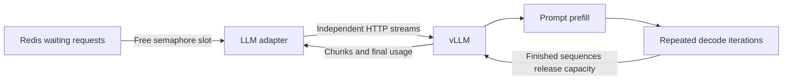

# LLM serving: where the platform stops and the engine starts

A classifier consumes one padded batch and produces one result per input.
An autoregressive language model first reads the prompt, then repeatedly predicts
another token using the prompt and all previously generated tokens. A **token**
is a tokenizer unit, which can be part of a word, a word, or punctuation.

## Prefill, decode and the KV cache

**Prefill** processes the prompt and constructs attention state. **Decode** uses
that state to produce successive tokens. Recomputing the prompt on every decode
step would waste work. A **KV cache** retains attention keys and values for prior
tokens. Longer prompts and outputs use more cache, reducing concurrent capacity.

**PagedAttention** manages KV-cache storage in blocks, with mappings from a
sequence's logical blocks to physical memory. This reduces allocation waste and
supports sharing; it does not make GPU memory unlimited. vLLM owns that memory
management. Our worker never allocates KV blocks or schedules CUDA kernels.

## Three batching policies

| Policy | Scheduling unit | Main limitation or benefit |
|---|---|---|
| Static | Fixed batch for an entire invocation | Short generations wait for long ones; capacity can sit unused |
| Dynamic classifier batching | Collect independent inputs before one forward execution | Trades a small collection delay for amortized compute |
| Continuous generation batching | Reschedule active sequences across decode iterations | Finished sequences leave and new ones enter without waiting for the longest generation |

Continuous batching belongs inside the generation engine. Putting chat requests
through our DynamicBatcher would add another collection delay without implementing
iteration scheduling. An adapter is closer to a restaurant host: admit only as
many guests as there are seats, then let the kitchen schedule its work.



## What our platform owns

The gateway owns auth, validation, rate limits, retained-depth admission and SSE.
The LLM worker owns bounded stream consumption, deadlines, cancellation monitoring,
HTTP errors, Redis publication and final-result caching. Its semaphore cap should
match vLLM's configured maximum sequences. The worker reads only free capacity:
excess requests remain visible in Redis instead of accumulating in Python tasks.
The engine still makes its own scheduling decisions within that admitted set.

For each upstream content stream, a bounded producer queue feeds a coalescer.
The **coalescing window** bundles original chunks into one Redis XADD. The gateway
expands the bundle into the original ordered SSE events. A timer flushes even if
upstream pauses. Zero disables intentional waiting; 20 ms reduces Redis writes
but can delay the first client-visible text. E6b measures both effects.

## Streaming changes failure semantics

SSE is UTF-8 text with `data: JSON` events separated by blank lines and a final
`data: [DONE]`. Before headers, an upstream error can become an HTTP error status.
After headers, the connection already has status 200: a failure becomes an SSE
error object followed by [DONE]. Consumers must inspect events, not just HTTP 200.

A separate monitor checks Redis cancellation even when the upstream sends no
chunks. Cancelling generation closes httpx's stream context. Both the TCP fake
server and the actual GB10 vLLM test confirmed upstream work stops after a client
closes its stream; this remains a version-specific measured behavior.

A worker records `stream_started` in the existing result JSON before publishing
its first chunk. Reclaim of an unfinished partial stream returns STREAM_INTERRUPTED,
rather than appending a second generation to already-visible text. Full stream
resumption is unsupported. Before any chunk is published, normal crash redelivery
can retry. Redis inbox trimming can also lose chunks: the gateway compares the
hash of emitted text with the final completion and reports interruption if they
differ. It cannot retract text already shown. The full cached completion may still
be available through authenticated result polling using X-Request-ID.

Slow clients have bounded local queues. Overflow cancels that request and reports
SLOW_CONSUMER without blocking every other request's inbox reader. Redis remains
at-least-once; simultaneous deliveries can still duplicate compute around races.

## Measuring the two experiences

**TTFT** is time to first content token. Worker TTFT starts at dequeue and excludes
Redis queueing; gateway/client TTFT also includes queueing, transport and coalescing.
Role-only chunks do not count as content. **TPOT** is time per output token during
decode. Our adapter estimates it from first/last content times and final usage;
a network chunk can contain multiple tokens, so this is not a kernel timing.
An output shorter than two observed content chunks has no meaningful estimate.
**Tokens/s** in E6 is total reported completion tokens divided by burst elapsed
time, including waiting. Aborted streams without usage do not invent token counts.

A healthy engine may still compile or initialize a kernel on its first request.
Our first real completion took 17.35 s, while later warmed measurements were much
shorter. Do not infer latency readiness from /health alone. E6 uses the warmed
server and records prefix caching and eager execution; it is not a production SLO.

## Speculative decoding

**Status in this project: not used.** No Compose service or Kubernetes overlay
passes a speculative-decoding option to vLLM, and no experiment has measured it.
A GPU experiment (E14) is proposed but not yet approved; see
[PROGRESS](../PROGRESS.md).

### The problem it attacks

During decode, each new token needs one forward pass of the whole model. For
a small batch, that pass is dominated by **reading the weights from GPU memory**, not by
arithmetic. The GPU's math units sit mostly idle. Our own E6a numbers show the
symptom: TPOT stayed ~6 ms whether 1 or 16 sequences shared each step. If the GPU
can check several tokens for the cost of one, we just need good guesses to check.

### The mechanism

1. A cheap **proposer** (or *drafter*) guesses the next *k* tokens.
2. The **target model** (the one users asked for) scores all *k* positions in a
   single forward pass, much like a short prefill.
3. Guesses are accepted left to right while they agree with the target (with greedy
   sampling, exact match; with sampling, a rejection-sampling test). At the first
   rejection, the target's own token is used instead.
4. One target pass therefore yields between 1 and *k + 1* tokens.

With standard verification the result is **lossless**: the output has the same
distribution the target model alone would produce. Speculation changes speed,
not answers.

The deciding quantity is the **acceptance rate**. If most guesses are rejected, you paid
for drafting and wider verification and got about one token per pass anyway.

### When it helps and when it hurts

| Situation | Effect | Why |
|---|---|---|
| Few concurrent sequences, memory-bound decode | Lower TPOT (faster streams) | Spare compute verifies guesses nearly for free |
| Output copies the input (summaries, code edits, RAG quotes) | Large win with n-gram drafting | Guesses can be looked up in the prompt, no extra model |
| Many concurrent sequences, compute-bound | Can **lower** total throughput | Verifying rejected guesses spends compute real requests needed |
| Creative, high-temperature text | Small or no win | Hard to guess, so low acceptance |
| Tight GPU memory | Fewer concurrent seats | A draft model needs its own weights and KV cache |

In short, it trades **throughput at high load** for **latency at low load**.
That's a product decision, not a free upgrade.

### What vLLM 0.33.0 offers

Read from the `SpeculativeConfig` source inside the pinned image
`vllm/vllm-openai@sha256:d825baf9…` (label `vllm/vllm-openai:v0.33.0`). The engine flag
is `--speculative-config` (alias `-sc`) and takes a JSON object. Selected fields:

| Field | Meaning |
|---|---|
| `method` | `ngram`, `draft_model`, `suffix`, `eagle`, `eagle3`, several model-specific `*_mtp` variants, `ngram_gpu`, `dflash`, `dspark`, `custom_class` |
| `num_speculative_tokens` | *k*, the number of tokens guessed per step |
| `model` | Draft model or EAGLE head to load (not needed for `ngram`) |
| `prompt_lookup_max` / `prompt_lookup_min` | n-gram window sizes; max is required for `ngram` |

Families of proposers, from cheapest to most involved:

- **n-gram / prompt lookup:** find the latest tokens elsewhere in the prompt and
  propose what followed them. It needs no extra weights.
- **Draft model:** a smaller model with the same tokenizer proposes tokens. Our
  dev model, Qwen2.5-0.5B, is already the smallest in its family, so this approach
  fits a larger target served with a 0.5B drafter better than it fits our setup.
- **EAGLE / MTP:** small prediction heads trained on the target's hidden states, or
  multi-token-prediction layers shipped with some models. Higher acceptance, but
  they need weights made for that specific target.

An illustrative configuration (shape verified against the source above; **not run
in this project**):

```bash
vllm serve Qwen/Qwen2.5-0.5B-Instruct ... \
  --speculative-config '{"method": "ngram", "num_speculative_tokens": 4, "prompt_lookup_max": 4}'
```

### What changes in our platform if you turn it on

Almost nothing, which is the point of the [adapter boundary](../adr/0007-llm-adapter.md):

- **No code changes.** The adapter still streams OpenAI-compatible chunks.
- **TPOT and tokens/s move**, and our existing `worker_tpot_seconds` shows it.
  Measure at low *and* high concurrency, because the two can move in opposite directions.
- **Chunks may arrive in bursts** of several tokens. The coalescing window already
  absorbs that.
- **New engine metrics to scrape** (counters in vLLM's `/metrics`):
  `vllm:spec_decode_num_drafts_total`, `vllm:spec_decode_num_draft_tokens_total`,
  `vllm:spec_decode_num_accepted_tokens_total` and
  `vllm:spec_decode_num_accepted_tokens_per_pos_total`. Acceptance rate is
  `rate(vllm:spec_decode_num_accepted_tokens_total[5m]) / rate(vllm:spec_decode_num_draft_tokens_total[5m])`.
  Mean tokens per target pass is `1 + rate(accepted_tokens_total) / rate(drafts_total)`.
  Both formulas come from the docstring of `SpecDecodingProm` in the pinned vLLM source.
- **It's per engine, not per request.** Every request on that vLLM server gets it.
  To offer both, run two engines behind two model names in `config/models.yaml`.

Reference: Leviathan, Kalman and Matias, *Fast Inference from Transformers via
Speculative Decoding*, ICML 2023 (verify link). Chen et al., *Accelerating Large
Language Model Decoding with Speculative Sampling*, 2023 (verify link).

## Sources and next reading

The tested engine is vLLM 0.33.0; environment and pending deployment checks are in
[GPU verification](../GPU_VERIFICATION.md). Read [lesson 04](../learning/04-llm-serving.md),
[ADR-0007](../adr/0007-llm-adapter.md), and [E6a/E6b](../EXPERIMENTS.md).

Primary references: [vLLM online serving](https://docs.vllm.ai/en/stable/serving/online_serving/),
Kwon et al., *Efficient Memory Management for Large Language Model Serving with
PagedAttention*, SOSP 2023 ([paper](https://arxiv.org/abs/2309.06180));
Yu et al., *Orca: A Distributed Serving System for Transformer-Based Generative
Models*, OSDI 2022 ([paper and talk](https://www.usenix.org/conference/osdi22/presentation/yu)).
