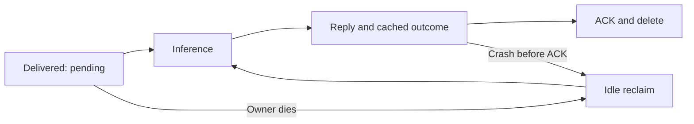

# Reliability and backpressure

A queue remembers work, but it cannot promise completion by itself. Reliability
comes from distinguishing accepted, delivered and completed work, then defining
what each failure means. This platform uses at-least-once processing: retries can
run an input more than once, and every attempt must tolerate that possibility.

## Ownership is not completion

XREADGROUP with > delivers new work and creates pending ownership. It does not
delete work. XPENDING describes delivered entries whose group ownership has not
been acknowledged. A killed worker cannot execute a finally block, remove its
heartbeat or return a response. Redis keeps the pending ledger.

XAUTOCLAIM transfers entries idle beyond a threshold to a replacement consumer.
The reclaim loop uses a cursor and extended XPENDING to inspect delivery counts.
A consumer group alone does not schedule that loop. A new worker reading only >
would leave old pending work untouched.

The threshold is measured since delivery/claim, not since the worker's last
heartbeat. A live GPU can still be busy. Too-short reclaim settings duplicate
valid compute; too-long settings delay recovery. Measure the slowest locally
buffered work and leave a margin. Free capacity and scan cadence also affect
recovery time, not just reclaim_idle_ms.

## At-least-once and idempotency

Publishing a response before ACK avoids marking work complete without an outcome.
There is still a crash window after response publication and before ACK. A retry
may rerun inference and publish another response. The gateway correlates by
request ID and ignores unknown or finished waiters. Cached terminal results can
be replayed without recompute, but do not eliminate every concurrent-execution
race. Idempotency means repeating work creates no extra external side effect;
it does not guarantee identical text from stochastic generation.

The worker writes inbox response, then result cache, then executes XACK and XDEL
in a transaction. ACK clears ownership; deletion clears retained work. Atomic
cleanup prevents completed-but-retained entries from consuming admission depth.
This transaction does not encompass model execution or HTTP receipt.

## Poison input, retries and dead letters

A poison input repeatedly fails inference. Within a batch, individual validation
protects good neighbors; one individual retry pass isolates model-call failures.
If an individual invocation still fails, leave the delivery pending and record
last_error. The reclaim interval prevents an immediate hot retry loop.

The delivery counter includes the initial delivery. With max_deliveries=3, the
fourth delivery/claim is quarantined instead of executed. Append the original
envelope, source entry ID, count and last error to dlq:{model}; publish an error,
cache it and ACK/delete. Malformed wire envelopes also have bounded attempts.
A routable request gets DEAD_LETTERED; an unroutable internal entry can only be
quarantined. A crash between DLQ append and ACK can create duplicate DLQ evidence.

DLQ retention is approximate MAXLEN 10000. It contains inputs even though logs do
not. Protect Redis and export records before retention trims evidence. There is
no replay endpoint: fixing a bad input and retrying it is an explicit operator or
client action, not an endless automatic retry.

## Deadlines and cancellation

A deadline says when work is no longer useful. Queue age comes from Redis TIME
and the stream ID, avoiding cross-container wall-clock skew. Workers check before
compute and again before publishing successful output. Expired work receives an
EXPIRED error and is acknowledged after that outcome is published.

A gateway timeout or disconnect sets cancel:{id} with TTL best effort. Queued
work can skip compute. A running CPU thread cannot be safely interrupted, so its
eventual output is discarded. A cancellation flag is not a guarantee of immediate
compute savings, and Redis failure can prevent writing it.

The default classifier timeout is 5 seconds versus a 30-second reclaim idle
threshold. Those defaults cannot produce successful synchronous recovery from a
dead worker. Reclaim will later expire that delivery. E4 deliberately uses a
6-second deadline and measured small fake workloads with shorter idle thresholds.
Tune those controls together rather than copying a test timeout into production.

## Backpressure, admission and retry storms

Backpressure makes a producer slow down when a consumer is full. Our worker
prefetch budget counts active, staged and queued inputs and results awaiting
delivery. When full, it stops pulling. This keeps work visible in Redis, but Redis
can still grow without gateway admission.

Admission rejects new work before enqueue when there are no accepting workers
or retained work has reached max_queue_depth. Lua combines the depth check and
append so concurrent gateways cannot all reserve the same last slot. The bound
includes pending plus undelivered entries, not only backlog. A stale heartbeat
can still advertise a dead replica until its TTL expires.

Per-key token buckets address a different problem: one caller's request rate.
Redis TIME refills shared tokens; Lua atomically spends them across gateways.
429 means the key's budget is empty. 503 means the model/gateway lacks available
admission capacity. Both return Retry-After. A rejected request has no accepted
result placeholder and must not be counted as a successful inference.

A retry storm happens when many callers retry failed work together, adding more
load to an already overloaded system. Respect Retry-After, jitter retry times,
limit attempts and stop at the original client deadline. Increasing queue depth
usually postpones overload symptoms; it does not increase service capacity.

## Tail latency and async results

Tail latency describes the slow end of the latency distribution. During overload,
queued work waits for many previous batches, so high percentiles grow before
average throughput necessarily changes. Deadlines eventually turn those waits
into 504s. Fast rejection preserves a chance for accepted requests to finish, but
rejection rate is part of service quality too.

E5 reports accepted-success latency, rejection latency and timeout latency
separately. An average over all outcomes would make admission look artificially
fast because 503s return quickly. Its fake model is simulated compute; the queue,
Redis, HTTP handlers and worker process are real.

Async mode returns an ID after acceptance. Its result:{id} record already exists,
so a poll can distinguish 202 pending from 404 unknown/expired. Final results
survive gateway restart within their TTL and can be fetched from another gateway
using the same API-key identity. Async mode does not create more compute capacity,
and callers must retain their accepted ID. There is no durable history beyond TTL.

## Graceful shutdown

SIGTERM is a request to stop; SIGKILL is immediate process death. On SIGTERM the
worker stops reading, drains accepted batches and replies, removes its heartbeat
and exits. Compose allows 15 seconds. A forced kill after grace expires returns
to the reclaim path. Kubernetes grace must exceed the expected drain time plus
margin when that deployment phase is implemented.

Further reading: [Redis XAUTOCLAIM](https://redis.io/docs/latest/commands/xautoclaim/)
and [XPENDING](https://redis.io/docs/latest/commands/xpending/). Links were checked
during Phase 3; the experiment record names the tested Redis version.
