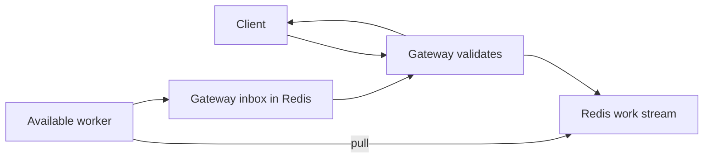

# 00 — The big picture

## What you'll understand

- Explain why an HTTP gateway and a model worker have separate responsibilities.
- Trace a request through Redis without assuming a gateway chooses a worker.
- Distinguish a simulated backend from real model inference.
- Describe what Phase 1 proves and what remains unfinished.

## The problem

An HTTP service receives work at the speed clients submit it. A model finishes
work at the speed its hardware allows. Those speeds differ, and they also vary:
a long input can cost more than a short one, and another process can compete
for CPU time. Putting every responsibility inside one request handler hides
those differences until requests start timing out.

We want a design whose waiting work we can see. We also want to change the number
of model copies without changing the client's API. A replica means one running
copy of a model worker. Our first step separates accepting a request from executing
it, while keeping the client's initial experience simple: send HTTP, receive JSON.

The model is deliberately fake. Its sleep represents compute cost, and its output
says SIMULATED. There is no claim about sentiment accuracy or GPU performance.
That lets us study distribution without downloading weights or confusing model
correctness with transport correctness.

## How it works

Think of a kitchen with an order board. The gateway is the person taking orders,
Redis is the board, and workers are cooks. A cook takes the next order only when
available. The cashier does not need to predict which cook will finish first.



A stream is an ordered ledger of entries. A consumer group is a shared delivery
ledger: it assigns each new entry to one available named reader. The gateway
adds work; the worker asks for it. The worker writes a reply to the inbox belonging
to the gateway that accepted the request.

An inbox is another stream, but its reader is different. One gateway task reads
all its replies and dispatches them by request ID. A waiter is a local queue
associated with a waiting HTTP request. Request identity joins the outgoing work
to its eventual response even when responses complete in a different order.

Delivery and completion are separate. Redis records a delivered request as
pending until the worker acknowledges it. This makes a dead worker's unfinished
work observable. It does not make recovery automatic: the first phase has no
reclaim controller. The order board remembers an order even if its cook leaves.

## How it works in this codebase

Read these files in order:

1. [settings.py](../../src/infer_platform/common/settings.py), Settings.load_models:
   load and validate the trusted model allowlist.
2. [app.py](../../src/infer_platform/gateway/app.py), create_app:
   construct resources in lifespan and define the HTTP boundary.
3. [response_router.py](../../src/infer_platform/gateway/response_router.py),
   ResponseRouter.register/read: connect incoming replies to local waiters.
4. [main.py](../../src/infer_platform/worker/main.py), Worker.run/process:
   pull one request, run it, write a response, then acknowledge.
5. [fake.py](../../src/infer_platform/worker/runners/fake.py),
   FakeRunner.predict_batch: simulate cost in a dedicated executor thread.

The executor is a thread pool that keeps blocking work away from the event loop,
the scheduler responsible for concurrent network I/O. This separation matters even
for a fake sleep: blocking the loop would delay other requests and inbox reads.

## Try it

From the repository root, these commands were run during Phase 1. The key is a
public local example, supplied through environment variables.

```bash
export UV_CACHE_DIR=/tmp/infer-uv-cache
uv sync
export INFER_API_KEYS='["phase1-verification-key"]'
export INFER_SMOKE_API_KEY=phase1-verification-key
docker compose -f deploy/docker/docker-compose.yml up --build -d --wait
./scripts/smoke.sh
```

Expect healthy and ready responses, a model listing, and an output labeled
SIMULATED with input_chars. Timing metadata identifies the worker and reports
queue, batch-wait and inference durations. Your exact durations will differ.

## Break it

First predict the result, then run the disposable drill:

```bash
uv run python scripts/experiment_e1.py
```

It performs three controlled disruptions. An invalid API key produces 401 without
enqueueing work. An unknown model with a valid key produces 404. Finally it slows
simulated compute and kills the worker after Redis reports delivery: the HTTP
request times out, while pending and retained entry counts remain nonzero.

Read [the recorded results](../EXPERIMENTS.md). Explain why starting another
Phase 1 worker would not automatically finish that pending request. A reader
asking for new deliveries does not ask for old deliveries owned by a dead consumer.

## Trade-offs and alternatives

Direct HTTP from gateway to worker would remove queue hops and simplify a small
deployment. It would also require worker discovery and a policy for routing to
busy replicas. A shared queue makes waiting and ownership inspectable, but Redis
becomes a shared availability dependency and each response needs another hop.

The fake backend isolates transport learning, but cannot predict real model
throughput. Likewise, a synchronous API is easy to use but holds a connection
while waiting. Async result polling and streaming have their own later phases.

## Check your understanding

1. Who chooses the worker?
<details><summary>Answer</summary>The consumer group delivers work to a worker that asks; the gateway chooses only the model stream.</details>

2. Is the output a sentiment prediction?
<details><summary>Answer</summary>No. It is explicitly simulated and reports input length.</details>

3. What would happen if a worker dies after delivery?
<details><summary>Answer</summary>The entry stays pending; Phase 1 has no reclaim loop, so the HTTP waiter eventually times out.</details>

4. Why use an executor?
<details><summary>Answer</summary>Blocking model work must not stop the event loop from doing network I/O.</details>

5. Does /healthz prove Redis works?
<details><summary>Answer</summary>No. It proves the process responds; /readyz checks Redis and the inbox reader.</details>

## Teach-back

- Explain the kitchen analogy, including what it fails to capture about retries.
- Sketch the two streams and identify their different readers.
- Explain why a successful smoke test is evidence about transport, not model quality.

## Further reading

Read [Redis Streams](../concepts/redis-streams.md), then
[ADR-0001](../adr/0001-redis-streams.md) for the queue alternatives.
The [official Redis Streams documentation](https://redis.io/docs/latest/develop/data-types/streams/)
was checked during this phase.
