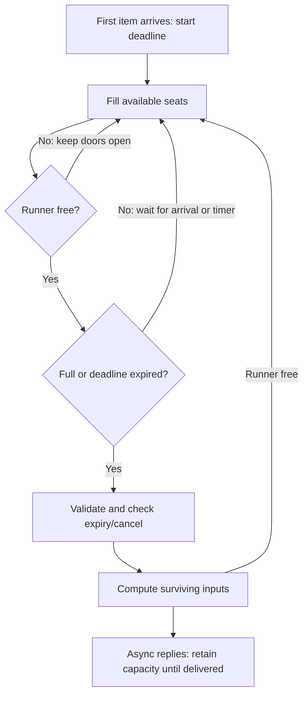

# 02 — Dynamic batching

## What you'll understand

- Explain static, dynamic and continuous batching without confusing their schedulers.
- Predict when a partial batch will flush while the runner is idle or busy.
- Distinguish batch latency, per-item service cost and end-to-end latency.
- Trace identity, validation and error isolation through a batch.

## The problem

A trained model can often process several inputs more efficiently together than
one at a time. Calling it repeatedly pays framework overhead repeatedly, and small
tensor operations may underuse the hardware. But independent HTTP clients cannot
usually coordinate a shared batch. One client may arrive now and another later.

The server could wait until enough inputs arrive. That improves efficiency during
busy periods, but an isolated request might wait forever. It could also execute
every request immediately, giving good latency when idle while missing useful
aggregation opportunities. Dynamic batching is the server's compromise: gather
independent inputs for a bounded intentional wait, then run them together.

Do not confuse this with static batching, where one caller already has a fixed
list. Continuous batching is different again: an LLM engine changes its active
generation sequences between decoding steps. Our classifier batcher does not
implement that generation scheduler; vLLM will own it in a later phase.

## How it works

Picture a shuttle bus. The timer starts when the first passenger arrives; an empty
bus has no timer. It leaves when full or when its timer expires and the road is
free. If a previous bus still blocks the road, keep the doors open. Closing empty
seats cannot make this bus leave sooner.



Consider the busy case. Suppose the first waiting item's timer
expires while another batch is computing. New arrivals can still join the next
batch. Once the runner becomes available, that batch leaves immediately if its
deadline has already passed. We never restart its timer and impose another wait.

max_wait_ms therefore bounds deliberate coalescing while the runner is available.
It does not bound local congestion, Redis waiting, inference or response delivery.
Zero wait can still produce multi-item batches when arrivals accumulate during
the previous computation.

The buffer is bounded too. Active, staged and queued items together cannot exceed
prefetch_bound. The default is twice max_batch_size. A full worker reads less from
Redis rather than growing a hidden local backlog. There is only one model executor
thread, although the CPU library can use a configurable team of internal threads.

## How it works in this codebase

Read these files in order:

1. [base.py](../../src/infer_platform/worker/runners/base.py), ModelRunner:
   synchronous load, warmup and predict_batch contract.
2. [torch_classifier.py](../../src/infer_platform/worker/runners/torch_classifier.py),
   TorchClassifierRunner.load/predict_batch: trusted safetensors, evaluation mode,
   inference_mode, dynamic padding and truncation at 256 tokens.
3. [batcher.py](../../src/infer_platform/worker/batcher.py),
   DynamicBatcher.run: stage the next batch while an execution task is active.
4. The same file's execute method: validate per item, preserve IDs, and retry
   each input individually once if the shared model call fails.
5. [main.py](../../src/infer_platform/worker/main.py), Worker.consume/prepare/finish:
   read free capacity, check Redis time and cancel flags, then reply before ACK.

The real runner loads and warms up in the dedicated executor before the worker
starts consuming. A warmup is a small prediction used to initialize model paths.
The worker's internal ready event currently has no heartbeat registry behind it.

Dynamic padding makes all rows as long as the longest input in that batch.
Short neighbors inherit the cost of a long input's tensor shape. Evaluation mode
turns off training behavior such as dropout; inference_mode avoids gradient
bookkeeping. Numerical equality tests allow small floating-point rounding changes.

CPU threads must match the deployment. Start near cores divided by replicas and
measure. Giving every replica all cores can make replicas fight for the same CPU.
Our recorded CPU experiments use one intra-op thread and do not claim GPU results.

## Try it

After the Phase 1 key exports in the root README, run these verified commands:

```bash
uv sync --extra ml
docker compose -f deploy/docker/docker-compose.yml --profile torch up --build -d --wait
curl --fail --silent --show-error -H "X-API-Key: $INFER_SMOKE_API_KEY" -H 'Content-Type: application/json' -d '{"input":"I loved this movie."}' http://localhost:8000/v1/infer/sentiment
uv run --extra ml pytest -m model
```

Startup downloads trusted weights. Allow time for the worker_ready
log; Compose's gateway readiness does not prove that a model is warm. The response
contains a real sentiment label, probability scores and batch metadata. A lone
request normally runs alone after the configured window. Cached model tests never
download weights and skip if the ML extra or cache is absent.

## Break it

Run these tests and read their assertions:

```bash
uv run --extra ml pytest tests/unit/test_batcher.py -k poison
uv run --extra ml pytest tests/unit/test_batcher.py -k elapsed
uv run --extra ml pytest tests/unit/test_batcher.py -k bound
```

The poison test forces the shared invocation to raise: two good inputs still
succeed after individual retries, and the poison input fails. The elapsed test
blocks the runner, advances a fake clock past the next batch's timer, then adds
more inputs: they still share that next batch. The bound test fills local capacity
and proves another submit waits until completion releases a slot.

## Trade-offs and alternatives

More waiting can improve throughput when it builds useful batches. At low load it
may add latency without sharing any compute. Larger batches also use more memory
and increase execution time. E2 measures runner service cost; E3 measures arrival
and completion behavior through the real batcher. See [the measured record](../EXPERIMENTS.md).

For a stable interval, Little's Law connects average work present, throughput and
time: L = λW. If average latency grows at unchanged throughput, more work must be
present. It does not predict tail percentiles or make an overloaded queue stable.
This is why batching must be combined with bounded buffers and later admission
control, rather than treated as unlimited capacity.

## Check your understanding

1. What starts the timer?
<details><summary>Answer</summary>The first locally accepted waiting input; an empty batch has no timer.</details>

2. What would happen if the timer expires while compute is busy?
<details><summary>Answer</summary>The next batch keeps accepting inputs and runs when compute finishes. Reply fan-out runs separately within the same outstanding-work bound.</details>

3. Is batch latency divided by batch size the request latency?
<details><summary>Answer</summary>No. It is amortized service cost; each input waits for the entire shared execution.</details>

4. Why test padded batches against single inputs?
<details><summary>Answer</summary>Grouping and attention masks should preserve each input's prediction within numerical tolerance.</details>

5. Can zero wait still batch?
<details><summary>Answer</summary>Yes. Several arrivals can accumulate while the previous batch is busy.</details>

## Teach-back

- Explain the shuttle analogy, including why its doors stay open while blocked.
- Separate Redis queue time, local batch wait and shared inference time.
- Explain why a long input and excessive CPU threads can undo batching gains.

## Further reading

Read [the batching concept guide](../concepts/batching.md) and
[ADR-0004](../adr/0004-dynamic-batching.md).
[Hugging Face padding documentation](https://huggingface.co/docs/transformers/main/en/pad_truncation)
was checked in Phase 2. The recorded library and model revisions, rather than
latest documentation, identify what was actually executed.
