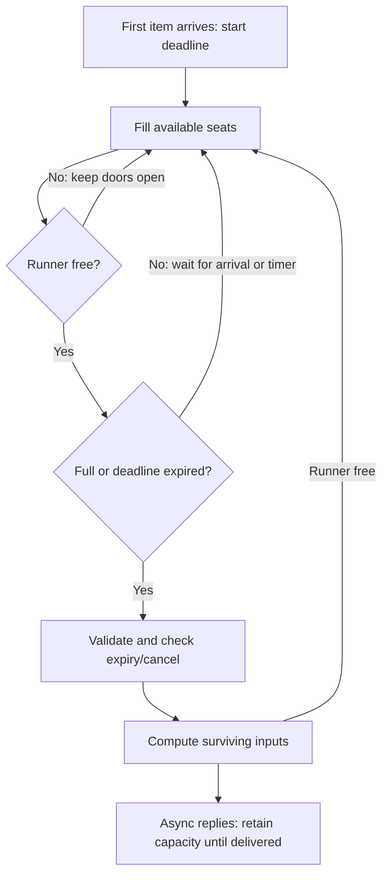
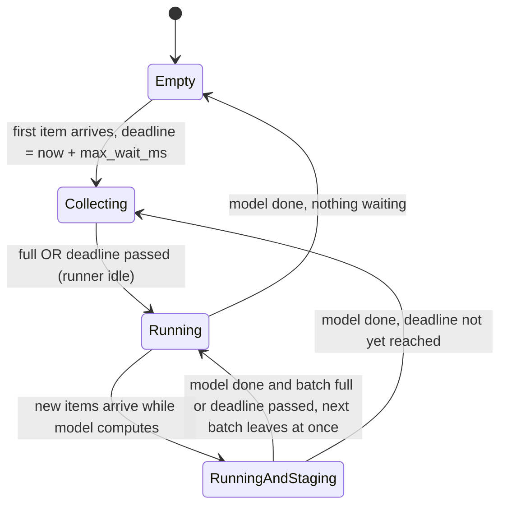
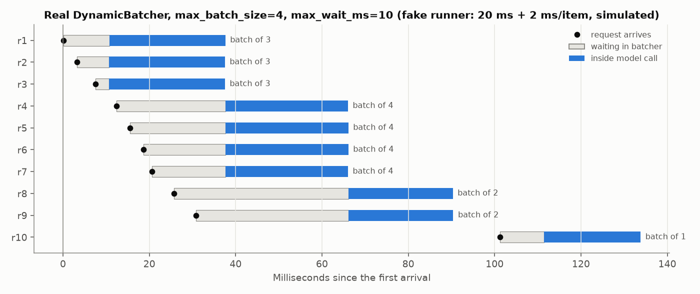
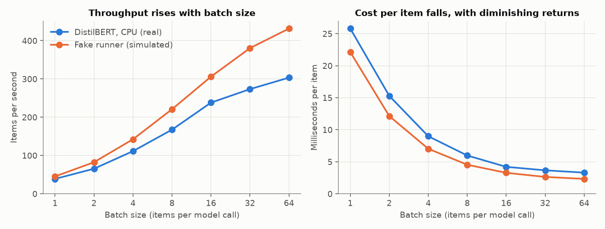

# 02 — Dynamic batching

## What you'll understand

- Explain static, dynamic and continuous batching without confusing their schedulers.
- Predict when a partial batch will flush while the runner is idle or busy.
- Distinguish batch latency, per-item service cost and end-to-end latency.
- Trace identity, validation and error isolation through a batch.

## The problem

A trained model can often process several inputs more efficiently together than
one at a time. Calling it repeatedly pays framework overhead repeatedly, and small
tensor operations may underuse the hardware. But independent HTTP clients cannot
usually coordinate a shared batch. One client may arrive now and another later.

The server could wait until enough inputs arrive. That improves efficiency during
busy periods, but an isolated request might wait forever. It could also execute
every request immediately, giving good latency when idle while missing useful
aggregation opportunities. Dynamic batching is the server's compromise: gather
independent inputs for a bounded intentional wait, then run them together.

Do not confuse this with static batching, where one caller already has a fixed
list. Continuous batching is different again: an LLM engine changes its active
generation sequences between decoding steps. Our classifier batcher does not
implement that generation scheduler; vLLM will own it in a later phase.

## How it works

Picture a shuttle bus. The timer starts when the first passenger arrives; an empty
bus has no timer. It leaves when full or when its timer expires and the road is
free. If a previous bus still blocks the road, keep the doors open. Closing empty
seats cannot make this bus leave sooner.



Consider the busy case. Suppose the first waiting item's timer
expires while another batch is computing. New arrivals can still join the next
batch. Once the runner becomes available, that batch leaves immediately if its
deadline has already passed. We never restart its timer and impose another wait.

max_wait_ms therefore bounds deliberate coalescing while the runner is available.
It does not bound local congestion, Redis waiting, inference or response delivery.
Zero wait can still produce multi-item batches when arrivals accumulate during
the previous computation.

The buffer is bounded too. Active, staged and queued items together cannot exceed
prefetch_bound. The default is twice max_batch_size. A full worker reads less from
Redis rather than growing a hidden local backlog. There is only one model executor
thread, although the CPU library can use a configurable team of internal threads.

The batcher is easiest to picture as three states:



`RunningAndStaging` is the important one. While the model works, the next batch
fills up with no timer, so under load batches grow by themselves.

### See it concretely: ten requests through the real batcher

Theory is easy to nod along to, so here is a measured run. The script
[tools/learning/batch_timeline.py](../../tools/learning/batch_timeline.py) feeds ten
requests into the **real** `DynamicBatcher` (no Redis) with `max_batch_size = 4`,
`max_wait_ms = 10`, and the fake runner set to exactly `20 ms + 2 ms × batch size`
(**simulated**, jitter off). Arrival times are scripted; everything else is measured.



| Batch | Requests (arrived at, ms) | Model ran (ms) | Why it left when it did |
|---|---|---|---|
| 1 | r1 (0), r2 (3), r3 (7) | 10.8 → 37.3 | **Deadline.** r1 arrived at 0, so the timer fired at 10 with only 3 aboard. The runner was idle, so the batch left. |
| 2 | r4 (12), r5 (15), r6 (18), r7 (20) | 37.4 → 65.7 | **Full**, but it had to wait for batch 1. It was full at 20 ms and left the instant the runner freed up at 37. |
| 3 | r8 (25), r9 (30) | 65.8 → 90.1 | **Deadline already passed** (25 + 10 = 35) while the runner was busy. Nobody restarted the timer, so it left at 65.8 with only 2. |
| 4 | r10 (100) | 110.8 → 133.2 | **Deadline.** Alone again: it waited the full 10 ms for company that never came. |

Look at what each request's `batch_wait_ms` (the grey bar) actually measured:

- r3 waited **3.2 ms**: it joined a batch whose timer was almost up.
- r8 waited **40.1 ms**, four times `max_wait_ms`. Almost all of that was waiting
  for the busy runner, not deliberate batching. **`batch_wait_ms` = deliberate wait + local
  congestion.** If you see it far above `max_wait_ms` in production, the worker is
  saturated: add replicas, don't tweak the timer.
- r10 paid the full 10 ms tax. At low load, batching only costs latency.

The model call itself took 26.6 / 28.3 / 24.4 / 22.5 ms for sizes 3 / 4 / 2 / 1.
The formula predicts 26 / 28 / 24 / 22; the extra ~0.5 ms is `time.sleep` overshoot
and thread handoff.

### Why bother: the measured payoff

The whole point is that the model's cost per call is mostly fixed. Experiment E2
called each runner directly at batch sizes 1 to 64 (5 repeats each, one CPU thread,
GB10 host):



| Batch size | DistilBERT CPU items/s (real) | DistilBERT ms per item | Fake items/s (simulated) | Fake formula ms per item, 20/n + 2 |
|---:|---:|---:|---:|---:|
| 1 | 38.8 | 25.8 | 45.2 | 22.0 + jitter |
| 4 | 111.3 | 9.0 | 142.3 | 7.0 |
| 16 | 238.1 | 4.2 | 306.0 | 3.25 |
| 64 | 303.4 | 3.3 | 431.6 | 2.31 |

Two lessons hide in this table:

1. **Diminishing returns.** Going from 1 to 16 gives the real model 6× throughput.
   Going from 16 to 64 gives only 1.3× more, and a 64-batch takes ~211 ms
   (64 × 3.3), which *every* item in it must wait for. That's why `sentiment` uses
   `max_batch_size: 16`, not 64.
2. **The fake runner is a good stand-in, not a substitute.** Its curve has the same
   shape because its formula has the same structure: fixed cost plus per-item cost.
   Real models add effects the formula lacks, such as padding to the longest input and
   memory bandwidth limits.

## How it works in this codebase

Read these files in order:

1. [base.py](../../src/infer_platform/worker/runners/base.py), ModelRunner:
   synchronous load, warmup and predict_batch contract.
2. [torch_classifier.py](../../src/infer_platform/worker/runners/torch_classifier.py),
   TorchClassifierRunner.load/predict_batch: trusted safetensors, evaluation mode,
   inference_mode, dynamic padding and truncation at 256 tokens.
3. [batcher.py](../../src/infer_platform/worker/batcher.py),
   DynamicBatcher.run: stage the next batch while an execution task is active.
4. The same file's execute method: validate per item, preserve IDs, and retry
   each input individually once if the shared model call fails.
5. [main.py](../../src/infer_platform/worker/main.py), Worker.consume/prepare/finish:
   read free capacity, check Redis time and cancel flags, then reply before ACK.

### Annotated (abridged): the lines that implement the flush rule

From [`DynamicBatcher.run`](../../src/infer_platform/worker/batcher.py#L97):

```python
# 1. Move waiting items into the next batch, never beyond max_batch_size.
while len(staged) < self.max_batch_size and not self.queue.empty():
    staged.append(self.queue.get_nowait())

# 2. The timer belongs to the OLDEST staged item. No items, no timer.
deadline = staged[0].enqueued_at + self.max_wait_ms / 1000 if staged else None

# 3. Leave only if the runner is free AND (full OR closing OR deadline passed).
if (
    staged
    and running is None
    and (
        len(staged) == self.max_batch_size
        or self.closed
        or (deadline is not None and self.clock.monotonic() >= deadline)
    )
):
    batch, staged = staged, []
    running = asyncio.create_task(self.execute(batch))  # don't await: keep staging!
    continue

# 4. Otherwise sleep until something changes. Note the condition on the timer:
#    "No timer while compute is busy: keep filling until the runner is free."
if running is None and deadline is not None:
    owned.append(asyncio.create_task(self.clock.sleep(deadline - now)))
```

Step 3's `create_task` without `await` is what makes `RunningAndStaging` possible:
the loop goes straight back to step 1 while the model runs in the executor.
Step 4 waits on *new arrival*, *timer* (only when idle), *running batch done*, or
*a delivery finished*, whichever comes first.

And the poison isolation in [`execute`](../../src/infer_platform/worker/batcher.py#L169):

```python
try:
    outputs = await self.predict([payload for _, payload in valid])  # whole batch
except Exception:
    for item, payload in valid:  # one retry each
        try:
            result.output = (await self.predict([payload]))[0]
        except Exception:
            result.error_code = "INFERENCE_FAILED"  # only the poison fails
```

One bad input in a batch of 16 costs one failed batch call plus 16 single calls.
That's expensive, but it happens once. The failed item is then left pending for
the reclaim loop and eventually the dead-letter queue (lesson 03), not retried in a
hot loop.

The real runner loads and warms up in the dedicated executor before the worker
starts consuming. A warmup is a small prediction used to initialize model paths.
The worker's internal ready event currently has no heartbeat registry behind it.

Dynamic padding makes all rows as long as the longest input in that batch.
Short neighbors inherit the cost of a long input's tensor shape. Evaluation mode
turns off training behavior such as dropout; inference_mode avoids gradient
bookkeeping. Numerical equality tests allow small floating-point rounding changes.

CPU threads must match the deployment. Start near cores divided by replicas and
measure. Giving every replica all cores can make replicas fight for the same CPU.
Our recorded CPU experiments use one intra-op thread and do not claim GPU results.

## Try it

After the Phase 1 key exports in the root README, run these verified commands:

```bash
uv sync --extra ml
docker compose -f deploy/docker/docker-compose.yml --profile torch up --build -d --wait
curl --fail --silent --show-error -H "X-API-Key: $INFER_SMOKE_API_KEY" -H 'Content-Type: application/json' -d '{"input":"I loved this movie."}' http://localhost:8000/v1/infer/sentiment
uv run --extra ml pytest -m model
```

Startup downloads trusted weights. Allow time for the worker_ready
log; Compose's gateway readiness does not prove that a model is warm. The response
contains a real sentiment label, probability scores and batch metadata. A lone
request normally runs alone after the configured window. Cached model tests never
download weights and skip if the ML extra or cache is absent.

To reproduce the timeline and the charts above (no Docker or model needed):

```bash
uv run python -m tools.learning.batch_timeline        # prints 4 batches, writes docs/results/learning/batch-timeline.json
uv run python -m tools.learning.plot_learning_charts  # redraws docs/learning/img/*.png from recorded results
```

Expected first lines (your milliseconds will differ slightly):

```text
batch size=3 ran 10.8-37.3 ms
batch size=4 ran 37.4-65.7 ms
batch size=2 ran 65.8-90.1 ms
batch size=1 ran 110.8-133.2 ms
```

Try editing `MAX_WAIT_MS` to `0` and rerun. Predict first: does batch 1 still have
three requests? When we ran it, the batches were sizes **1, 4, 4, 1**. r1 left alone
at 0.1 ms, but while it computed, r2–r5 piled up and left together at 22.7 ms, then
r6–r9 at 51.3 ms. Zero wait still batches under load, because the busy runner does
the waiting. The last of the first nine requests finished at 80 ms instead of 90 ms.
For this arrival pattern, a timer was not needed at all.

## Break it

Run these tests and read their assertions:

```bash
uv run --extra ml pytest tests/unit/test_batcher.py -k poison
uv run --extra ml pytest tests/unit/test_batcher.py -k elapsed
uv run --extra ml pytest tests/unit/test_batcher.py -k bound
```

The poison test forces the shared invocation to raise: two good inputs still
succeed after individual retries, and the poison input fails. The elapsed test
blocks the runner, advances a fake clock past the next batch's timer, then adds
more inputs: they still share that next batch. The bound test fills local capacity
and proves another submit waits until completion releases a slot.

## Trade-offs and alternatives

More waiting can improve throughput when it builds useful batches. At low load it
may add latency without sharing any compute. Larger batches also use more memory
and increase execution time. E2 measures runner service cost; E3 measures arrival
and completion behavior through the real batcher. See [the measured record](../EXPERIMENTS.md).

For a stable interval, Little's Law connects average work present, throughput and
time: L = λW. If average latency grows at unchanged throughput, more work must be
present. It does not predict tail percentiles or make an overloaded queue stable.
This is why batching must be combined with bounded buffers and later admission
control, rather than treated as unlimited capacity.

## Check your understanding

1. What starts the timer?
<details><summary>Answer</summary>The first locally accepted waiting input; an empty batch has no timer.</details>

2. What would happen if the timer expires while compute is busy?
<details><summary>Answer</summary>The next batch keeps accepting inputs and runs when compute finishes. Reply fan-out runs separately within the same outstanding-work bound.</details>

3. Is batch latency divided by batch size the request latency?
<details><summary>Answer</summary>No. It is amortized service cost; each input waits for the entire shared execution.</details>

4. Why test padded batches against single inputs?
<details><summary>Answer</summary>Grouping and attention masks should preserve each input's prediction within numerical tolerance.</details>

5. Can zero wait still batch?
<details><summary>Answer</summary>Yes. Several arrivals can accumulate while the previous batch is busy.</details>

## Teach-back

- Explain the shuttle analogy, including why its doors stay open while blocked.
- Separate Redis queue time, local batch wait and shared inference time.
- Explain why a long input and excessive CPU threads can undo batching gains.

## Further reading

Read [the batching concept guide](../concepts/batching.md) and
[ADR-0004](../adr/0004-dynamic-batching.md).
[Hugging Face padding documentation](https://huggingface.co/docs/transformers/main/en/pad_truncation)
was checked in Phase 2. The recorded library and model revisions, rather than
latest documentation, identify what was actually executed.
