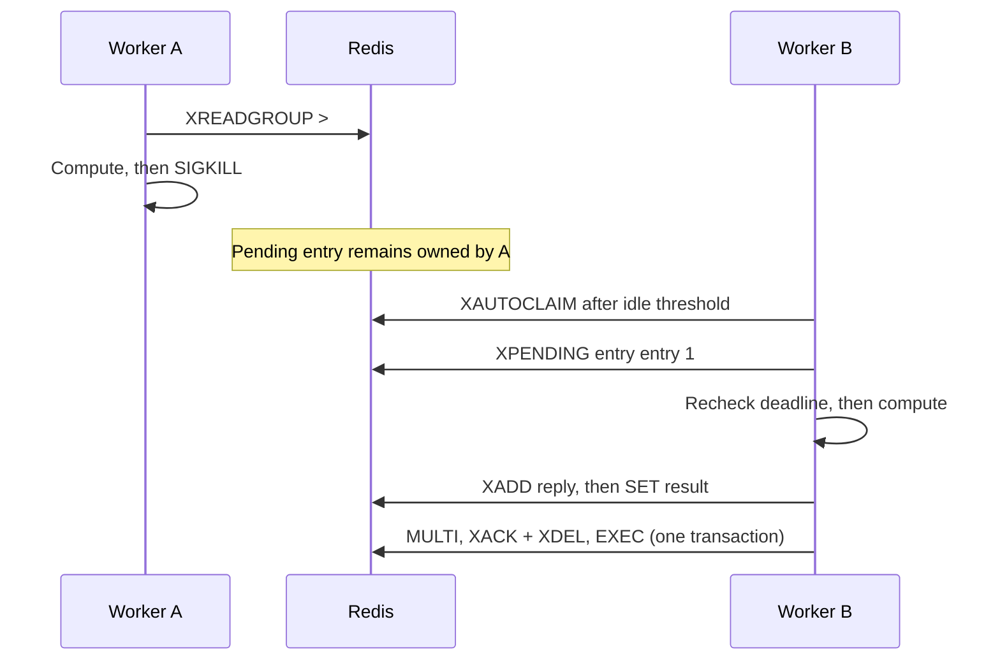
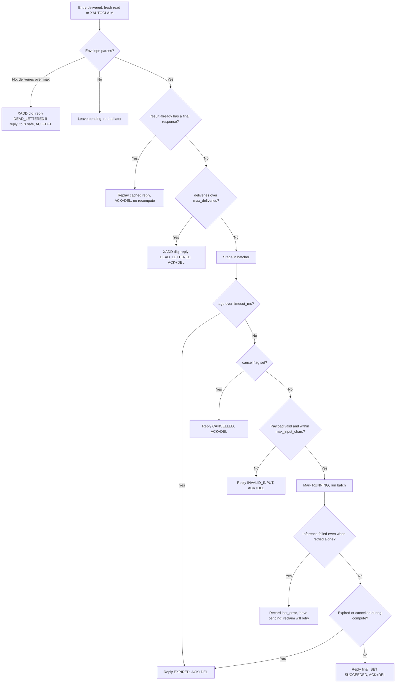
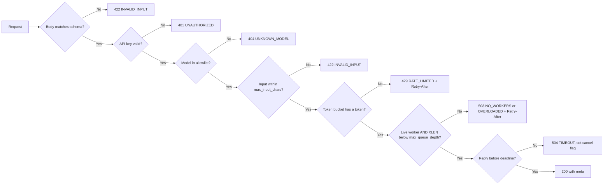
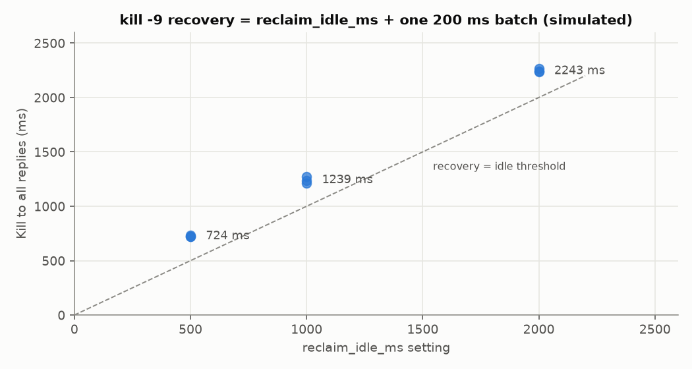
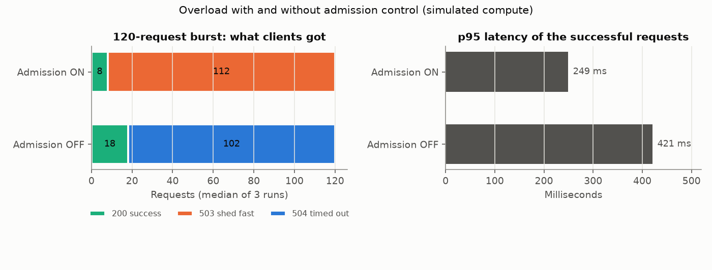

# 03 — Distribution and reliability

## What you'll understand

- Trace a worker killed mid-batch through pending ownership, reclaim and completion.
- Separate delivery retries, poison isolation, deadlines and cancellation.
- Explain 429 versus 503 and why admission protects accepted work.
- Distinguish graceful shutdown from immediate process death.

## The problem

A successful request path is not enough. A worker can disappear after accepting
work, a model can fail repeatedly, or clients can submit faster than compute
finishes. A queue remembers some of those facts; it does not decide what to do.

We need explicit ownership, bounded recovery and useful rejection. Otherwise a
crash strands work, a poison input burns compute forever, and overload makes
every caller wait until timeout. Reliability includes knowing when completion
is no longer useful, not merely retrying indefinitely.

## How it works

Follow one of E4's four requests. The model's compute is **simulated**, while
Redis, subprocesses, SIGKILL and the HTTP handlers are real.

1. **Accept:** The gateway authenticates and runs the token-bucket Lua script using
   Redis TIME, HMGET and HSET. SCAN/GET finds accepting heartbeats. The enqueue
   Lua operation checks heartbeat existence and XLEN, SETs result:{id} to QUEUED
   with TTL, then XADDs req:{model}. A synchronous waiter already exists.
2. **Deliver:** Worker A calls XREADGROUP GROUP workers A COUNT free-capacity
   BLOCK milliseconds STREAMS req:{model} >. Redis assigns the entry to A and
   records it in the pending-entry list (PEL), the ledger of unacknowledged work.
   Delivery count starts at one. The stream entry still exists.
3. **Begin compute:** Worker.prepare uses TIME minus the original entry timestamp
   to check the deadline, EXISTS for cancel:{id}, validates the input, then
   conditionally marks result:{id} RUNNING. The executor starts the shared batch.
4. **Kill A:** The drill sends SIGKILL, the signal used by kill -9. No finally
   block runs. No reply, cache final, XACK, XDEL or heartbeat cleanup happens.
   XPENDING still lists A's four deliveries. The heartbeat expires separately.
5. **Find a replacement:** B warms up, SETs its TTL heartbeat and joins the same
   workers group. Reading > alone would not return A's pending entries.
6. **Transfer ownership:** With free local capacity, B calls XAUTOCLAIM
   req:{model} workers B reclaim_idle_ms cursor COUNT capacity. Once idle long
   enough, Redis transfers ownership to B. B preserves the returned scan cursor
   and calls extended XPENDING with min=max=entry_id and count=1. Delivery count
   is now two. This is redelivery, not a new request ID.
7. **Recheck usefulness:** B checks original age and cancellation again. Claiming
   does not reset the request deadline. If eligible, it batches and reruns
   inference. If expired or cancelled, it publishes that error instead.
8. **Complete:** B XADDs the final inbox response, refreshes inbox EXPIRE, and SETs
   result:{id} with TTL. Then MULTI, XACK, XDEL, EXEC atomically clear pending
   ownership and retained work. The gateway's XREAD task routes the reply to its
   original waiter. E4 confirms pending=0 and XLEN=0 afterward.



A crash after response publication but before acknowledgement can repeat compute
or replies. At-least-once handling permits that duplication. Idempotency means
repetition creates no extra external side effect; do not put payments inside a
runner. Cached finals avoid some recompute, and the gateway ignores finished IDs,
but neither makes the entire system exactly once.

The default classifier deadline is 5 seconds versus 30 seconds for reclaim idle.
Those defaults time out before recovery. E4 uses a 6-second deadline and shorter
idle thresholds safe for its measured small fake batches. Tune deadline, idle
threshold and expected compute together.

### Every branch a delivered entry can take

The numbered story above is the happy recovery path. This is the complete
decision tree the worker runs for each entry, read straight from
[`accept`](../../src/infer_platform/worker/main.py#L192),
[`prepare`](../../src/infer_platform/worker/main.py#L307) and
[`finish`](../../src/infer_platform/worker/main.py#L332):



Notice that only two kinds of failure leave the entry **pending**: a garbled
envelope and an inference crash. Pending is how the system says "someone should
try again later". Every other branch ends in a definite answer plus ACK+DEL,
because retrying an expired or cancelled request would only waste compute.

### The same idea at the gateway: which status code, and why



The schema check comes first because FastAPI validates the `InferInput` body
before the handler runs. The rest follows the order in
[`infer`](../../src/infer_platform/gateway/app.py#L175). Every rejection to the left of the queue costs the system almost nothing. That's
the point of doing the checks in this order: cheapest first, and none of them
touch a model.

### Measured: how fast does reclaim recover a killed worker?

E4 killed a worker (`kill -9`) holding 4 in-flight requests whose simulated batch
takes 200 ms, then measured the time until all 4 replies arrived. Three runs at
each `reclaim_idle_ms`:



| `reclaim_idle_ms` | Recovery (median of 3) | Minus idle threshold |
|---:|---:|---:|
| 500 | 724 ms | 224 ms |
| 1000 | 1239 ms | 239 ms |
| 2000 | 2243 ms | 243 ms |

The leftover ~230 ms is one 200 ms batch rerun plus the 50 ms reclaim polling
interval and Redis hops. So recovery time ≈ `reclaim_idle_ms` + one batch.
**The threshold is the dial, and it is a trade-off.** Set it below your slowest
healthy batch and a live worker's entries get stolen and computed twice.

### Measured: what admission control buys under overload

E5 fired a burst of 120 requests at one worker (batch of 4, simulated 60 ms batches,
450 ms deadline, `max_queue_depth` 8), three times with admission on and three with it off:



- **On:** 8 requests succeed and 112 get an immediate `503`. The queue never
  exceeded 8 entries. Successful requests had p95 ≈ 249 ms.
- **Off:** all 120 are queued (XLEN reached 120). About 18 succeed, but the other ~102
  wait the full deadline and get `504`. Even the winners were slower (p95 ≈ 421 ms).

"Off" completed more requests, because a fuller queue kept the worker busier. But
look at what everyone else experienced: ~100 clients each held a connection for
450 ms to receive nothing. With admission on, rejected clients learned within
milliseconds and could retry elsewhere or back off. That's **load shedding**:
fail fast for some so that the accepted ones stay fast.

### Annotated: reclaim in 20 lines

From [`Reclaimer.claim`](../../src/infer_platform/worker/reclaim.py#L16):

```python
result = await self.redis.xautoclaim(
    self.stream,
    GROUP,
    self.worker_id,
    self.idle_ms,  # only entries nobody has touched for this long
    start_id=self.cursor,  # resume scanning where the last call stopped
    count=capacity,  # never claim more than we can hold (bounded!)
)
self.cursor = str(result[0])  # "0-0" again once the scan wraps around
for entry_id, fields in entries:
    pending = await self.redis.xpending_range(
        self.stream, GROUP, min=entry_id, max=entry_id, count=1
    )
    if pending:  # XAUTOCLAIM doesn't return the count, so ask XPENDING
        claimed.append((entry_id, fields, int(pending[0]["times_delivered"])))
```

`times_delivered` is what lets `accept` send a poison message to the DLQ after
`max_deliveries` instead of retrying it forever.

## How it works in this codebase

Read in this order:

1. [admission.py](../../src/infer_platform/gateway/admission.py), enqueue:
   atomic retained-depth check and acceptance.
2. [rate_limit.py](../../src/infer_platform/gateway/rate_limit.py), RateLimiter.check:
   shared per-key budget using Redis time.
3. [main.py](../../src/infer_platform/worker/main.py), Worker.consume/accept:
   one bounded producer for fresh reads and reclaims.
4. [reclaim.py](../../src/infer_platform/worker/reclaim.py), Reclaimer.claim:
   ownership transfer and delivery-count inspection.
5. [main.py](../../src/infer_platform/worker/main.py), Worker.finish/publish/ack_delete:
   outcome before acknowledgement; quarantine after bounded failures.
6. [heartbeat.py](../../src/infer_platform/worker/heartbeat.py), Heartbeats.write:
   recent compute fraction and locally outstanding work, independent of inference.

## Try it

After the README's environment exports and Compose startup:

```bash
uv run --extra ml pytest -m chaos
uv run --extra ml python -m tools.reliability_experiments E4 --output docs/results/e4-recovery.json
uv run --extra ml python -m tools.reliability_experiments E5 --output docs/results/e5-overload.json
```

The drills own disposable Redis containers and worker processes. They do not kill
your Compose workers. Compare your measurements with [the recorded results](../EXPERIMENTS.md).

## Break it

```bash
uv run --extra ml pytest tests/integration/test_reliability.py -k poison
uv run --extra ml pytest tests/integration/test_reliability.py -k overload
uv run --extra ml pytest tests/integration/test_reliability.py -k disconnect
```

Poison first triggers individual retries within the batch. Persistent failure
leaves the entry pending. The fourth delivery exceeds max_deliveries=3 and moves
it to the DLQ, a dead-letter queue holding failed envelopes. Overload produces
503 before enqueue. Disconnect writes a cancel flag; queued work skips compute,
while running CPU work finishes and discards its output.

## Trade-offs and alternatives

A heartbeat can be stale until TTL expiry. A reclaim threshold can be too short
for a healthy slow batch. Async polling survives gateway replacement within TTL,
but requires the caller to retain its ID. DLQ retention is bounded and contains
inputs, requiring controlled Redis access.

429 means the key's rate budget is exhausted; 503 means insufficient admission
capacity. Clients should respect Retry-After, jitter retries and keep their
original deadline. Otherwise retries amplify overload. Fast rejection is not
successful inference; E5 reports its latency separately from success and timeout.

SIGTERM stops reads, drains accepted work and removes the heartbeat. SIGKILL
does none of that. Compose allows 15 seconds; Kubernetes grace comes in Phase 7.

## Check your understanding

1. Does a heartbeat reclaim an entry?
<details><summary>Answer</summary>No. It advertises capacity; XAUTOCLAIM transfers idle pending ownership.</details>

2. What would happen if B only read >?
<details><summary>Answer</summary>It would receive new work, leaving A's old deliveries pending.</details>

3. Does reclaim reset the deadline?
<details><summary>Answer</summary>No. Age still comes from the original stream ID.</details>

4. Why ACK and delete together?
<details><summary>Answer</summary>It prevents a completed-but-retained entry from permanently consuming admission depth.</details>

5. Does cancellation stop a CPU thread?
<details><summary>Answer</summary>No. It skips queued inference or discards the eventual output.</details>

## Teach-back

- Walk a teammate through SIGKILL using the actual commands above.
- Explain why bounded retries still need deadlines and admission.
- Explain why the default timing policy cannot recover a sync classifier request before timeout.

## Further reading

Read [the reliability concept guide](../concepts/reliability-and-backpressure.md),
[ADR-0005](../adr/0005-delivery-semantics.md) and [ADR-0006](../adr/0006-admission-control.md).
The checked Redis references are [XAUTOCLAIM](https://redis.io/docs/latest/commands/xautoclaim/)
and [XPENDING](https://redis.io/docs/latest/commands/xpending/).
