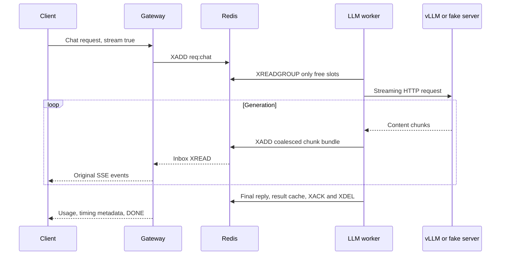
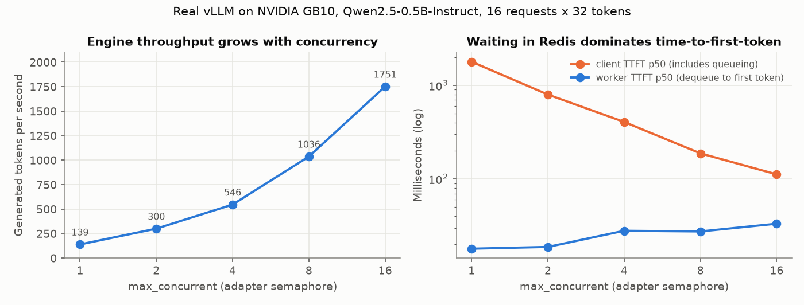
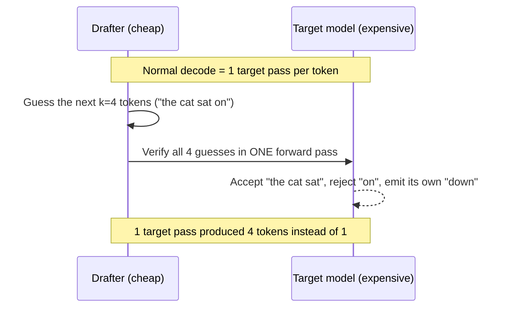

# Lesson 04: stream generation without becoming a generation engine

## 1. What you'll understand

- Explain prefill, decode, KV cache and continuous batching.
- Trace a chat chunk from vLLM through Redis to a client's SSE connection.
- Explain why a semaphore limits active sequences while Redis holds waiting work.
- Distinguish engine latency, client latency, simulated output and GPU evidence.

## 2. The problem

Our classifier finishes one tensor batch at a time. A chat model reads a prompt,
then generates tokens repeatedly. Some answers end quickly; others continue for
hundreds of steps. Treating all of them as one fixed batch leaves spare capacity
when short answers finish. Meanwhile, users want to see text before the whole
answer is ready and expect generation to stop when they disconnect.

We need an engine that schedules generation and a platform that controls access,
waiting and delivery. A second classifier batcher would not solve that problem.

## 3. How it works

**Prefill** processes the prompt. **Decode** generates successive tokens. The
**KV cache** stores attention state so decode does not recompute the prompt.
vLLM manages that cache using PagedAttention and admits/removes active sequences
across decode iterations: **continuous batching**.

Think of the adapter as a host assigning seats and vLLM as a kitchen organizing
cooking. Our semaphore bounds occupied seats; it never tells the kitchen which
GPU operation to run next. Waiting guests stay in Redis, where queue age and
admission remain observable.



The default 20 ms **coalescing window** combines Redis writes, while retaining
original chunk order. It introduces waiting, so fewer writes do not automatically
mean better client latency. TTFT means time to first content; client TTFT includes
queueing, whereas worker TTFT starts at dequeue. TPOT estimates decode time per
output token using final usage, not a count of HTTP chunks.

### Static vs continuous batching, one decode step at a time

An illustrative grid (not a measurement). Four chat requests, three seats.
`P` = prefill, `D` = one decode step, `.` = seat held but idle.

```text
STATIC batching: the batch is fixed until its longest member finishes
step:     1  2  3  4  5  6  7  8  9 10 11 12 13
seat 1 A  P  D  D  D  D  D  D  D
seat 2 B  P  D  D  .  .  .  .  .   <- B done at step 3; seat idle for 5 steps
seat 3 C  P  D  D  D  D  .  .  .
seat 1 D                          P  D  D  D  D   <- D waited for the whole batch, starts at step 9

CONTINUOUS batching (vLLM): the batch is re-formed every decode step
step:     1  2  3  4  5  6  7  8
seat 1 A  P  D  D  D  D  D  D  D
seat 2 B  P  D  D
seat 2 D           P  D  D  D  D   <- D takes B's seat at step 4
seat 3 C  P  D  D  D  D
```

Request D finishes at step 8 instead of step 13. Generations vary wildly in
length, which is why static batching suits LLMs poorly: the shortest answers
hold seats hostage to the longest. vLLM does the continuous kind *inside* the
engine. Our adapter only decides how many requests may be inside at once
(`max_concurrent`, kept equal to vLLM's `--max-num-seqs 32`).

### What a "seat" costs: KV-cache arithmetic for our dev model

The real `config.json` of Qwen2.5-0.5B-Instruct has 24 layers, 2 key/value heads
(grouped-query attention), head dimension 896 / 14 = 64, and bfloat16 (2 bytes).
Each token in the cache stores one key and one value vector per layer:

```text
KV bytes per token = 2 (K and V) × 24 layers × 2 KV heads × 64 dims × 2 bytes = 12,288 B = 12 KiB
one full sequence  = 12 KiB × 2,048 tokens (--max-model-len)                 = 24 MiB
all 32 seats full  = 24 MiB × 32 (--max-num-seqs)                            = 768 MiB
```

So on this model, 32 maximum-length conversations need under 1 GiB of KV cache.
That's why `--gpu-memory-utilization 0.25` is enough here. A 7B-class model
with more layers and KV heads needs many times more per token, and **KV memory,
not compute, usually limits concurrency.** PagedAttention allocates that memory
in small blocks on demand, so a 50-token chat doesn't reserve 2,048 tokens' worth.

### See it concretely: a real stream through our platform

This is the complete output of one `stream: true` request against the
`fake-llm` Compose profile (the **simulated** OpenAI server), captured 2026-11-13.
IDs are shortened; the full capture is in
[sse-fake-llm.txt](../results/learning/sse-fake-llm.txt).

```text
data: {"id": "chatcmpl-c19e…", ..., "choices": [{"index": 0, "delta": {"role": "assistant"}}]}
data: {"id": "chatcmpl-c19e…", ..., "choices": [{"index": 0, "delta": {"content": "token0 "}}]}
data: {... "delta": {"content": "token1 "}}]}
data: {... "delta": {"content": "token2 "}}]}
data: {... "delta": {"content": "token3 "}}]}
data: {... "delta": {"content": "token4 "}}]}
data: {... "delta": {}, "finish_reason": "length"}]}
data: {... "choices": [], "usage": {"prompt_tokens": 1, "completion_tokens": 5, "total_tokens": 6},
       "meta": {"queue_ms": 1.83, "inference_ms": 96.6, "total_ms": 100.6,
                "ttft_ms": 73.2, "tpot_ms": 5.27, "completion_tokens": 5, "chunk_writes": 3}}
data: [DONE]
```

Read the `meta`:

- **8 SSE events, but `chunk_writes: 3`.** The 20 ms coalescing window bundled
  the chunks into 3 Redis `XADD`s. The gateway unbundled them back into the
  original events, in order.
- `finish_reason: "length"`: generation stopped because it hit `max_tokens: 5`,
  not because the model chose to stop (that would be `"stop"`).
- `ttft_ms` 73 ms is mostly the fake server's configured first-token delay.
  `tpot_ms` ≈ 5.3 ms is the configured per-token delay. Simulated or not, the
  *measurement code* is the same one used against real vLLM.
- `batch_size: 1` and `batch_wait_ms: 0` (in the full capture): the LLM path never
  goes through our `DynamicBatcher`. vLLM batches.

### Measured on the real GPU: why `max_concurrent` matters

E6a sent 16 requests × 32 tokens to **real vLLM on the GB10** at different adapter
concurrency limits (median of 3 runs):



| `max_concurrent` | Tokens/s | Client TTFT p50 | Worker TTFT p50 | TPOT p50 |
|---:|---:|---:|---:|---:|
| 1 | 139 | 1,791 ms | 18.0 ms | 6.7 ms |
| 2 | 300 | 798 ms | 18.8 ms | 6.0 ms |
| 4 | 546 | 407 ms | 28.0 ms | 6.2 ms |
| 8 | 1,036 | 188 ms | 27.5 ms | 6.1 ms |
| 16 | 1,751 | 112 ms | 33.3 ms | 6.4 ms |

Three things to see:

1. **Throughput scales almost linearly with concurrency, while TPOT stays ~6 ms.**
   With 16 sequences the GPU produced 12× more tokens per second, and each
   sequence's decode step got no slower. Decode for a small model is limited by
   reading weights from memory, not by arithmetic, so more sequences per step
   are nearly free. That's continuous batching paying off.
2. **Client TTFT is mostly waiting in Redis.** At concurrency 1, the
   *engine* produced a first token in 18 ms, but the median client waited 1.8 s,
   queued behind the other requests. Little's Law at work: same arrival burst, fewer
   seats, longer waits.
3. **Worker TTFT rises slightly with concurrency** (18 → 33 ms), because a new
   request's prefill shares GPU steps with everyone else's decode. Prefill and decode
   compete, so more seats aren't free forever.

### Speculative decoding: does this platform use it?

**No.** Neither Compose nor the Kubernetes overlay passes a speculative-decoding
option to vLLM, so every token is produced by one full forward pass of the target
model. It's worth understanding anyway, because it's an engine-side switch that
needs **no platform code** (the adapter boundary from ADR-0007 again).

The idea, in one picture:



It's lossless with the standard verification: the accepted text is distributed exactly as
if the target had generated it alone. It's *faster* only when guesses are
usually right and the GPU has spare capacity to verify them. Our measurements
show it has that capacity at low concurrency: TPOT barely moved from 1 to 16
sequences. At high load, the compute spent on rejected guesses competes with
real requests and can *reduce* throughput. The concept guide has the details,
the exact vLLM 0.33.0 options, and the metrics to watch:
[speculative decoding](../concepts/llm-serving.md#speculative-decoding).

## 4. How it works in this codebase

Read these files in order:

1. [chat.py](../../src/infer_platform/gateway/chat.py), `install_chat_routes`:
   validates the supported subset, caps tokens and registers a bounded waiter.
2. [llm_worker.py](../../src/infer_platform/worker/llm_worker.py), `LLMWorker`:
   pulls only available capacity and owns per-request lifecycle tasks.
3. [llm_adapter.py](../../src/infer_platform/worker/llm_adapter.py), `LLMAdapter`:
   streams HTTP, monitors cancellation and bundles chunks.
4. [response_router.py](../../src/infer_platform/gateway/response_router.py),
   `ResponseRouter`: routes one shared inbox without blocking on slow clients.
5. [openai_server.py](../../src/infer_platform/fake/openai_server.py), `create_app`:
   supplies synthetic tokens and diagnostic cancellation counts over real TCP.

The adapter is separate from ModelRunner and DynamicBatcher. Even nonstream
clients use streaming upstream; the gateway returns one complete JSON response.

### Annotated: "excess requests wait in Redis, not inside vLLM"

From [`LLMWorker.serve`](../../src/infer_platform/worker/llm_worker.py#L117) (abridged):

```python
capacity = self.llm.max_concurrent - len(self.active)   # free seats right now
if not capacity:
    await <a seat frees up or shutdown>                  # read NOTHING from Redis
    continue
streams = await self.redis.xreadgroup(
    GROUP, self.worker_id, {request_stream(self.model): ">"},
    count=capacity,                                      # never more than free seats
    block=100,
)
```

The worker never holds a request it can't start. A backlog therefore stays in
`req:chat` where the exporter, autoscaler and admission control can all see it,
and where another worker replica can take it.

### Annotated: the coalescer is a tiny batcher

From [`LLMAdapter._generate`](../../src/infer_platform/worker/llm_adapter.py#L79),
inner `consume` loop (abridged):

```python
if not pending:
    deadline = now + self.config.coalesce_ms / 1000  # timer starts at the FIRST buffered chunk
pending.append(chunk)
if not self.config.coalesce_ms or len(pending) >= self.config.max_buffered_chunks:
    await flush()  # window off, or buffer full: write now
...
if timer and timer in done:
    await flush()  # window expired: one XADD for all of them
```

That's the shuttle-bus rule from lesson 02 again (leave when full or when the timer
for the first passenger expires), this time applied to Redis writes instead of
model calls. E6b measured the effect on real vLLM: with 4 concurrent streams × 64 tokens,
`coalesce_ms: 0` made 1,040 `XADD`s and `coalesce_ms: 20` made ~256, with the
same ~600 tokens/s.

## 5. Try it

From the repository root, with uv and Docker available:

```bash
export UV_CACHE_DIR=/tmp/infer-uv-cache
export INFER_API_KEYS='["phase1-verification-key"]'
docker compose -f deploy/docker/docker-compose.yml --profile fake-llm up --build -d --wait
curl --fail --silent --show-error -N -H 'X-API-Key: phase1-verification-key' -H 'Content-Type: application/json' -d '{"model":"chat","messages":[{"role":"user","content":"Explain queues."}],"max_tokens":32,"stream":true}' http://localhost:8000/v1/chat/completions
```

Expect synthetic token0 onward, a finish event, usage/meta, then [DONE]. This
verifies transport, not language understanding. Gateway readiness precedes worker
registration; if admission returns 503 briefly, check /v1/models and retry.
For real generation, stop this profile and follow [GPU verification](../GPU_VERIFICATION.md).

## 6. Break it

These tests own disposable Redis instances and real TCP fake upstreams:

```bash
uv run --extra ml pytest tests/integration/test_llm.py -k disconnect -v
uv run --extra ml pytest tests/integration/test_llm.py -k concurrency -v
uv run --extra ml pytest tests/integration/test_llm.py -k missing_chunk -v
```

The first closes a client during normal and stalled generation; fake active work
must fall to zero. Cancellation is independent of token arrivals. The second
fills two slots and proves additional work remains in Redis. The third drops a
chunk publication deliberately: the gateway must detect incomplete text instead
of presenting a silently truncated success. The full cached result remains readable.

## 7. Trade-offs and alternatives

Direct gateway-to-vLLM routing would remove Redis hops, but bypass our common
queue, worker registry and delivery controls. Embedding vLLM would couple Python,
CUDA and engine lifecycle to this worker. A separate server costs HTTP overhead
but makes that boundary explicit; see [ADR-0007](../adr/0007-llm-adapter.md).

Once SSE starts, HTTP status is already committed. Later failures arrive as SSE
error objects followed by [DONE]. A reclaimed partially emitted answer fails as
STREAM_INTERRUPTED; restarting it could splice two different answers. We do not
support resumable streams. Cancellation is best effort, with polling latency.

## 8. Check your understanding

1. Why does chat avoid DynamicBatcher?
<details><summary>Answer</summary>vLLM schedules sequences at generation iterations; fixed forward-batch collection cannot manage decode or KV state.</details>

2. Where do requests beyond max_concurrent wait?
<details><summary>Answer</summary>In Redis, because the worker reads only free semaphore capacity.</details>

3. What happens if a worker dies after publishing text?
<details><summary>Answer</summary>Reclaim sees stream_started and ends the partial request as interrupted rather than restarting generation in that stream.</details>

4. Why can gateway TTFT exceed worker TTFT?
<details><summary>Answer</summary>It includes queueing, response transport and coalescing before the client sees content.</details>

5. Does a fake cancellation test prove vLLM releases GPU work?
<details><summary>Answer</summary>No. The separate real-GPU test observed an active vLLM sequence, closed the client, then verified zero active sequences and CANCELLED.</details>

## 9. Teach-back

- Explain the platform/engine boundary without referring to filenames.
- Walk through disconnect → Redis cancel → upstream close → released slot.
- Use E6b to explain why reducing Redis writes can still delay first text.

## 10. Further reading

Read [LLM concepts](../concepts/llm-serving.md), [diagram 5](../ARCHITECTURE.md#diagram-5-streaming-and-cancellation)
and [E6a/E6b](../EXPERIMENTS.md). Primary sources are
[vLLM online serving](https://docs.vllm.ai/en/stable/serving/online_serving/),
[Kwon et al., PagedAttention, SOSP 2023](https://arxiv.org/abs/2309.06180), and
[Yu et al., Orca, OSDI 2022](https://www.usenix.org/conference/osdi22/presentation/yu).
