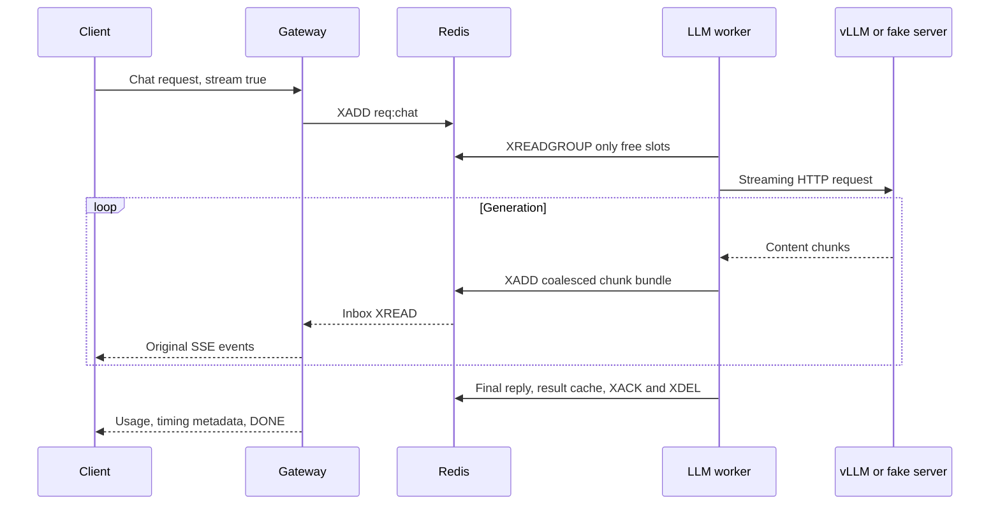

# Lesson 04: stream generation without becoming a generation engine

## 1. What you'll understand

- Explain prefill, decode, KV cache and continuous batching.
- Trace a chat chunk from vLLM through Redis to a client's SSE connection.
- Explain why a semaphore limits active sequences while Redis holds waiting work.
- Distinguish engine latency, client latency, simulated output and GPU evidence.

## 2. The problem

Our classifier finishes one tensor batch at a time. A chat model reads a prompt,
then generates tokens repeatedly. Some answers end quickly; others continue for
hundreds of steps. Treating all of them as one fixed batch leaves spare capacity
when short answers finish. Meanwhile, users want to see text before the whole
answer is ready and expect generation to stop when they disconnect.

We need an engine that schedules generation and a platform that controls access,
waiting and delivery. A second classifier batcher would not solve that problem.

## 3. How it works

**Prefill** processes the prompt. **Decode** generates successive tokens. The
**KV cache** stores attention state so decode does not recompute the prompt.
vLLM manages that cache using PagedAttention and admits/removes active sequences
across decode iterations: **continuous batching**.

Think of the adapter as a host assigning seats and vLLM as a kitchen organizing
cooking. Our semaphore bounds occupied seats; it never tells the kitchen which
GPU operation to run next. Waiting guests stay in Redis, where queue age and
admission remain observable.



The default 20 ms **coalescing window** combines Redis writes, while retaining
original chunk order. It introduces waiting, so fewer writes do not automatically
mean better client latency. TTFT means time to first content; client TTFT includes
queueing, whereas worker TTFT starts at dequeue. TPOT estimates decode time per
output token using final usage, not a count of HTTP chunks.

## 4. How it works in this codebase

Read these files in order:

1. [chat.py](../../src/infer_platform/gateway/chat.py), `install_chat_routes`:
   validates the supported subset, caps tokens and registers a bounded waiter.
2. [llm_worker.py](../../src/infer_platform/worker/llm_worker.py), `LLMWorker`:
   pulls only available capacity and owns per-request lifecycle tasks.
3. [llm_adapter.py](../../src/infer_platform/worker/llm_adapter.py), `LLMAdapter`:
   streams HTTP, monitors cancellation and bundles chunks.
4. [response_router.py](../../src/infer_platform/gateway/response_router.py),
   `ResponseRouter`: routes one shared inbox without blocking on slow clients.
5. [openai_server.py](../../src/infer_platform/fake/openai_server.py), `create_app`:
   supplies synthetic tokens and diagnostic cancellation counts over real TCP.

The adapter is separate from ModelRunner and DynamicBatcher. Even nonstream
clients use streaming upstream; the gateway returns one complete JSON response.

## 5. Try it

From the repository root, with uv and Docker available:

```bash
export UV_CACHE_DIR=/tmp/infer-uv-cache
export INFER_API_KEYS='["phase1-verification-key"]'
docker compose -f deploy/docker/docker-compose.yml --profile fake-llm up --build -d --wait
curl --fail --silent --show-error -N -H 'X-API-Key: phase1-verification-key' -H 'Content-Type: application/json' -d '{"model":"chat","messages":[{"role":"user","content":"Explain queues."}],"max_tokens":32,"stream":true}' http://localhost:8000/v1/chat/completions
```

Expect synthetic token0 onward, a finish event, usage/meta, then [DONE]. This
verifies transport, not language understanding. Gateway readiness precedes worker
registration; if admission returns 503 briefly, check /v1/models and retry.
For real generation, stop this profile and follow [GPU verification](../GPU_VERIFICATION.md).

## 6. Break it

These tests own disposable Redis instances and real TCP fake upstreams:

```bash
uv run --extra ml pytest tests/integration/test_llm.py -k disconnect -v
uv run --extra ml pytest tests/integration/test_llm.py -k concurrency -v
uv run --extra ml pytest tests/integration/test_llm.py -k missing_chunk -v
```

The first closes a client during normal and stalled generation; fake active work
must fall to zero. Cancellation is independent of token arrivals. The second
fills two slots and proves additional work remains in Redis. The third drops a
chunk publication deliberately: the gateway must detect incomplete text instead
of presenting a silently truncated success. The full cached result remains readable.

## 7. Trade-offs and alternatives

Direct gateway-to-vLLM routing would remove Redis hops, but bypass our common
queue, worker registry and delivery controls. Embedding vLLM would couple Python,
CUDA and engine lifecycle to this worker. A separate server costs HTTP overhead
but makes that boundary explicit; see [ADR-0007](../adr/0007-llm-adapter.md).

Once SSE starts, HTTP status is already committed. Later failures arrive as SSE
error objects followed by [DONE]. A reclaimed partially emitted answer fails as
STREAM_INTERRUPTED; restarting it could splice two different answers. We do not
support resumable streams. Cancellation is best effort, with polling latency.

## 8. Check your understanding

1. Why does chat avoid DynamicBatcher?
<details><summary>Answer</summary>vLLM schedules sequences at generation iterations; fixed forward-batch collection cannot manage decode or KV state.</details>

2. Where do requests beyond max_concurrent wait?
<details><summary>Answer</summary>In Redis, because the worker reads only free semaphore capacity.</details>

3. What happens if a worker dies after publishing text?
<details><summary>Answer</summary>Reclaim sees stream_started and ends the partial request as interrupted rather than restarting generation in that stream.</details>

4. Why can gateway TTFT exceed worker TTFT?
<details><summary>Answer</summary>It includes queueing, response transport and coalescing before the client sees content.</details>

5. Does a fake cancellation test prove vLLM releases GPU work?
<details><summary>Answer</summary>No. The separate real-GPU test observed an active vLLM sequence, closed the client, then verified zero active sequences and CANCELLED.</details>

## 9. Teach-back

- Explain the platform/engine boundary without referring to filenames.
- Walk through disconnect → Redis cancel → upstream close → released slot.
- Use E6b to explain why reducing Redis writes can still delay first text.

## 10. Further reading

Read [LLM concepts](../concepts/llm-serving.md), [diagram 5](../ARCHITECTURE.md#diagram-5-streaming-and-cancellation)
and [E6a/E6b](../EXPERIMENTS.md). Primary sources are
[vLLM online serving](https://docs.vllm.ai/en/stable/serving/online_serving/),
[Kwon et al., PagedAttention, SOSP 2023](https://arxiv.org/abs/2309.06180), and
[Yu et al., Orca, OSDI 2022](https://www.usenix.org/conference/osdi22/presentation/yu).
