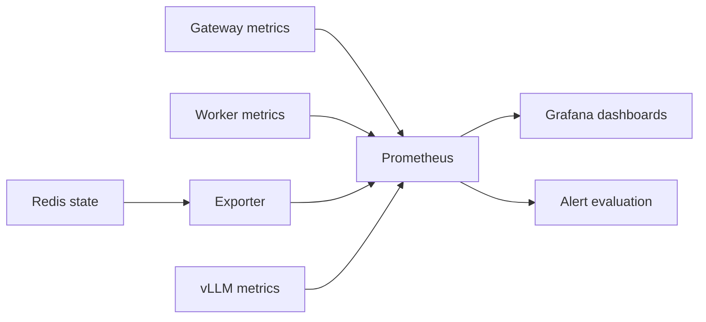

# Lesson 05: find the wait before changing the system

## 1. What you'll understand

- Separate queueing, batch collection, compute and response latency.
- Read a histogram and explain why a mean can conceal slow requests.
- Diagnose saturation using dashboards without reading application logs.
- Explain why request IDs belong in logs and never in metric labels.

## 2. The problem

A request is slow. Increasing the model batch size might help, or the worker
might already be processing healthy batches while an upstream server stalls.
Adding workers without locating the wait wastes resources and can conceal a
Redis or gateway issue. We need observations at component boundaries rather
than one stopwatch around the whole system.

A useful analogy is a hospital visit: waiting for admission, waiting in a room,
receiving treatment and receiving discharge paperwork all contribute to elapsed
time. A fast treatment does not prove that patients are being seen promptly.
Our queue, batcher, runner and gateway have similarly distinct responsibilities.

## 3. How it works

A **counter** counts events, a **gauge** reports a changing value, and a
**histogram** groups duration observations into ranges. Prometheus periodically
scrapes their HTTP exposition; Grafana queries Prometheus and draws the panels.
An exporter translates Redis queue and heartbeat state into platform gauges.



**p95** estimates the duration below which 95% of observations fall. The mean
can be low while a small group waits seconds. Our classic histograms approximate
quantiles using buckets; they do not store every request. Add bucket rates across
replicas before calculating a quantile. Never average replica p95 values.

The **RED** view covers rate, errors and duration. The **USE** view covers
utilization, saturation and errors. Overview supplies the first; Batching plus
backlog and head age supply the second. An alert is a sustained condition, not
an explanation. It tells you where to begin looking.

### See it concretely: how a histogram turns into a p95, and how it can mislead

A Prometheus histogram doesn't store latencies. It stores **counters**, one
per bucket boundary, each counting requests *at or below* that boundary. Our
buckets are defined once in
[`LATENCY_BUCKETS`](../../src/infer_platform/common/metrics.py#L1):
5 ms, 10, 25, 50, 100, 250, 500 ms, 1 s, 2.5, 5, 10, 30, 60 s.

We sent 300 requests (20 at a time) to one fake-classifier worker (**simulated**
compute) and recorded two things: the bucket counters before and after, and the
exact `total_ms` from each response. Command and output:
[histogram_vs_exact.py](../../tools/learning/histogram_vs_exact.py),
[histogram-estimate.json](../results/learning/histogram-estimate.json).

```text
le="0.05"  ->   0     (no request faster than 50 ms)
le="0.1"   -> 223     (223 of 300 took ≤ 100 ms)
le="0.25"  -> 300     (all 300 took ≤ 250 ms)
le="+Inf"  -> 300
```

Now estimate p95 the way `histogram_quantile()` does:

```text
rank of p95       = 0.95 × 300 = 285th fastest request
which bucket?     the 285th is past 223, within 300 → bucket (100 ms, 250 ms]
position inside   (285 − 223) / (300 − 223) = 62 / 77 = 0.805 of the way through
assume uniform    100 ms + 0.805 × 150 ms ≈ 221 ms
```

| | Exact (from every response) | Histogram estimate |
|---|---:|---:|
| p50 | **97 ms** | 84 ms |
| p95 | **105 ms** | 221 ms |
| p99 | **118 ms** | 244 ms |

The estimated p95 is **twice the truth.** The 77 slow requests actually took
100–118 ms, but the histogram only knows they fell "somewhere between 100 and
250", and interpolation assumes they were spread evenly. Three lessons:

1. **Percentiles from histograms are estimates whose error depends on the
   bucket width at that latency.** Put boundaries close together near your SLO.
   An SLO of "p95 < 150 ms" can't be judged with a 100→250 gap.
2. **The error is bounded:** the true value is guaranteed to be in the bucket.
   Here, "p95 is between 100 and 250 ms" is exactly true.
3. **Averages hide even more.** The mean here was ~98 ms. A mean never shows a
   tail at all.

### See it concretely: the latency breakdown under load

The same 300 responses, averaged per `meta` field:

| Component | Mean | What it means here |
|---|---:|---|
| `queue_ms` | 1.2 ms | Redis handed work over almost instantly |
| `batch_wait_ms` | 37.5 ms | **4× `max_wait_ms`**: items waited for the busy runner, not for the timer |
| `inference_ms` | 42.1 ms | Batches averaged 10 items: 20 + 2 × 10 ≈ 40 ms, plus jitter |
| `gateway_overhead_ms` | 16.2 ms | Coordination under 20-way concurrency (vs 7.6 ms for the lone request in the [walkthrough](WALKTHROUGH.md)) |

That table *is* a diagnosis. Low queue time but high batch wait means one worker
is saturated, and its prefetch buffer is where the waiting happens. The fix is more
worker replicas (lesson 06), not a smaller `max_wait_ms`. That's what the
**Batching** dashboard is for: [dashboards.md](../dashboards.md) maps each panel to
its query.

### Which metric answers which question

| Question | Metric (Prometheus name) | Emitted by |
|---|---|---|
| How many requests, how many errors? | `gateway_requests_total{model,endpoint,status}` | gateway |
| How slow for users? | `gateway_request_duration_seconds` histogram | gateway |
| Are we shedding load? | `gateway_rejected_total{reason}` | gateway |
| Is work piling up? | `queue_backlog`, `queue_head_age_seconds` | exporter (reads Redis) |
| Is work stuck with a dead worker? | `queue_pending` | exporter |
| Are workers alive and busy? | `workers_alive`, `worker_busy_ratio` | exporter / worker |
| Is batching working? | `worker_batch_size`, `worker_batch_wait_seconds` | worker |
| How fast is the model itself? | `worker_inference_seconds` | worker |
| Are poison inputs piling up? | `worker_dlq_total` | worker |
| How fast do LLM streams start and flow? | `gateway_ttft_seconds`, `worker_ttft_seconds`, `worker_tpot_seconds` | gateway / worker |
| What is the autoscaler doing? | `autoscaler_desired_replicas`, `autoscaler_current_replicas` | autoscaler |

## 4. How it works in this codebase

Read these files in order:

1. [common/metrics.py](../../src/infer_platform/common/metrics.py): shared seconds
   buckets and autoscaler metric definitions.
2. [gateway/metrics.py](../../src/infer_platform/gateway/metrics.py), `ObserveHTTP`:
   observes the full response lifetime, including SSE, without buffering the stream.
3. [worker/metrics.py](../../src/infer_platform/worker/metrics.py), `WorkerMetrics`:
   distinguishes actual invocations from per-item published outcomes.
4. [queue_stats.py](../../src/infer_platform/common/queue_stats.py), `snapshot`:
   finds the oldest undelivered entry after the group delivery cursor.
5. [exporter/main.py](../../src/infer_platform/exporter/main.py), `Exporter.poll`:
   publishes backlog, pending, head age, alive workers and DLQ evidence.
6. [monitoring configuration](../../deploy/monitoring/prometheus.yml) and
   [panel guide](../dashboards.md): connect scraped series to visible questions.

Logs carry request_id and trace_id across gateway and worker; structured context
adds component/model/worker identity. User text and API keys are not metric labels
or normal log fields. Unknown model names share one bounded metric label.

## 5. Try it

From the root, start the monitored simulated stack and validate its configuration:

```bash
export UV_CACHE_DIR=/tmp/infer-uv-cache
export INFER_API_KEYS='["phase1-verification-key"]'
docker compose -f deploy/docker/docker-compose.yml --profile fake-llm up --build -d --wait
docker compose -f deploy/docker/docker-compose.yml exec -T prometheus promtool check config /etc/prometheus/prometheus.yml
curl --fail --silent http://localhost:3000/api/search
```

Open http://localhost:3000 and select Overview, Batching or LLM. Four dashboards
are provisioned automatically; Autoscaler gains data in Phase 6. The API search
lists their stable UIDs. A panel with no observations may be empty rather than
zero. Confirm target health in Prometheus before interpreting it.

## 6. Break it

Run the E7 experiment. It owns a temporary worker configuration and restores the
normal worker afterward; use an otherwise idle local Compose stack.

```bash
uv run --extra ml python -m tools.monitoring_experiment
uv run --extra ml pytest tests/integration/test_observability.py -v
```

E7 compares a healthy batch policy with batch-size-one under the same arrival
rate. First inspect Overview: errors, p95, backlog and head age reveal waiting.
Then inspect Batching: a mean batch near one and a busy worker explain insufficient
service capacity. Similar single-invocation duration points away from a suddenly
slower model. The saved evidence contains the exact dashboard expressions and
returned series; no application logs are needed for the diagnosis.

The second command deliberately separates one pending entry from one undelivered
entry. Predict which contributes to backlog before running it. It also sends an
untrusted model name and checks that metric labels do not retain that value.
These two drills exercise different failure modes: capacity and misleading state.

## 7. Trade-offs and alternatives

Metrics discard individual detail to make aggregation cheap. Logs preserve
identity but require a separate query strategy for populations. We use both,
without adding a logging infrastructure dependency. Histogram buckets cost more
series than a single mean, and quantiles have interpolation error. Native
histograms are an alternative for a future deployment compatibility review.

Our localhost Grafana allows anonymous read-only viewing for learning. It is not
a production authentication configuration. Alerts for configured models without
started workers are expected in partial development profiles. The latency alert
was introduced without an invented threshold; Phase 8 now supplies a measured
local proposal, described in [SLO.md](../SLO.md).

## 8. Check your understanding

1. Why is XLEN not undelivered backlog?
<details><summary>Answer</summary>Retained entries include deliveries still pending ACK; subtract pending and inspect delivery position for head age.</details>

2. Can you average two worker p95 values?
<details><summary>Answer</summary>No. Aggregate histogram bucket rates, then estimate the combined quantile.</details>

3. What happens if request_id becomes a label?
<details><summary>Answer</summary>Every request creates new series, causing unbounded cardinality and storage costs.</details>

4. Why can fast 503s make latency look better?
<details><summary>Answer</summary>They return quickly but do no inference. Inspect status rates and successful completions alongside duration.</details>

5. Does a frozen zero-backlog gauge prove Redis is healthy?
<details><summary>Answer</summary>No. Check scrape health and exporter freshness; its last successful poll may be stale.</details>

## 9. Teach-back

- Explain which panel distinguishes queueing from slower compute.
- Explain why shared batch compute time is not divided by batch size in item meta.
- Describe an SLI, an SLO and an error budget using one accepted-request example.

## 10. Further reading

Read [latency concepts](../concepts/latency-and-observability.md),
[ADR-0008](../adr/0008-metrics.md), [E7](../EXPERIMENTS.md) and
[Prometheus histogram guidance](https://prometheus.io/docs/practices/histograms/).
