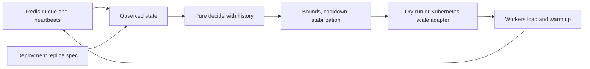
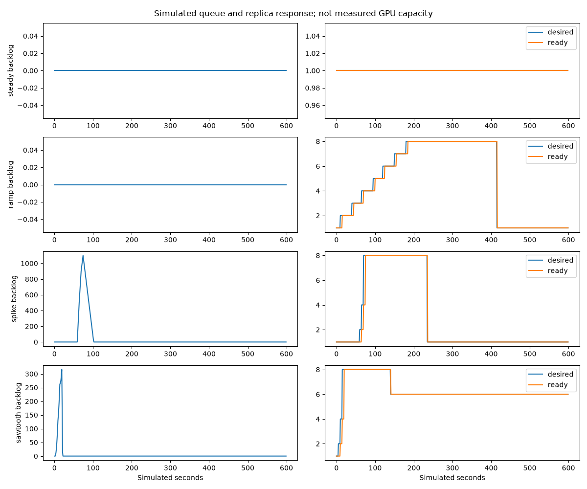

# Lesson 06: teach the controller to wait before it shrinks

## 1. What you'll understand

- Read backlog, head age and busy fraction as different serving signals.
- Explain the pure decision function without Redis or Kubernetes knowledge.
- Predict the effects of cooldown, stabilization and model warmup.
- Distinguish simulated policy evidence from actual replica changes.

## 2. The problem

Fixed capacity must either reserve enough workers for peak traffic or let bursts
wait. Adding a worker after every slow request can create a second problem:
workers start slowly, traffic changes before they become ready, and the controller
removes capacity just before another burst. Repeated expansion and contraction
is called flapping. It wastes startup work and makes latency harder to predict.

A thermostat that ignores the time needed to heat a room will overshoot. Our
controller similarly needs feedback plus memory, rather than reacting to one
instantaneous sample. We build that memory explicitly so you can inspect it.

## 3. How it works

The policy converts backlog, busy fraction and waiting age into separate replica
recommendations, then chooses the largest. A maximum bound prevents unbounded
resource requests; a minimum keeps one worker alive. Growth is limited per cycle.
A **cooldown** delays repeated changes; a **stabilization window** remembers high
recent demand before allowing contraction.



### See it concretely: twelve decisions through the real `decide()`

[tools/learning/autoscale_walkthrough.py](../../tools/learning/autoscale_walkthrough.py)
feeds a scripted spike into the **real** `decide()` function with the
`fake-classifier` policy (`min 1, max 10, target_backlog_per_replica 20,
target_busy_ratio 0.7`, defaults otherwise: 5 s up-cooldown, 30 s down-cooldown,
120 s stabilization, at most +4 or ×2 per step). To isolate the decision logic,
it assumes new replicas are ready instantly. Real pods take seconds to minutes to warm up.

The three signals, recomputed every cycle:

```text
by_backlog = ceil(backlog / 20)                  # "enough workers to hold 20 waiting each"
by_util    = ceil(current × busy_ratio / 0.7)    # "enough workers so each is ~70% busy"
by_latency = current + 1 if head_age > 0.5 s     # "the oldest request waited too long: add one"
raw        = clamp(max(all three), min, max)
```

Output (also saved as [autoscale-walkthrough.md](../results/learning/autoscale-walkthrough.md)):

| t (s) | backlog | busy | head age | current | by_backlog | by_util | by_latency | desired | reason |
|---|---|---|---|---|---|---|---|---|---|
| 0 | 0 | 0.30 | 0.0 | 1 | 0 | 1 | 0 | **1** | demand |
| 5 | 150 | 1.00 | 0.8 | 1 | 8 | 2 | 2 | **2** | demand |
| 10 | 140 | 1.00 | 0.9 | 2 | 7 | 3 | 3 | **4** | demand |
| 15 | 60 | 0.95 | 0.6 | 4 | 3 | 6 | 5 | **6** | demand |
| 20 | 10 | 0.80 | 0.1 | 6 | 1 | 7 | 0 | **7** | demand |
| 25 | 0 | 0.40 | 0.0 | 7 | 0 | 5 | 0 | **7** | stabilization |
| 60 | 0 | 0.10 | 0.0 | 7 | 0 | 2 | 0 | **7** | stabilization |
| 120 | 0 | 0.10 | 0.0 | 7 | 0 | 2 | 0 | **7** | stabilization |
| 145 | 0 | 0.10 | 0.0 | 7 | 0 | 2 | 0 | **2** | stabilization |
| 150 | 0 | 0.10 | 0.0 | 2 | 0 | 1 | 0 | **2** | stabilization |
| 185 | 0 | 0.10 | 0.0 | 2 | 0 | 1 | 0 | **2** | stabilization |
| 270 | 0 | 0.10 | 0.0 | 2 | 0 | 1 | 0 | **1** | stabilization |

How to read it, row by row:

- **t=5:** the backlog says 8 replicas, but the result is **2**. The step limit allows at most
  doubling per cycle (`max(current + 1, current × 2)`, capped at `current + 4`).
  Scaling up gradually lets each new replica prove useful before more are added.
- **t=10 → 20:** 2 → 4 → 6 → 7. Notice which signal drives each step: backlog
  at t=10, then **utilization** once the backlog has drained (t=15, 20). Backlog is
  small at t=20, but the 6 workers are 80% busy, so they're needed.
- **t=25 → 120:** demand fell (raw 5, then 2), but desired stays **7**. The
  stabilization window takes the **maximum raw recommendation of the last 120 s**,
  which is still the 7 from t=20. This is the anti-flapping memory.
- **t=145:** the t=20 recommendation is now 125 s old and has left the window.
  The maximum of what remains is 2, so the controller drops **7 → 2 in one step**.
  Scale-down is slow to *start* but not gradual once it starts.
- **t=270:** the last "2" has aged out, so the controller returns to **1**.

**What surprised us:** at t=60, `by_util` is 2, although 7 workers at 10% busy is
0.7 worker's worth of work. `7 × 0.1 / 0.7` is `1.0000000000000002` in floating
point, and `ceil` rounds it up to 2. The production code has this edge case: an
exact ratio can round one replica too high, which delayed the final step down here
(t=145 to t=270). The effect is one replica for one stabilization window, but it's
a real bug. It is recorded in [PROGRESS](../PROGRESS.md) under known issues.

### The same rules over ten minutes of simulated traffic

[tools/autoscale_sim.py](../../tools/autoscale_sim.py) adds what the table left
out: arrivals over time, a queue, and **warmup delay** before a new replica is ready.
All capacity here is **simulated**. Each ready replica serves 20 requests/s, a new
replica takes 5 s to warm up, the controller runs every 5 s, and the policy is
`min 1, max 8, target_backlog_per_replica 10` (the `sentiment` values, not the table's).



- **Spike (third row):** traffic jumps to 120 requests/s at t=60 s. Backlog peaks at 1,100
  at t=74 s, when 8 replicas are desired but only 4 are ready. Desired replicas
  climb 1 → 2 → 4 → 8 by doubling, at t=60, 65 and 70. The orange *ready* line trails the blue
  *desired* line by the warmup delay. That lag is why the backlog peak exists
  at all. Once drained, replicas stay at 8 for the 120 s stabilization
  window plus cooldowns, then drop to 1 at t=235 s.
- **Sawtooth (bottom row):** traffic oscillates, but replicas don't. The window
  remembers the peaks, so the controller holds capacity through the troughs (8,
  then 6) instead of flapping. That's the behavior E9 contrasts with "no stabilization".

History contains raw demand recommendations, not already stabilized outputs.
Otherwise a high value would continually renew itself and never expire. Old high
demand can delay a downscale, but must not independently cause a new scale-up.

A Redis ownership token prevents ordinary simultaneous controllers from acting.
Its lease refreshes independently and is checked before writes. This is useful
coordination, not a mathematical guarantee against a paused process completing
an already-issued API operation after its lease expires.

## 4. How it works in this codebase

Read these files in order:

1. [policy.py](../../src/infer_platform/autoscaler/policy.py), `decide`: pure state,
   policy and history values; no network or wall-clock lookup.
2. [test_autoscaler.py](../../tests/unit/test_autoscaler.py): table-driven examples,
   cooldown, history decay and a fake Kubernetes API.
3. [autoscale_sim.py](../../tools/autoscale_sim.py), `simulate`: synthetic arrivals,
   delayed ready capacity, queue service and replica-second accounting.
4. [loop.py](../../src/infer_platform/autoscaler/loop.py), `Controller`: real Redis
   snapshots, leadership renewal, decisions and metrics.
5. [scalers](../../src/infer_platform/autoscaler/scalers): dry-run logs and official
   Kubernetes scale-subresource calls in threads with timeouts.

The Kubernetes deployment map explicitly identifies managed workloads. Unmapped
models are excluded from actual Kubernetes actuation. Dry-run reports observed
workers as current and never pretends its proposals changed Compose.

## 5. Try it

Run the policy checks and generate all four traces plus E8–E10 summaries:

```bash
export UV_CACHE_DIR=/tmp/infer-uv-cache
uv run --extra ml pytest tests/unit/test_autoscaler.py tests/sim tests/integration/test_autoscaler_lock.py -q
uv run python -m tools.autoscale_sim --output docs/results/autoscale-sim.json
```

The JSON includes assumptions, time series, prediction and measured simulation
summaries; its PNG plots backlog and desired versus ready replicas. All inference
capacity there is simulated, not benchmarked. The steady trace should keep one
replica, while the spike creates a temporary queue and delayed added capacity.

For the real Redis dry-run, start the monitored stack and send a short burst:

```bash
export INFER_API_KEYS='["phase1-verification-key"]'
docker compose -f deploy/docker/docker-compose.yml --profile fake-llm up --build -d --wait
uv run python -m tools.autoscale_dryrun_probe
```

The Autoscaler dashboard now shows current, desired and decisions alongside
backlog. A recommendation above current is expected; Compose remains unchanged.
The saved probe identifies actual_scaling=false explicitly.

## 6. Break it

The first command above contains three controlled breaks. The sawtooth test
removes stabilization and cooldowns to expose repeated direction reversals;
compare E9's retained-capacity cost before calling the stable policy free.
The lock test installs another owner's token and verifies that the old controller
cannot renew or act. The fake Kubernetes test checks the scale subresource and
network timeout arguments without requiring cluster credentials.

For a third prediction exercise, inspect E10's backlog-target sweep before reading
its results. Will every target change the outcome? Other signals and step limits
can dominate it. This is why changing one knob need not improve a dashboard.

## 7. Trade-offs and alternatives

A slow downscale reserves capacity while traffic is quiet. Fast scale-up can still
arrive too late for a short deadline because weights and warmup take time.
Busy fraction can also mislead while some desired replicas are not ready.
These are reasons to keep admission and deadlines, not remove them after adding
a controller.

HPA provides established Kubernetes scaling behavior when custom metrics are
available. KEDA provides existing Redis Streams integration. We implement a
custom loop for learning and signal transparency, not because it is automatically
better in production. The [comparison](../concepts/autoscaling.md) cites the current
KEDA docs and explains pending entries versus lag versus retained length.

## 8. Check your understanding

1. Why not use only CPU utilization?
<details><summary>Answer</summary>GPU activity, batching and warmup can decouple CPU use from serving saturation.</details>

2. What happens if stabilized output is saved as new raw history?
<details><summary>Answer</summary>A high recommendation can refresh itself forever, preventing downscale.</details>

3. Does desired=4 mean four workers can accept work now?
<details><summary>Answer</summary>No. Startup, scheduling and warmup delay accepting heartbeats.</details>

4. Why do E10 targets sometimes give the same curve?
<details><summary>Answer</summary>The maximum of other signals or step limits may dominate the backlog recommendation.</details>

5. Does dry-run demonstrate Kubernetes scaling?
<details><summary>Answer</summary>No. It demonstrates decisions against real Redis; Phase 7 separately verifies actual Deployment changes.</details>

## 9. Teach-back

- Explain why slow contraction and fast expansion have different costs.
- Walk from a Redis snapshot through decide to a bounded scale operation.
- Explain which simulation assumptions prevent treating its results as GPU capacity.

## 10. Further reading

Read [autoscaling concepts](../concepts/autoscaling.md), [ADR-0009](../adr/0009-autoscaling.md),
[HPA documentation](https://kubernetes.io/docs/concepts/workloads/autoscaling/horizontal-pod-autoscale/)
and [KEDA 2.21 Redis Streams](https://keda.sh/docs/2.21/scalers/redis-streams/).
