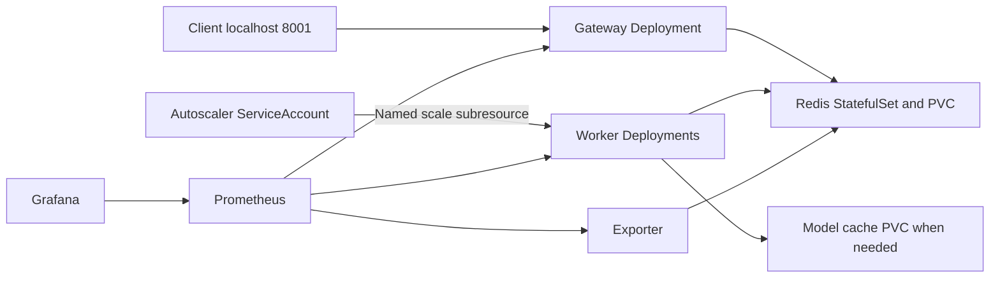
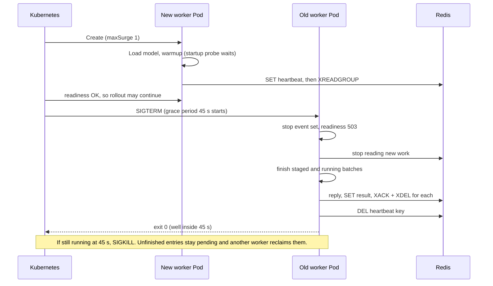

# Lesson 07: a ready process is not yet a reliable deployment

## 1. What you'll understand

- Distinguish image, container, Pod, Deployment and StatefulSet.
- Explain startup/readiness/liveness and graceful model-worker draining.
- Follow a real rolling update and pending-request recovery on kind.
- Describe resource limits, model caches, narrow RBAC and GPU prerequisites.

## 2. The problem

Docker can start one worker, but a reliable deployment needs replacements, health
checks, storage and a way to change capacity. A model may spend seconds loading
before it can accept requests. Stopping it while it owns Redis deliveries can
interrupt work even though another Pod starts successfully. Packaging alone does
not establish that requests survived the transition.

Kubernetes is a reconciler: it repeatedly moves observed objects toward their
desired state. It does not know our request delivery protocol. We must make
readiness, drain and Redis recovery agree with that reconciliation.

## 3. How it works

An **image** packages dependencies and code. A **container** runs it. A **Pod** is
the unit Kubernetes schedules. A **Deployment** maintains interchangeable Pods;
a **StatefulSet** associates a stable identity with storage for Redis here.
A **PersistentVolumeClaim** asks for storage that outlives an individual Pod.



A startup probe allows initialization time. Readiness says whether to use a Pod;
liveness says whether to restart its process. Worker readiness follows model
warmup and becomes false on shutdown. SIGTERM stops pulling and drains accepted
work; SIGKILL skips cleanup. The latter needs Redis reclaim within the deadline.

During a rolling update, maxUnavailable=0 retains available old capacity and
maxSurge=1 permits a replacement. A PodDisruptionBudget limits voluntary eviction,
not force deletion or process death. Spare scheduling capacity is still required.

### See it concretely: the three probes, with our real numbers

From [base/workloads.yaml](../../deploy/k8s/base/workloads.yaml) (worker-fake shown;
the gateway uses the same pattern on port 8000):

| Probe | Endpoint | Timing | Fails when | Kubernetes then… |
|---|---|---|---|---|
| startup | `GET :9001/readyz` | every 2 s, up to 90 failures (**180 s budget**) | model still loading or warming | waits; other probes are paused |
| readiness | `GET :9001/readyz` | every 2 s, 2 s timeout | not warmed **or** draining after SIGTERM | removes the Pod from Service endpoints |
| liveness | `GET :9001/healthz` | every 10 s, 2 s timeout | the process stops answering HTTP | **restarts** the container |

The logic is three lines in
[`probes.py`](../../src/infer_platform/worker/probes.py#L19):

```python
elif path in {"/healthz", "/readyz"}:
    status = 503 if path == "/readyz" and (not ready.is_set() or stop.is_set()) else 200
```

Liveness deliberately ignores Redis and the model. If Redis goes down, restarting
every worker wouldn't fix Redis. It would only add a cold start (model load + warmup)
on top of the outage. **Liveness should fail only when a restart would help.**

Workers don't receive traffic from a Service (they *pull* from Redis), so worker
readiness mainly drives rollouts and PDB accounting, not load balancing.

### See it concretely: a worker Pod being replaced



**Why 45 s for worker-fake and 80 s for worker-chat?** The grace period must cover
the worst case: the last batch, or the longest in-flight generation, plus reply
time. A fake batch is tens of milliseconds, so 45 s is generous. A chat stream can
run up to `request_timeout_ms` (60 s), so worker-chat gets 80 s. If grace were
shorter than a long generation, every rollout would cut streams mid-sentence.

### See it concretely: the live kind cluster

A read-only snapshot of the dedicated `kind-infer-platform` cluster on the GB10 host,
taken 2026-11-13 (Kubernetes v1.34.0):

```text
NAME                               READY   UP-TO-DATE   AVAILABLE
deployment.apps/autoscaler         1/1     1            1
deployment.apps/exporter           1/1     1            1
deployment.apps/fake-openai        1/1     1            1
deployment.apps/gateway            2/2     2            2
deployment.apps/grafana            1/1     1            1
deployment.apps/prometheus         1/1     1            1
deployment.apps/worker-chat        1/1     1            1
deployment.apps/worker-fake        1/1     1            1
deployment.apps/worker-sentiment   1/1     1            1
statefulset.apps/redis             1/1

NAME                                     MIN AVAILABLE   ALLOWED DISRUPTIONS
poddisruptionbudget.policy/gateway       1               1
poddisruptionbudget.policy/worker-fake   1               0
```

Read the last line carefully. `worker-fake` has **1 replica and `minAvailable: 1`**,
so **zero** voluntary disruptions are allowed. A `kubectl drain` of that node would
wait indefinitely for the PDB. It doesn't fail, it waits, until the autoscaler
(or you) adds a second replica. A PDB protects capacity, and with a single replica
"protect capacity" means "never move it". The gateway, with 2 replicas, can lose
one at a time.

Resources use the same spirit. Every worker requests `cpu: 100m` (what the scheduler
reserves) and is limited to `cpu: '2'` (the most it may use). `INFER_TORCH_THREADS`
is set explicitly so PyTorch doesn't size its thread pool from the *node's* core count
and fight neighboring Pods. That's the threads ≈ cores ÷ replicas rule from lesson 02.

## 4. How it works in this codebase

Read these files in order:

1. [Dockerfile](../../deploy/docker/Dockerfile): locked multi-stage build, non-root
   runtime, role targets and mutually exclusive CPU/CUDA ML extras.
2. [worker/probes.py](../../src/infer_platform/worker/probes.py), `start_server`:
   process health, model/drain readiness and metrics on one internal listener.
3. [base workloads](../../deploy/k8s/base/workloads.yaml): resources, probes,
   rollout policy and termination grace.
4. [RBAC](../../deploy/k8s/base/rbac.yaml): only the autoscaler can get/patch the
   named worker scale subresource.
5. [kind-up.sh](../../scripts/kind-up.sh): dedicated cluster, image load, env-created
   Secret, Kustomize apply and readiness waits.
6. [kind_experiments.py](../../tools/kind_experiments.py): actual HTTP load, rollout,
   process/pod loss and replica histories. It targets only this dedicated cluster.

The base serves simulated classifier/chat workloads. The CPU component adds real
sentiment with a weight PVC; the GPU overlay routes chat to a GPU vLLM Deployment.
The latter was subsequently verified on real GB10 kind during wrap-up;
[the GPU guide](../GPU_VERIFICATION.md) records prerequisites and scope.

## 5. Try it

The verified tools were kind 0.30.0, kubectl/Kubernetes 1.34.0 on Linux arm64.
Install compatible tools first and put them on PATH. The agent used /tmp/infer-tools
and an isolated kubeconfig, without editing the owner's default cluster settings.

```bash
export PATH="/tmp/infer-tools:$PATH"
export KUBECONFIG=/tmp/infer-kind-kubeconfig
export INFER_API_KEYS='["phase1-verification-key"]'
./scripts/kind-up.sh
kubectl --context kind-infer-platform -n infer-platform get pods
```

Expect ready gateways, workers, Redis, exporter, controller and monitoring. Initial
application restarts while dependencies initialize were observed; stable readiness
was established before experiments. The NodePort is mapped only to localhost:8001.
API keys are supplied through a generated Secret, not a committed secret file.

## 6. Break it

Run all three real-cluster experiments against an otherwise idle dedicated stack:

```bash
uv run python -m tools.kind_experiments
uv run --extra ml pytest tests/unit/test_deployment_config.py tests/unit/test_worker_probes.py -v
```

E11 pauses the autoscaler and rolls two workers under load. E12 temporarily uses
known slow simulated compute, selects a pending entry, kills its process from the
kind node namespace, deletes the Pod and checks that exact request ID succeeds
on a different worker. E13 restores normal compute and the controller, then records
actual desired/ready counts during growth and delayed contraction.

The first deletion-only attempt completed on the old worker, so it was not reclaim
evidence. A signal sent from inside the worker's PID namespace also failed to stop
its init process. Both initial records are preserved. The final helper targets the
selected container's node PID, not unrelated host processes. Predict the PEL and
heartbeat behavior before reading the final evidence.

## 7. Trade-offs and alternatives

One Redis StatefulSet with AOF is convenient development persistence, not HA or
a zero-loss guarantee. Production needs a managed/operated Redis topology,
backups, authentication/TLS and recovery verification. Monitoring history is also
ephemeral in this local cluster.

CPU requests guide placement; limits constrain usage and can throttle compute.
Threads per replica must fit the available cores. Weight caches improve startup
but require storage and non-root write permissions. The CUDA image and GPU runner
were verified in Docker. Subsequent real GPU kind testing also verified the
NVIDIA device plugin, matching node labels and actual GPU allocation. These
remain distinct checks, not a guarantee about another cluster.

The CI workflow checks code and builds/publishes role images on authorized main
pushes. The wrap-up ran hosted CI and published six role images successfully.
It also caught real overlay issues: missing namespace and a Kubernetes-injected
VLLM_PORT variable. Rendered namespace/service-link checks now run in CI.
The single-GPU engine uses Recreate, so engine updates have downtime.

## 8. Check your understanding

1. Why can /healthz return 200 before /readyz?
<details><summary>Answer</summary>The process is alive while loading/warming or draining; readiness follows whether it can accept model work.</details>

2. What happens if termination grace is shorter than compute?
<details><summary>Answer</summary>Kubernetes can kill the process before result publication, leaving pending deliveries for reclaim or expiry.</details>

3. Does a PDB prevent forced Pod deletion?
<details><summary>Answer</summary>No. It governs voluntary eviction, not force deletion or SIGKILL.</details>

4. Why can a force-delete command fail to prove mid-batch death?
<details><summary>Answer</summary>The API can remove the Pod object before its process actually stops; selected work may finish meanwhile.</details>

5. Does a successful CUDA Docker prediction prove the GPU overlay works?
<details><summary>Answer</summary>No. Cluster drivers, device plugin, resource advertisement and scheduling need separate verification.</details>

## 9. Teach-back

- Explain startup, readiness and liveness using one loading worker.
- Trace the selected pending ID through E12's actual process loss and reclaim.
- Explain what local Redis persistence preserves and which failure guarantees it lacks.

## 10. Further reading

Read [deployment concepts](../concepts/deploying-ml-workloads.md),
[ADR-0010](../adr/0010-deployment.md), [kind quick start](https://kind.sigs.k8s.io/docs/user/quick-start/)
and [Kubernetes documentation](https://kubernetes.io/docs/).
