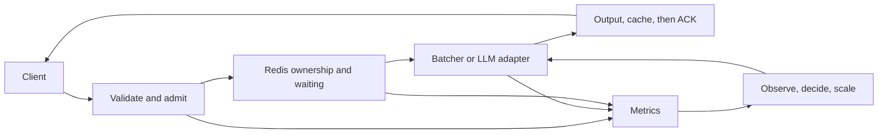

# Lesson 08: review the whole system with evidence

## 1. What you'll understand

- Explain the complete serving path and the boundary between our platform and vLLM.
- Use measurements to propose capacity, admission and latency targets.
- Run operational drills and distinguish successful recovery from a misleading signal.
- State exactly what is verified, simulated, conditional or still pending.

## 2. The problem

A collection of individually working components is not yet an understood system.
A fast model can sit behind a slow queue. A healthy Pod can still be warming.
A successful HTTP status can contain an SSE error. A replica recommendation can
exist without usable capacity. The final task is to connect these observations
into one explanation and test that explanation against failures.

Treat the platform as a workshop, not a trophy. The goal is to predict what a
change will do, measure it and revise your model when the prediction is wrong.

## 3. How it works

The gateway controls access and waiting. Redis records delivery ownership and
outcomes. Classifier workers batch bounded inputs; LLM adapters bound independent
streams while vLLM schedules generation. Metrics reveal populations, logs preserve
identity, and the controller changes capacity after observing serving pressure.



The **system boundary** matters in every measurement. Client duration includes
transport; API total_ms ends while constructing the final reply. Worker queue,
collection and compute have separate clocks/boundaries. Cached polls retain worker
timings but do not fabricate the original gateway's elapsed time.

## 4. How it works in this codebase

Read these together, following one request ID:

1. [Gateway](../../src/infer_platform/gateway/app.py), `infer`: admission, wait and cancel.
2. [Worker](../../src/infer_platform/worker/main.py), `accept`, `finish`, `publish`:
   eligible work, cached outcome, response-before-ACK ordering.
3. [Batcher](../../src/infer_platform/worker/batcher.py), `execute`: per-item identity,
   actual shared invocation and poison isolation.
4. [LLM adapter](../../src/infer_platform/worker/llm_adapter.py), `generate`:
   independent cancellation and bounded chunk coalescing.
5. [Controller](../../src/infer_platform/autoscaler/loop.py), `cycle`, and
   [pure policy](../../src/infer_platform/autoscaler/policy.py), `decide`.
6. [Verification audit](../VERIFICATION.md): evidence and limits for each promised outcome.

The [architecture](../ARCHITECTURE.md) is the current view; historical phase
records explain how measurements changed decisions.

### Capstone drill: rebuild the whole flow from memory

Before you reread anything, draw the request's path on paper with all ten stations
from the [walkthrough](WALKTHROUGH.md). Then check yourself against this table,
which joins each station to the lesson that explains it and the number that
characterizes it in our measurements:

| # | Station | Code | Lesson | A measured number to remember |
|---|---|---|---|---|
| 1 | Authenticate | `Authenticator.authenticate` | 01 | 0 Redis calls on a bad key |
| 2 | Rate limit | `TOKEN_BUCKET` Lua | 03 | burst 200, refill 100/s per key |
| 3 | Register waiter | `ResponseRouter.register` | 01 | must happen **before** step 4 |
| 4 | Admit + enqueue | `ENQUEUE` Lua | 03 | E5: 112 of 120 shed in ms instead of ~102 timing out |
| 5 | Pull | `Worker.consume`/`accept` | 01 | `queue_ms` ≈ 1 ms when a worker is idle |
| 6 | Batch | `DynamicBatcher.run` | 02 | E2: 38.8 → 238 items/s, batch 1 → 16 (real CPU) |
| 7 | Last checks | `Worker.prepare` | 03 | expired or cancelled work is never computed |
| 8 | Compute | `predict` in executor | 02 | DistilBERT 25.8 ms alone, 4.2 ms/item at 16 |
| 8b | Reply, cache, ACK | `publish`, `ack_delete` | 03 | E4: recovery ≈ `reclaim_idle_ms` + one batch |
| 9 | Inbox reader | `ResponseRouter.read` | 01 | one reader per gateway, not per request |
| 10 | Respond | `timed_reply`, `render` | 05 | overhead 7.6 ms alone, 16 ms at 20-way concurrency |
| LLM | Seat-limited stream | `LLMWorker.serve` | 04 | E6a: 139 → 1,751 tokens/s, concurrency 1 → 16 (real GB10) |
| Scale | Control loop | `decide` | 06 | scale up ×2 per cycle; scale down after 120 s of lower demand |

If you can explain *why* each number came out the way it did, you understand
the system.

## 5. Try it

With the dedicated kind/CPU setup from [benchmarks](../BENCHMARKS.md):

```bash
export UV_CACHE_DIR=/tmp/infer-uv-cache
export PATH="/tmp/infer-tools:$PATH"
export KUBECONFIG=/tmp/infer-kind-kubeconfig
uv run --extra ml pytest
uv run --extra ml python -m tools.bench.e2e --verify-final
uv run --extra ml python -m tools.runbook_drills
```

Expect 62 CPU tests with the GPU marker excluded, 900 successful final-image
benchmark requests, and six completed isolated runbook drills. The drills own
their own Redis and synthetic inputs. Real-GPU checks are opt-in and separately
recorded; passing fake output never substitutes for them.

## 6. Break it

Before running the runbook, predict three outcomes. With no worker, should a
request wait or get rejected? With depth two and twenty simultaneous submissions,
which results should be fast and which do compute? During Redis outage, should
liveness fail? Compare those predictions with the artifact before reading answers.

Then inspect E12's first and final records. The first deleted Pod still completed
the selected request. The final killed process forced another worker to reclaim
it. Explain why the first result proved availability but not mid-batch recovery.

Finally read the Little's Law prediction before its measured table. Explain why
the predicted mean occupancy was low even though the formula held approximately.
The formula was not wrong; the assumed mean duration was too optimistic.

## 7. Trade-offs and alternatives: a design review

| Reviewer asks | Defensible answer |
|---|---|
| Why Redis instead of direct routing? | Pull distribution, durable ownership and visible waiting, at the cost of extra I/O and infrastructure availability |
| Why a custom controller? | Transparent learning policy and simulations; HPA/KEDA often reduce production maintenance |
| Why not put LLMs in DynamicBatcher? | Generation requires engine-level iteration scheduling and KV management; vLLM owns that |
| Why not declare production-ready? | Hosted CI, local GPU kind and a bounded soak now pass; production HA, month-long SLOs and representative production traffic still need deployment acceptance |

The [SLO proposal](../SLO.md) is deliberately scoped. Short zero-error runs do not
establish a month-long reliability target. A larger queue may accept more work
while violating the waiting budget. A stable scaler reserves extra capacity.

## 8. Check your understanding

1. Why register a waiter before XADD?
<details><summary>Answer</summary>A fast worker could otherwise reply before a local recipient exists.</details>

2. What happens if a worker crashes after publishing but before ACK?
<details><summary>Answer</summary>The pending entry can be reclaimed. A cached final avoids recompute when available; duplicate replies/compute remain possible around crash windows.</details>

3. Why does the batch timer keep collecting while compute is busy?
<details><summary>Answer</summary>An elapsed deadline cannot free the runner. Keeping seats open makes the next eligible batch ready without wasting available capacity.</details>

4. Distinguish prefill, decode and KV cache.
<details><summary>Answer</summary>Prefill reads the prompt; decode repeatedly generates tokens; cached attention keys/values avoid recomputing prior context.</details>

5. Why are gateway and worker TTFT different?
<details><summary>Answer</summary>The gateway/client boundary includes queueing, transport and coalescing; worker TTFT starts after dequeue.</details>

6. What would happen if request IDs became metric labels?
<details><summary>Answer</summary>Each request creates new time series, causing unbounded cardinality. Keep identity in logs.</details>

7. Can p95 replace mean W in Little's Law?
<details><summary>Answer</summary>No. The relationship uses averages within one stable population and boundary.</details>

8. Why can desired replicas rise before ready workers?
<details><summary>Answer</summary>Scheduling, image pull, loading and warmup take time. A scale API response does not finish those steps.</details>

9. Why is readiness different from liveness?
<details><summary>Answer</summary>A loading/draining process can be alive while unable to accept work; a Redis outage should not directly define process liveness.</details>

10. Does zero Locust failures prove a production SLO?
<details><summary>Answer</summary>No. Short closed-loop runs, simulated compute and one local failure domain leave workload, duration and deployment gaps.</details>

## 9. Teach-back

- Trace one request through validation, Redis ownership, batching/generation,
  response publication, cache and ACK, naming each relevant clock.
- Diagnose E7 using only its saved dashboard queries, then propose one measured change.
- Explain every pending item in the audit and what evidence would close it.

## 10. Further reading

Use [the study plan](README.md), [benchmarks](../BENCHMARKS.md),
[capacity worksheet](../CAPACITY_PLANNING.md), [runbook](../RUNBOOK.md),
[tuning](../TUNING.md) and all ten ADRs. Suggested extensions after reviewing
Phase 8: Triton comparison, gRPC, model versioning, multi-region delivery,
OpenTelemetry and carefully evaluated scale-to-zero for simulated workloads.
None is silently implemented as part of this phase.
