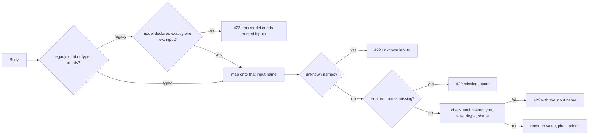
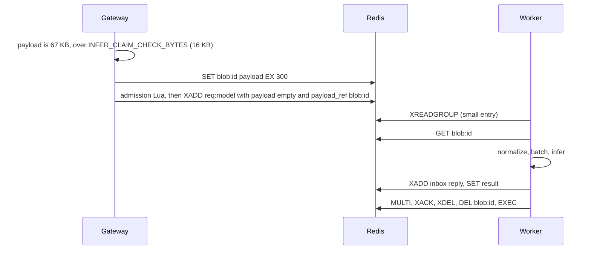

# 09 — Generic serving: any model, same platform

## What you'll understand

- Explain how one gateway, one Redis schema and one worker loop serve text, image,
  embedding and tabular (ONNX) models.
- Write an input declaration for a new model and predict which requests it rejects.
- Explain claim-check: why big payloads should not ride inside queue messages.
- Explain why a batch's cost is *items × longest item* under padding, and how a
  cost budget changes batch formation.
- Say what stays deliberately closed (the model allowlist, the backend registry) and why.

## The problem

Until Phase D the platform could serve exactly one shape of model: a text
classifier taking `{"input": "..."}`. Everything else about the design was already
model-agnostic: pull-based queues, deadlines, at-least-once delivery, batching,
autoscaling. Only three places assumed "one string in":

1. **The request contract** (`InferInput.input: str`).
2. **The worker's runner choice** (an `if backend == ...` chain).
3. **The batch size rule**, which counted items, as if every item cost the same.

A fourth issue was hidden: the whole request travelled *inside* the Redis stream
entry. That's fine for 30 characters of text, and wasteful for a 1 MB photo copied
by every `XREADGROUP`, `XAUTOCLAIM`, `XRANGE` and DLQ write.

## How it works

### 1. Declare inputs; validate once, in two places

Each model in `models.yaml` may declare named, typed inputs:

```yaml
image-classifier:
  backend: hf_pipeline
  hf_id: google/vit-base-patch16-224
  pipeline: {task: image-classification, kwargs: {top_k: 3}}
  inputs:
    image: {type: image, max_bytes: 2000000}
```

The four types and their mandatory limits:

| Type | Wire form | Limit you must declare | Runner receives |
|---|---|---|---|
| `text` | `{"type": "text", "value": "..."}` | `max_chars` | `str` |
| `json` | `{"type": "json", "value": <any JSON>}` | `max_bytes` | the JSON value |
| `tensor` | `{"type": "tensor", "dtype": "float32", "shape": [3], "data": [..]}` | `dtype`, `max_elements` (optional `shape`, `-1` = any) | `{"dtype", "shape", "data"}` |
| `image` | `{"type": "image", "data_b64": "<base64 PNG/JPEG>"}` | `max_bytes` | raw `bytes`, decoded inside the runner thread |

A model that declares nothing gets `{"input": {type: text, max_chars: max_input_chars}}`.
That's the original contract, so **every existing client and config keeps working**.

The same function, [`normalize`](../../src/infer_platform/common/inputs.py), runs in the
gateway (reject with 422 before anything is queued) and in the worker (defence in
depth, and safety during rolling upgrades):



### 2. Claim-check: send a ticket, not the luggage



Like a coat check: the queue carries a small ticket, and the coat waits elsewhere.
The blob is written *before* the entry becomes visible, so a worker can never see a
ticket without a coat. The blob is deleted *in the same transaction* as the ACK,
so a reclaimed entry can still find it. A blob that has vanished (TTL, data loss)
gives a clean `PAYLOAD_MISSING` error instead of a hang.

### 3. The runner registry: a closed menu, not an open door

[`registry.py`](../../src/infer_platform/worker/runners/registry.py) maps backend
names to factories:

```python
@register("onnx")
def _onnx(config: ModelConfig, settings: Settings) -> ModelRunner:
    from infer_platform.worker.runners.onnx import OnnxRunner  # lazy: fake images stay small

    ...
```

| Backend | One class serves… | Key safety rule |
|---|---|---|
| `torch` | the measured DistilBERT sentiment path | safetensors, no remote code |
| `hf_pipeline` | text classification, token classification, embeddings, image classification for thousands of Hub models | task allowlist, safetensors, no remote code |
| `onnx` | anything exported to ONNX: PyTorch, TensorFlow, scikit-learn | file path only from config, resolved under the model cache |
| `fake` | simulated cost | — |

"Generic" here means *configurable within a closed set*, not "load whatever a
request names". A model name in a request only selects an entry already in the
allowlist.

### 4. Cost-aware batching: padding makes the longest item everyone's problem

With dynamic padding, every row of a batch is padded to the longest one:

```text
batch of 4 texts, estimated tokens [12, 9, 15, 500]
tensor computed  = 4 rows × 500 tokens = 2,000 token-slots
useful work      = 12 + 9 + 15 + 500   =   536 token-slots   (73% wasted)
```

`max_batch_cost` adds a second limit next to `max_batch_size`. In `padded` mode a
batch costs `count × max(item cost)`. When the next item would push the batch over
the budget, the batch leaves and that item starts the next one. The first item
always fits, so a single huge input runs alone instead of blocking.

## How it works in this codebase

1. [common/inputs.py](../../src/infer_platform/common/inputs.py): wire types,
   `InputSpec`, `normalize`. Start with `normalize` at the bottom.
2. [common/settings.py](../../src/infer_platform/common/settings.py), `ModelConfig`:
   `inputs`, `pipeline`, `onnx`, `max_batch_cost`, `batch_cost_mode`, `input_specs()`.
3. [gateway/app.py](../../src/infer_platform/gateway/app.py), `infer`: normalize → claim-check → enqueue.
4. [gateway/admission.py](../../src/infer_platform/gateway/admission.py), `WorkerDirectory`:
   a cached heartbeat list, still checked atomically with `EXISTS` in Lua.
5. [worker/main.py](../../src/infer_platform/worker/main.py): `accept` (fetch blob,
   compute cost), `prepare` (normalize), `ack_delete` (DEL blob with ACK).
6. [worker/batcher.py](../../src/infer_platform/worker/batcher.py): `stage` and `batch_cost`.
7. [worker/runners/](../../src/infer_platform/worker/runners/): `registry.py`,
   `hf_pipeline.py`, `onnx.py`.
8. Tests: [test_inputs.py](../../tests/unit/test_inputs.py),
   [test_runners.py](../../tests/unit/test_runners.py) (includes a real ONNX model
   written byte by byte), [test_batcher.py](../../tests/unit/test_batcher.py)
   (cost tests at the bottom),
   [test_generic_serving.py](../../tests/integration/test_generic_serving.py).

## Try it

The demo starts a disposable Redis container, one real worker per model in
[models.examples.yaml](../../config/models.examples.yaml), and the real gateway
app. It sends requests through the gateway's HTTP interface. The first run downloads
about 480 MB of weights into `/tmp/infer-model-cache`. CPU only.

```bash
uv sync --extra ml
uv run --extra ml python -m tools.learning.generic_serving_demo
```

Recorded run, 2026-11-13, GB10 host, CPU (full output:
[generic-serving-demo.json](../results/learning/generic-serving-demo.json)):

| Model (backend) | Request | Result |
|---|---|---|
| `image-classifier` (hf_pipeline, ViT-Base) | `{"inputs": {"image": {"type": "image", "data_b64": <red circle PNG>}}}` | top-3: bow 3.2%, plunger 3.1%, rifle 2.3%. Low confidence is the *right* answer: a drawn circle isn't an ImageNet object |
| `embedder` (hf_pipeline, MiniLM-L6) | three sentences | 384-dimension vectors. cosine("The cat sat on the warm windowsill.", "A kitten was resting by the sunny window.") = **0.657**; vs "Quarterly revenue grew by twelve percent." = **0.005** |
| `sentiment-pipeline` (hf_pipeline, DistilBERT SST-2) | legacy `{"input": "I loved this movie."}` | POSITIVE, 0.9999. The old body still works on a new backend |
| `tabular-onnx` (onnx, `y = x + x`) | tensor `[1.5, -2, 4]` | `[3.0, -4.0, 8.0]` |

The image request took 176.5 ms in total: 146.5 ms ViT inference on one CPU thread,
14.4 ms batch wait, 12.2 ms queue, 3.4 ms gateway overhead. These are the same `meta`
fields as every other model, because nothing in the latency breakdown was model-specific.

### Cost-aware batching, measured

The demo fires 16 embedding requests at once: 8 short ("Short note.", cost 4)
and 8 long (1,800 characters, estimated cost 1800 / 4 + 2 = 452). The embedder has
`max_batch_size: 32`, `max_batch_cost: 4096`, `batch_cost_mode: padded`.

```text
size limit alone  : all 16 fit in one batch (16 ≤ 32), padded cost 16 × 452 = 7,232
with the budget   : 9 × 452 = 4,068 ≤ 4,096, but 10 × 452 = 4,520 > 4,096 → at most 9
measured          : batches of 9 and 7
```

The size-only line is arithmetic, not a measured run. The budget is a ceiling on the
padded tensor, which is what actually drives memory and time. Note the trade-off it exposes: the
short items rode along at the long items' price. Length bucketing (separate queues for
short and long inputs) would avoid that. ADR-0013 explains why we stopped at a budget.

## Break it

1. **Send the wrong shape.** POST `{"inputs": {"x": {"type": "tensor", "dtype": "float32",
   "shape": [1, 3], "data": [1, 2, 3]}}}` to `tabular-onnx`. Predict the status and message
   before you look. Declared `shape: [3]`, so you get 422: `input 'x' must have shape [3]`.
   Now try `"shape": [4], "data": [1, 2, 3, 4]`. You might expect the same shape error,
   but you get `input 'x' exceeds 3 elements`: the size limit is checked before the
   shape. Either way, no Redis entry is created.
2. **Expire a blob.** `test_claim_check_entry_is_small_and_missing_blob_fails_cleanly`
   enqueues an entry whose blob was never written. Read it, then predict the reply type
   (an `error` with `PAYLOAD_MISSING`, ACKed, not left pending).
3. **Set the budget too low.** In a copy of the example catalog, set `max_batch_cost: 100`
   for the embedder and rerun the demo. When we did, every long text ran as a batch of
   **one** (each costs 452 > 100 by itself), even though `max_batch_size` is 32. The short
   texts still batched with each other (batches of up to 5 were seen). The first item
   always fits, so nothing blocks; long inputs simply stop sharing.

## Trade-offs and alternatives

- **JSON tensors are slow and large.** `[0.1, 0.2, ...]` as text is roughly 3–5× the
  binary size and costs parsing time. KServe v2's binary extension or raw bytes plus
  dtype/shape headers would fix that; we kept JSON for readability.
- **Base64 images add about 33%.** Multipart uploads avoid it but add a second
  request format.
- **The blob still lives in Redis.** Claim-check keeps *queue operations* small, but
  Redis memory still holds every in-flight image once. Object storage (S3/MinIO) is the
  production choice. We stayed within AGENTS.md's single-infrastructure rule.
- **`hf_pipeline` trades speed for breadth.** It covers thousands of models with
  configuration only, but adds Python pre/post-processing overhead. The bespoke
  `torch` runner remains for the measured sentiment path.
- **Triton/KServe** do all of this (and GPU ONNX/TensorRT) out of the box. Reach for them
  in production. This lesson exists so you know what they are doing for you.
- **Not done:** Redis Cluster hash tags, GPU ONNX providers, ragged ONNX batching,
  multipart uploads, model versions. See ADRs 0011–0013 and [PROGRESS](../PROGRESS.md).

## Check your understanding

1. A client sends `{"input": "hello"}` to `image-classifier`. What happens, and where?
<details><summary>Answer</summary>422 at the gateway: the model declares one image input, not a single text input, so the legacy form can't be mapped ("this model needs named 'inputs'"). Nothing is enqueued.</details>

2. Why validate in the worker too, if the gateway already did?
<details><summary>Answer</summary>Defence in depth: the stream might be written by an older or newer gateway during a rolling upgrade, or by a reclaim of an old entry. Validation is cheap compared with inference.</details>

3. What would happen if the gateway wrote the blob *after* XADD?
<details><summary>Answer</summary>A fast worker could read the entry, find no blob and fail it with PAYLOAD_MISSING, even though the client did nothing wrong. "Coat before ticket" removes that race.</details>

4. Four texts have estimated costs 10, 10, 10 and 400, with `max_batch_cost: 1000` in padded mode. How many batches?
<details><summary>Answer</summary>Three items cost 3 × 10 = 30. Adding the 400 makes 4 × 400 = 1,600 > 1,000, so the first batch is [10, 10, 10] and the 400 starts the next. In sum mode, 430 ≤ 1,000 and all four share one batch.</details>

5. Why is the backend registry deliberately closed?
<details><summary>Answer</summary>An open plugin mechanism (import a module path from config) would let configuration run arbitrary code. Combined with model allowlists and safetensors-only loading, the closed registry keeps "generic" from becoming "anything".</details>

## Teach-back

- Explain claim-check with the coat-check analogy, including what happens to the coat
  when the ticket is redeemed (DEL in the ACK transaction).
- Explain to a teammate why `max_batch_size: 32` didn't stop a 7,232-token-slot batch,
  and what `max_batch_cost` measures instead.
- Walk through adding a new model family (say, audio classification): which files
  change, and which don't (the gateway, Redis schema and autoscaler don't).

## Further reading

- [ADR-0011](../adr/0011-typed-inputs-and-claim-check.md), [ADR-0012](../adr/0012-runner-registry.md),
  [ADR-0013](../adr/0013-cost-aware-batching-and-worker-directory.md).
- *Enterprise Integration Patterns*, Hohpe and Woolf, 2003: the Claim Check pattern
  (cite by title; verify link).
- KServe Open Inference Protocol (v2) and NVIDIA Triton's model configuration and
  dynamic batcher documentation: the production versions of typed inputs and batching
  (official docs; verify links).
