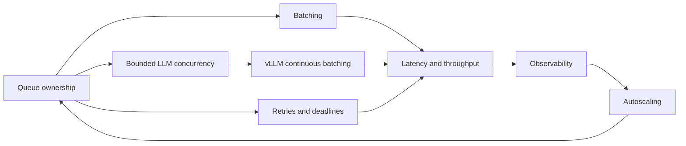

# Study plan

Use one lesson per sitting, with a separate sitting for its experiment. The loop is
**Run → Read → Break → Explain**. Run the smoke path first; read a small number of
functions; introduce one controlled failure; teach the result without reading notes.

| Order | Lesson and companion | Availability |
|---|---|---|
| 00 | [Big picture](00-big-picture.md), [architecture](../ARCHITECTURE.md) | Phase 1 |
| 01 | [Request path](01-request-path.md), [Redis Streams](../concepts/redis-streams.md), E1, ADRs 0001–0003 | Phase 1 |
| 02 | [Dynamic batching](02-dynamic-batching.md), [batching concept](../concepts/batching.md), E2–E3, [ADR-0004](../adr/0004-dynamic-batching.md) | Phase 2: available |
| 03 | [Reliability](03-reliability.md), [reliability/backpressure](../concepts/reliability-and-backpressure.md), E4–E5, ADRs 0005–0006 | Phase 3: available |
| 04 | [LLM serving](04-llm-serving.md), [LLM concept](../concepts/llm-serving.md), E6a–E6b, [ADR-0007](../adr/0007-llm-adapter.md), [GPU verification](../GPU_VERIFICATION.md) | Phase 4: available |
| 05 | Observability, latency concept, E7, ADR-0008 | Phase 5 |
| 06 | Autoscaling, controller concept, E8–E10, ADR-0009 | Phase 6 |
| 07 | Kubernetes, deployment concept, E11–E13, ADR-0010 | Phase 7 |
| 08 | Capstone, benchmarks, runbook and self-assessment | Phase 8 |

## Redis command cheat sheet

These are command names and signatures for study, not additional shell setup.
The E1 script executes the inspection operations through redis-py against a
disposable Redis 7 container.

| Operation | What to inspect |
|---|---|
| XADD stream fields | Append work or a reply; automatic entry ID |
| XGROUP CREATE stream workers 0 MKSTREAM | Create a delivery group including old work |
| XREADGROUP GROUP workers consumer COUNT 1 BLOCK 1000 STREAMS stream > | Deliver new work to an available replica |
| XREAD BLOCK 1000 STREAMS inbox cursor | Read replies after a concrete cursor |
| XINFO STREAM stream | Retained entries and stream metadata |
| XINFO GROUPS stream | Group delivery position and pending count |
| XPENDING stream workers | Unacknowledged deliveries and consumer summary |
| XLEN stream | Retained entries, not just undelivered work |
| XACK stream workers id | Remove the group's pending ownership record |
| XDEL stream id | Remove the stream entry itself |
| TIME | Shared Redis clock for cross-process age |
| EXPIRE inbox seconds | Keep temporary response storage from living forever |

Do not erase shared queues while experimenting. E1 owns a disposable stream and
cleans up only that stream; the integration tests use unique model names too.
