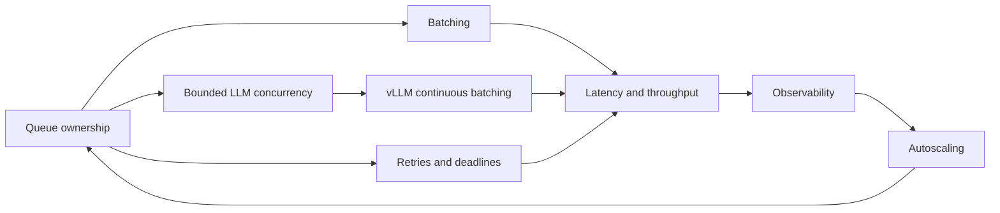

# Study plan

Use one lesson per sitting, with a separate sitting for its experiment. The loop is
**Run → Read → Break → Explain**. Run the smoke path first; read a small number of
functions; introduce one controlled failure; teach the result without reading notes.

## Start here

1. [Lesson 00: big picture](00-big-picture.md): one-page system map and Redis key map.
2. **[Walkthrough: one request, every hop, real data](WALKTHROUGH.md)**: follow a real
   request through ten stations with every Redis command captured live. This is the
   most concrete document in the repo; return to it whenever a lesson feels abstract.
3. Then lessons 01–08 in order.

## What you'll see along the way

Every chart below comes from a recorded run in `docs/results/`. Charts from the fake
backend are labeled **simulated**. Regenerate them with
`uv run python -m tools.learning.plot_learning_charts`.

| Picture | Shows | Lesson |
|---|---|---|
| [batch-timeline.png](img/batch-timeline.png) | Ten requests through the real batcher: who rode which batch, and why | 02 |
| [batching-sweep.png](img/batching-sweep.png) | Throughput and cost per item vs batch size, real DistilBERT and simulated | 02 |
| [reclaim-recovery.png](img/reclaim-recovery.png) | `kill -9` recovery time vs `reclaim_idle_ms` | 03 |
| [admission-overload.png](img/admission-overload.png) | Overload with and without admission control | 03 |
| [llm-concurrency.png](img/llm-concurrency.png) | Real vLLM on GB10: tokens/s and TTFT vs concurrency | 04 |
| [autoscale-sim.png](../results/autoscale-sim.png) | Simulated backlog and replicas for four traffic shapes | 06 |

## Study order

| Order | Lesson and companion | Availability |
|---|---|---|
| 00 | [Big picture](00-big-picture.md), [architecture](../ARCHITECTURE.md) | Phase 1 |
| 00½ | [Walkthrough: one request, every hop](WALKTHROUGH.md) | Captured 2026-11-13 |
| 01 | [Request path](01-request-path.md), [Redis Streams](../concepts/redis-streams.md), E1, ADRs 0001–0003 | Phase 1 |
| 02 | [Dynamic batching](02-dynamic-batching.md), [batching concept](../concepts/batching.md), E2–E3, [ADR-0004](../adr/0004-dynamic-batching.md) | Phase 2: available |
| 03 | [Reliability](03-reliability.md), [reliability/backpressure](../concepts/reliability-and-backpressure.md), E4–E5, ADRs 0005–0006 | Phase 3: available |
| 04 | [LLM serving](04-llm-serving.md), [LLM concept](../concepts/llm-serving.md), E6a–E6b, [ADR-0007](../adr/0007-llm-adapter.md), [GPU verification](../GPU_VERIFICATION.md) | Phase 4: available |
| 05 | [Observability](05-observability.md), [latency concept](../concepts/latency-and-observability.md), E7, [ADR-0008](../adr/0008-metrics.md), [dashboards](../dashboards.md) | Phase 5: available |
| 06 | [Autoscaling](06-autoscaling.md), [controller concept](../concepts/autoscaling.md), E8–E10, [ADR-0009](../adr/0009-autoscaling.md) | Phase 6: available |
| 07 | [Kubernetes](07-kubernetes-deployment.md), [deployment concept](../concepts/deploying-ml-workloads.md), E11–E13, [ADR-0010](../adr/0010-deployment.md) | Phase 7: available |
| 08 | [Capstone](08-capstone.md), [benchmarks](../BENCHMARKS.md), [capacity worksheet](../CAPACITY_PLANNING.md), [runbook](../RUNBOOK.md), [audit](../VERIFICATION.md) | Phase 8: available |

## Redis command cheat sheet

These are command names and signatures for study, not additional shell setup.
The E1 script executes the inspection operations through redis-py against a
disposable Redis 7 container.

| Operation | What to inspect |
|---|---|
| XADD stream fields | Append work or a reply; automatic entry ID |
| XGROUP CREATE stream workers 0 MKSTREAM | Create a delivery group including old work |
| XREADGROUP GROUP workers consumer COUNT 1 BLOCK 1000 STREAMS stream > | Deliver new work to an available replica |
| XREAD BLOCK 1000 STREAMS inbox cursor | Read replies after a concrete cursor |
| XINFO STREAM stream | Retained entries and stream metadata |
| XINFO GROUPS stream | Group delivery position and pending count |
| XPENDING stream workers | Unacknowledged deliveries and consumer summary |
| XLEN stream | Retained entries, not just undelivered work |
| XACK stream workers id | Remove the group's pending ownership record |
| XDEL stream id | Remove the stream entry itself |
| XAUTOCLAIM stream workers consumer idle-ms cursor COUNT n | Recover idle deliveries within free capacity |
| XPENDING stream workers min-id max-id count | Inspect delivery count and owner per entry |
| XRANGE stream exclusive-delivery-id + COUNT 1 | Find oldest undelivered entry |
| SCAN cursor MATCH worker:model:* COUNT n | Discover candidate heartbeat keys without KEYS |
| GET / SET result:id JSON EX seconds | Read/write typed result outcome with TTL |
| EXISTS cancel:id | Check a best-effort cancellation flag |
| SET autoscaler:lock token NX PX milliseconds | Acquire an expiring leadership token |
| EVAL script keys args | Atomic admission/rate limiting and token-owned lease renew/release |
| TIME | Shared Redis clock for cross-process age |
| EXPIRE inbox seconds | Keep temporary response storage from living forever |

Do not erase shared queues while experimenting. E1 owns a disposable stream and
cleans up only that stream; the integration tests use unique model names too.
