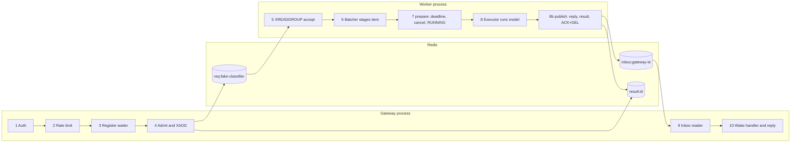
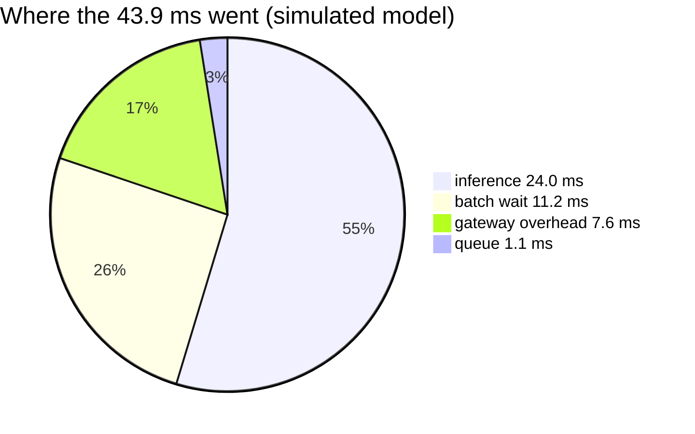

# Walkthrough: one request, every hop, real data

This page follows **one real request** through the whole system. It's not a
diagram of what *should* happen. Every Redis command below was captured with
`redis-cli MONITOR` while the request ran, and every JSON value is the real
data from that run.

- **Request:** `POST /v1/infer/fake-classifier` with body `{"input":"Learning Redis Streams"}`
- **Backend:** the fake runner (**simulated** compute: 20 ms + 2 ms per item + up to 3 ms jitter)
- **Captured:** 2026-11-13, Docker Compose default profile, NVIDIA GB10 host (20 Arm cores)
- **Raw evidence:** [request-trace-monitor.txt](../results/learning/request-trace-monitor.txt),
  [request-trace-response.json](../results/learning/request-trace-response.json)

Read this after [lesson 00](00-big-picture.md) and before [lesson 01](01-request-path.md).
Keep the code open in another tab: every station links to the exact function.

---

## The map

Ten stations, three processes, one Redis. The gateway runs two independent
loops: the HTTP handler (one per request) and a single inbox reader per gateway.



## The timeline at a glance

Times are milliseconds after the gateway's first Redis call for this request.
The labels `G` and `W` show which process sent the command (gateway container
`172.23.0.6`, worker container `172.23.0.7` in the raw file).

| t (ms) | Who | Redis command (abridged) | Station |
|---:|---|---|---|
| 0.0 | G | `EVAL token_bucket` → `TIME`, `HMGET rl:…`, `HSET rl:… tokens 199`, `EXPIRE` | 2 Rate limit |
| 1.4 | G | `SCAN 0 MATCH worker:fake-classifier:* COUNT 100` | 4 Admission |
| 1.6 | G | `GET worker:fake-classifier:fd1f…` | 4 Admission |
| 2.0 | G | `EVAL enqueue` → `EXISTS worker:…`, `XLEN req:…`, `TIME`, `SET result:… QUEUED`, `XADD req:fake-classifier * …` | 4 Enqueue |
| 2.9 | W | `GET result:29b9…` (already finished by someone else?) | 5 Accept |
| 3.1 | W | `TIME` (to compute `queue_ms`) | 5 Accept |
| 3.4 | W | `XREADGROUP … COUNT 63 BLOCK 328 …` (ask for more work) | 5 Accept |
| 13.8 | W | `TIME`, `EXISTS cancel:29b9…`, `EVAL mark_running` → `SET result:… RUNNING` | 7 Prepare |
| 39.0 | W | `TIME`, `EXISTS cancel:29b9…` | 8b Finish |
| 41.4 | W | `XADD inbox:4c62… MAXLEN ~ 10000 * … type final …` | 8b Publish |
| 42.4 | W | `EXPIRE inbox:4c62… 120` | 8b Publish |
| 42.6 | W | `SET result:29b9… {"status":"SUCCEEDED",…} EX 300` | 8b Publish |
| 42.9 | W | `MULTI` · `XACK req:… workers 1794594405603-0` · `XDEL req:… 1794594405603-0` · `EXEC` | 8b ACK + delete |
| 43.3 | G | `XREAD BLOCK 1000 COUNT 100 STREAMS inbox:4c62… 1794594405642-0` (next read; the reply was just consumed) | 9 Inbox reader |

Three things stand out in this trace:

1. **The gap between 3.4 ms and 13.8 ms is the batching window.** The request was
   alone, so the batcher waited the full `max_wait_ms = 10` for company that never came.
   At low load, every request pays this deliberate wait. See lesson 02.
2. **The gap between 13.8 ms and 39.0 ms is the model.** Here that's 24 ms of simulated compute.
3. **Everything else is coordination**, about 8 ms of Redis round trips plus Python.
   For a tiny model that overhead is real. For a 25 ms model it's acceptable.

---

## Station 1: Authenticate

**Code:** [`Authenticator.authenticate`](../../src/infer_platform/gateway/auth.py#L13)

```python
candidate = hashlib.sha256((key or "").encode()).hexdigest()
valid = False
for expected in self.hashes:
    valid |= hmac.compare_digest(candidate, expected)  # constant time, no early exit
return candidate if key and valid else None
```

- The gateway never stores or forwards the raw API key. It hashes it, and the
  **hash** becomes `key_id`. You'll see
  `4ea86e37…f32f3` in every Redis entry below. That's `sha256("learning-key")`, not the key.
- The loop checks *every* stored hash with `compare_digest`, so the response time
  doesn't reveal which key almost matched.
- No Redis call happens here. A bad key costs nothing downstream.

## Station 2: Rate limit (token bucket in Lua)

**Code:** [`TOKEN_BUCKET` and `RateLimiter.check`](../../src/infer_platform/gateway/rate_limit.py#L6)

The trace shows the script's inner commands, prefixed `[0 lua]`:

```text
"TIME"
"HMGET" "rl:4ea86e37…" "tokens" "updated"
"HSET"  "rl:4ea86e37…" "tokens" "199" "updated" "1794594405.601057"
"EXPIRE" "rl:4ea86e37…" "4"
```

- The bucket is a Redis hash with two fields. It held 200 tokens (`burst`); this
  request spent one, leaving `199`.
- **Why Lua:** read-refill-spend-write must be atomic. Two gateways spending the
  same last token at once would otherwise both succeed.
- **Why `TIME` inside the script:** refill is "tokens += elapsed × rate". Using Redis's clock
  means two gateways with skewed container clocks still agree.
- `EXPIRE 4` = `ceil(2 × burst / rate)` = `ceil(2 × 200 / 100)`. An idle key cleans itself up.

## Station 3: Register the waiter (before enqueueing)

**Code:** [`infer`, line 212](../../src/infer_platform/gateway/app.py#L212) and
[`ResponseRouter.register`](../../src/infer_platform/gateway/response_router.py#L39)

```python
queue = None if async_mode else router.register(request_id)   # 1. make the mailbox
message = RequestMessage(request_id=request_id, reply_to=router.inbox, ...)
outcome = await enqueue(...)                                    # 2. only then publish work
```

`register` just puts an `asyncio.Queue(maxsize=1)` into a dict keyed by
`request_id`. No Redis call happens, so it isn't in the trace, but its *position*
matters. If enqueue came first, a fast worker could reply before the mailbox
existed, and the inbox reader would drop the reply as "unknown id".

## Station 4: Admission and enqueue (one atomic script)

**Code:** [`live_workers`](../../src/infer_platform/common/registry.py#L7), then
[`ENQUEUE` and `enqueue`](../../src/infer_platform/gateway/admission.py#L8)

First the gateway finds live workers (`SCAN` + `GET`, outside the script, because
Lua scripts must declare their keys up front). Then one `EVAL` does everything else:

```text
[lua] "EXISTS" "worker:fake-classifier:fd1f769d8eb8-feac25f1"   -> is anyone alive?
[lua] "XLEN"   "req:fake-classifier"                            -> is the queue full?
[lua] "TIME"                                                    -> stamp the deadline
[lua] "SET" "result:29b9…" "{\"status\":\"QUEUED\", ... \"deadline_ms\":1794594410601.1}" "EX" "300"
[lua] "XADD" "req:fake-classifier" "*"  request_id 29b9…  reply_to inbox:4c62…
      kind infer  payload {"input":"Learning Redis Streams","options":{}}
      timeout_ms 4998  stream 0  key_id 4ea86e37…  trace_id ff768af6…
```

This is the **exact stream entry** the worker will receive. Points to notice:

- `reply_to` is the gateway's private inbox. The worker never needs the gateway's address.
- `timeout_ms` is **4998**, not 5000. The gateway already spent ~2 ms in stations 1–4,
  so it forwards only the time that's left.
- `payload` is a JSON string inside a Redis field. Redis Streams store flat
  string fields, and the project never uses pickle.
- The stream entry ID Redis assigned is **`1794594405603-0`**. The first half is
  Redis's clock in milliseconds. The worker will subtract it from Redis `TIME` to
  get `queue_ms`, using no container clock at all.
- If `EXISTS` had found no worker, or `XLEN ≥ max_queue_depth` (500), the script
  would return `NO_WORKERS` / `OVERLOADED` *without* writing anything, and the client
  gets a `503` with `Retry-After`. Check and append are one step, so two gateways
  can't both squeeze past the limit.

## Station 5: Worker receives it

**Code:** [`Worker.consume`](../../src/infer_platform/worker/main.py#L150) and
[`Worker.accept`](../../src/infer_platform/worker/main.py#L192)

Look at the raw file: the worker had already been waiting since *before* the request existed:

```text
1794594404.968564 [W] "XREADGROUP" "GROUP" "workers" "fd1f…" "COUNT" "64" "BLOCK" "964" "STREAMS" "req:fake-classifier" ">"
```

That's a **blocking pull**. `COUNT 64` is the worker's free capacity
(`prefetch_bound = 2 × max_batch_size = 64`), and `>` means "only entries never
delivered to anyone". When the `XADD` landed 635 ms later, Redis answered this
call immediately. That's why there's no new `XREADGROUP` before the `GET` at 2.9 ms.

Then `accept` does three cheap things:

| Command | Why |
|---|---|
| `GET result:29b9…` | Has some *other* delivery of this request already finished? With at-least-once delivery, the answer could be yes (lesson 03). |
| `TIME` | `queue_ms = redis_now − 1794594405603` = **1.1 ms** |
| `XREADGROUP … COUNT 63` | Immediately ask for more. Capacity is now 64 − 1 = 63. |

## Station 6: The batcher holds it

**Code:** [`DynamicBatcher.submit` and `run`](../../src/infer_platform/worker/batcher.py#L84)

No Redis traffic for ~10 ms. The item sits in `staged`. The flush condition at
[batcher.py:115](../../src/infer_platform/worker/batcher.py#L115) is:

```python
if staged and running is None and (
    len(staged) == self.max_batch_size          # full (32 items): no
    or self.closed                               # shutting down: no
    or self.clock.monotonic() >= deadline        # first item + 10 ms: wait for it...
):
```

Nothing else arrived, so the deadline fired and the batch left with one passenger:
`batch_size: 1`, `batch_wait_ms: 11.2`. [Lesson 02](02-dynamic-batching.md) shows
the same code under load, where batches fill up instead.

## Station 7: Last checks before compute

**Code:** [`Worker.prepare`](../../src/infer_platform/worker/main.py#L307)

```text
13.8 ms  "TIME"                        -> age = now − entry time; < 4998 ms, so not expired
         "EXISTS" "cancel:29b9…"        -> 0: the client hasn't given up
         "EVAL" mark_running → "SET" "result:29b9…" {"status":"RUNNING",…}
```

Why check *again* when the worker checked on accept? Time has passed, and these
checks are what stop us from **wasting compute on requests nobody is waiting for**.
`mark_running` is a Lua compare-and-set: if a finished result already exists, it
refuses, and the worker replays the cached answer instead of recomputing it.

## Station 8: Inference in the executor thread

**Code:** [`DynamicBatcher.predict`](../../src/infer_platform/worker/batcher.py#L151) →
[`FakeRunner.predict_batch`](../../src/infer_platform/worker/runners/fake.py#L20)

```python
outputs = await asyncio.get_running_loop().run_in_executor(
    self.executor,
    self.runner.predict_batch,
    inputs,  # blocking work off the event loop
)
```

The event loop stays free while the model works. That's how the worker kept issuing
`XREADGROUP` and heartbeats during these 24 ms. The fake runner returns
`{"label": "SIMULATED", "input_chars": 22}` ("Learning Redis Streams" is 22 characters).

## Station 8b: Publish, in a deliberate order

**Code:** [`Worker.finish`](../../src/infer_platform/worker/main.py#L332) →
[`publish`](../../src/infer_platform/worker/main.py#L404) →
[`ack_delete`](../../src/infer_platform/worker/main.py#L423)

```text
39.0  TIME, EXISTS cancel:…                       re-check: expired or cancelled while computing?
41.4  XADD inbox:4c62… * request_id 29b9… type final
           data {"label": "SIMULATED", "input_chars": 22}
           meta {"worker_id":"fd1f…","batch_size":1,"queue_ms":1.12,
                 "batch_wait_ms":11.21,"inference_ms":24.04,...}
42.4  EXPIRE inbox:4c62… 120
42.6  SET result:29b9… {"status":"SUCCEEDED", "response": {...}} EX 300
42.9  MULTI / XACK req:… workers 1794594405603-0 / XDEL req:… 1794594405603-0 / EXEC
```

**The order is the reliability design.** Ask what happens if the worker dies
between any two lines:

| Worker dies after… | What survives | Outcome |
|---|---|---|
| inference, before `XADD inbox` | entry is still *pending* | another worker reclaims it after `reclaim_idle_ms` and recomputes |
| `XADD inbox`, before `SET result` | client already has its answer | reclaim recomputes; gateway ignores the duplicate reply |
| `SET result`, before `XACK` | cached result | reclaim finds the cached result and replays it, no recompute |
| `XACK`/`XDEL` | nothing left to do | done |

If the order were ACK first and reply second, a crash in between would lose the
request silently. `MULTI … EXEC` makes ACK and delete happen together, so an
ACKed entry can never linger and count against `max_queue_depth`.

## Station 9: The gateway's inbox reader

**Code:** [`ResponseRouter.read`](../../src/infer_platform/gateway/response_router.py#L53)

```python
streams = await self.redis.xread({self.inbox: cursor}, block=1000, count=100)
...
queue = self.waiters.get(message.request_id)
if queue is None or ...:
    continue  # unknown or finished: ignore duplicates
if not queue.full():
    queue.put_nowait(message)
```

There's one reader task per gateway, not one per request. Its next `XREAD`
(at 43.3 ms) uses cursor `1794594405642-0`, the ID of the reply it just
dispatched, so it never re-reads an entry.

## Station 10: Handler wakes and replies

**Code:** [`wait_reply`](../../src/infer_platform/gateway/app.py#L162) →
[`timed_reply`](../../src/infer_platform/gateway/metrics.py#L125) →
[`render`](../../src/infer_platform/gateway/app.py#L272)

The client received:

```json
{
  "request_id": "29b9aa2ab4654712b7d4002351a49d48",
  "output": {"label": "SIMULATED", "input_chars": 22},
  "meta": {
    "worker_id": "fd1f769d8eb8-feac25f1",
    "batch_size": 1,
    "queue_ms": 1.115966796875,
    "batch_wait_ms": 11.206508002942428,
    "inference_ms": 24.044929014053196,
    "total_ms": 43.93119498854503,
    "gateway_overhead_ms": 7.563791174674407
  }
}
```

`gateway_overhead_ms` isn't measured directly. It's computed as
`total − (queue + batch_wait + inference)` = 43.93 − 36.37 = **7.56 ms**. It covers
auth, rate limit, admission, both Redis hops, the inbox reader and JSON work.



---

## What Redis held, moment by moment

| Key | Before | After station 4 | After station 7 | After station 8b | Later |
|---|---|---|---|---|---|
| `rl:4ea8…` (hash) | 200 tokens | 199 tokens | | | refills at 100/s, expires after 4 s idle |
| `req:fake-classifier` (stream) | XLEN 0 | XLEN 1 (undelivered) | XLEN 1 (pending to worker) | XLEN 0 | |
| `result:29b9…` (string) | n/a | `QUEUED` | `RUNNING` | `SUCCEEDED` + full reply | expires after 300 s |
| `inbox:4c62…` (stream) | exists, reader blocked | | | +1 `final` entry | trimmed at ~10 000 entries; TTL 120 s refreshed |
| `worker:fake-classifier:fd1f…` | heartbeat JSON, TTL ≤ 10 s | | | | refreshed every ~3 s |

You can inspect the same keys yourself. These are the outputs captured after the request:

```text
$ redis-cli XINFO GROUPS req:fake-classifier
name workers  consumers 16  pending 0  last-delivered-id 1794594405603-0  entries-read 15455  lag 0

$ redis-cli GET worker:fake-classifier:fd1f769d8eb8-feac25f1
{"worker_id":"fd1f769d8eb8-feac25f1","device":"cpu","backend":"fake","in_flight":0,
 "busy_ratio":0.0,"started_at":1794594377803.886,"accepting":true}

$ redis-cli TTL worker:fake-classifier:fd1f769d8eb8-feac25f1
7
```

`consumers 16` is a real observation, not a typo. The Compose Redis volume has
outlived many worker restarts, and Redis keeps one consumer record per worker ID
that ever read. Nothing in the platform deletes old consumers
(`XGROUP DELCONSUMER`). That's harmless because their pending count is zero, but
it clutters `XINFO CONSUMERS`.

## Try it yourself

```bash
export INFER_API_KEYS='["learning-key"]'
docker compose -f deploy/docker/docker-compose.yml up --build -d --wait

# Terminal 1: watch every Redis command (stop with Ctrl-C)
docker compose -f deploy/docker/docker-compose.yml exec redis redis-cli MONITOR

# Terminal 2: send one request
curl -s -H 'X-API-Key: learning-key' -H 'Content-Type: application/json' \
  -d '{"input":"Learning Redis Streams"}' http://localhost:8000/v1/infer/fake-classifier
```

> When this capture was made, port 8000 was taken by another local service, so the
> run used a Compose override that published the gateway on `127.0.0.1:8010`
> instead. Nothing else differed.

Then grep the monitor output for your `request_id` and match each line to a station above.

## Check your understanding

1. Why does the trace show the worker's `XREADGROUP` *before* the request's `XADD`?
<details><summary>Answer</summary>It was a blocking read issued earlier (BLOCK 964). Redis answered it the moment the XADD arrived. MONITOR logs a command when it's received, not when it returns.</details>

2. The client asked for a 5000 ms timeout, but the stream entry says 4998. Why?
<details><summary>Answer</summary>The gateway forwards the remaining budget after auth, rate limiting and admission, so the worker's expiry check uses the real deadline.</details>

3. What would happen if the worker crashed between `SET result … SUCCEEDED` and `XACK`?
<details><summary>Answer</summary>The entry stays pending. After reclaim_idle_ms another worker claims it, finds the cached SUCCEEDED result in accept(), and republishes it without recomputing. The gateway ignores the duplicate if it already answered.</details>

4. Where did 11.2 of the 43.9 ms go, and how would you reduce it?
<details><summary>Answer</summary>The deliberate batching window (max_wait_ms = 10). Lower max_wait_ms for latency-sensitive, low-traffic models. Under load the wait shrinks by itself, because batches fill before the deadline.</details>

5. Why is the admission check a Lua script and not "XLEN, then XADD" from Python?
<details><summary>Answer</summary>Two gateways could both see XLEN = 499 and both append, exceeding the bound. The script runs atomically inside Redis.</details>
